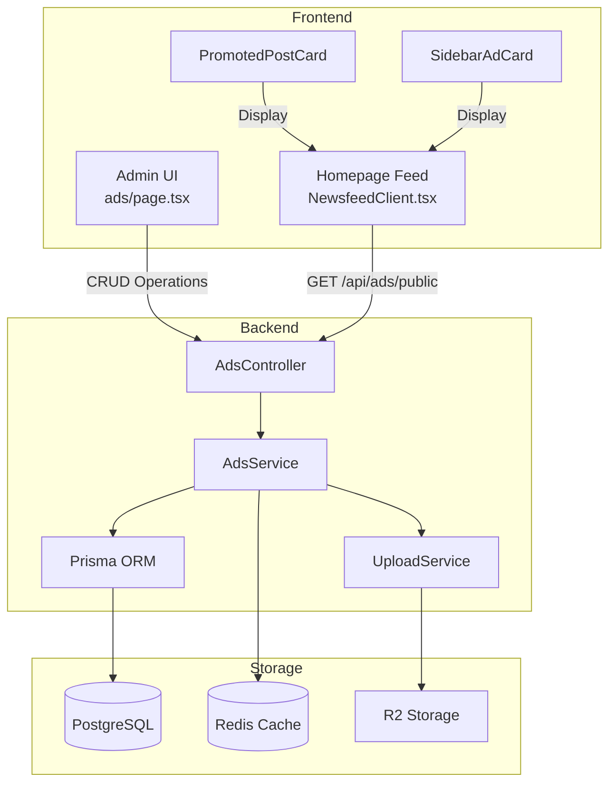
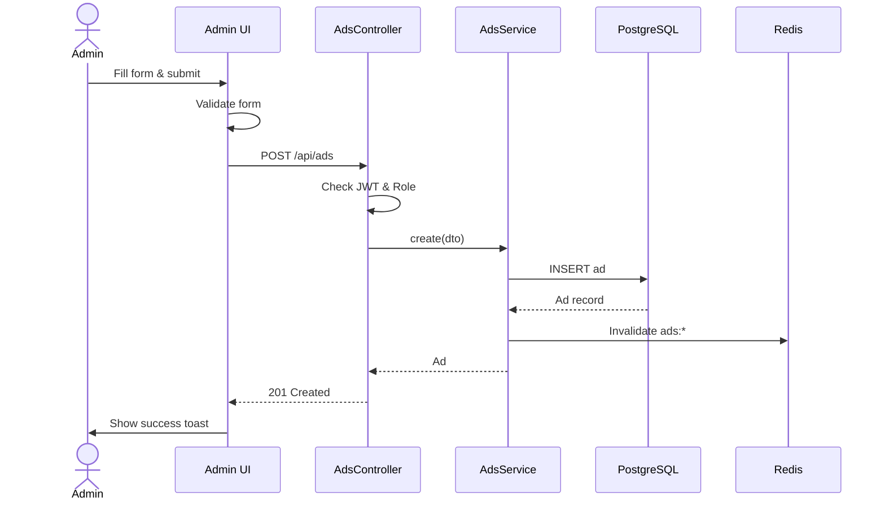
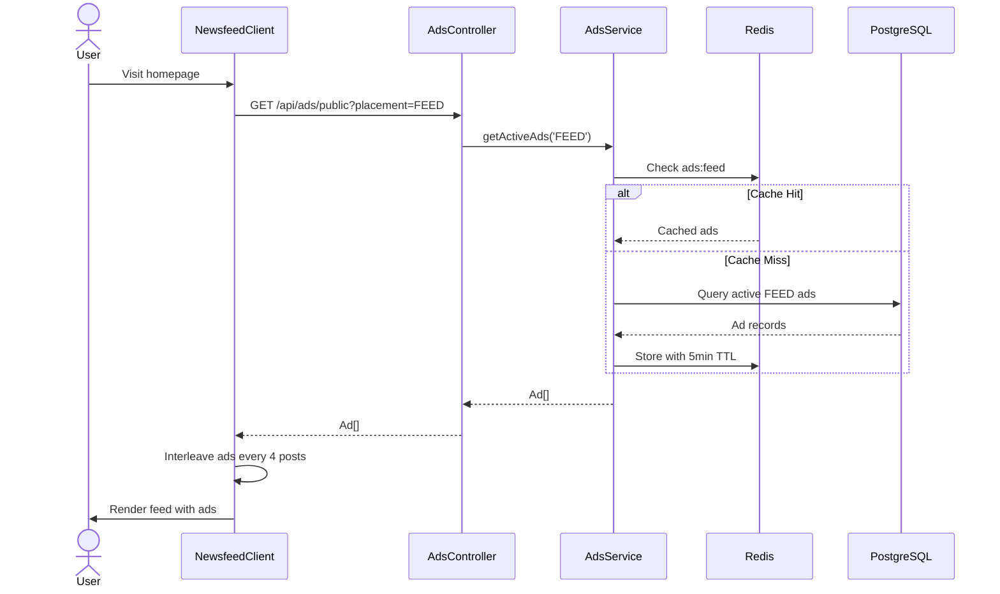

<!-- @SECTION:ARCHITECTURE -->
# Architecture

## System Overview

The Ads/Promoted Posts feature follows a modular architecture with clear separation between backend API, frontend components, and caching layer.



## Module Dependencies

**Backend**: `Backend/src/modules/ads/ads.module.ts:1-15`
- PrismaModule: Database operations
- RedisModule: Caching layer
- UploadModule: Image upload and R2 cleanup

**Frontend**:
- React Query: Data fetching and cache management
- TipTap: Rich text editor for ad descriptions
- Next.js Image: Optimized image rendering

<!-- @END:ARCHITECTURE -->

<!-- @SECTION:DATA_MODELS -->
## Data Models

### Ad Model

See `Backend/prisma/schema.prisma:610-626` for complete schema.

```prisma
model Ad {
  id          String      @id @default(uuid())
  title       String
  description String?     @db.Text
  imageUrl    String?
  ctaText     String      @default("Tìm hiểu thêm")
  ctaLink     String
  placement   AdPlacement @default(FEED)
  isActive    Boolean     @default(true)
  priority    Int         @default(0)
  createdAt   DateTime    @default(now())
  updatedAt   DateTime    @updatedAt
}
```

**Indexes**:
- `[isActive, placement]`: Optimizes public ad queries
- `[priority]`: Optimizes ordering by priority

### AdPlacement Enum

See `Backend/prisma/schema.prisma:602-608`

```prisma
enum AdPlacement {
  FEED     // Display in homepage feed
  SIDEBAR  // Display in sidebar
  BOTH     // Display in both locations
}
```

### TypeScript Types

Frontend types: `Frontend/src/types/ad.ts:1-35`

```typescript
interface Ad {
  id: string
  title: string
  description: string | null
  imageUrl: string | null
  ctaText: string
  ctaLink: string
  placement: AdPlacement
  isActive: boolean
  priority: number
  createdAt: string
  updatedAt: string
}
```

<!-- @END:DATA_MODELS -->

<!-- @SECTION:API_ENDPOINTS -->
## API Endpoints

### Public Endpoints (No Auth)

**GET /api/ads/public**
- Query params: `placement?: 'FEED' | 'SIDEBAR' | 'BOTH'`
- Returns: `Ad[]` (active ads only)
- Cache: Redis 5 minutes
- Implementation: `Backend/src/modules/ads/controllers/ads.controller.ts:28-31`

### Admin Endpoints (ADMIN/SUPER_ADMIN only)

**GET /api/ads**
- Query params: `page?, limit?, placement?, isActive?`
- Returns: `PaginatedResult<Ad>`
- Implementation: `Backend/src/modules/ads/controllers/ads.controller.ts:37-42`

**GET /api/ads/:id**
- Returns: `Ad`
- Implementation: `Backend/src/modules/ads/controllers/ads.controller.ts:48-53`

**POST /api/ads**
- Body: `CreateAdDto`
- Returns: `Ad`
- Side effects: Invalidates cache
- Implementation: `Backend/src/modules/ads/controllers/ads.controller.ts:59-64`

**PUT /api/ads/:id**
- Body: `UpdateAdDto`
- Returns: `Ad`
- Side effects: Invalidates cache, cleans up old R2 image
- Implementation: `Backend/src/modules/ads/controllers/ads.controller.ts:70-75`

**PATCH /api/ads/:id/toggle**
- Returns: `Ad` (with flipped isActive)
- Side effects: Invalidates cache
- Implementation: `Backend/src/modules/ads/controllers/ads.controller.ts:81-86`

**DELETE /api/ads/:id**
- Returns: `{ message: string }`
- Side effects: Invalidates cache, cleans up R2 image
- Implementation: `Backend/src/modules/ads/controllers/ads.controller.ts:92-97`

<!-- @END:API_ENDPOINTS -->

<!-- @SECTION:COMPONENTS -->
## Frontend Components

### Admin Management UI

**Component**: `Frontend/src/app/admin/ads/page.tsx`

Key features:
- Table view with ad list (image, title, placement, CTA, status)
- Create/Edit dialog with post-like form layout
- TipTap rich text editor for descriptions
- Multi-method image upload (drag-drop, paste, click, URL)
- Character count with warnings (450-499 yellow, 500+ red)
- Advanced settings (placement, priority, isActive toggle)
- Delete confirmation dialog

### Feed Display Components

**PromotedPostCard**: `Frontend/src/features/ads/components/PromotedPostCard.tsx`
- Full-width card layout for feed
- "Quảng cáo" badge in header
- Title, description, image (aspect-video)
- Full-width CTA button in footer

**SidebarAdCard**: `Frontend/src/features/ads/components/SidebarAdCard.tsx`
- Compact card layout (max-width 300px)
- Image with overlay badge (aspect 4:3)
- Smaller text and button sizes
- Optimized for sidebar display

### Feed Integration

**Component**: `Frontend/src/app/(main)/NewsfeedClient.tsx:27-50`

```typescript
function interleaveAdsWithPosts(posts: Post[], feedAds: Ad[]): (Post | Ad)[] {
  const AD_INTERVAL = 4; // Insert ad every 4 posts
  // Cycles through available ads
}
```

Logic:
- Fetches active FEED ads via `usePublicAds('FEED')`
- Interleaves ads every 4 posts
- Cycles through ads if more slots than ads available
- Type guard `isAd()` to differentiate rendering

<!-- @END:COMPONENTS -->

<!-- @SECTION:CACHING_STRATEGY -->
## Caching Strategy

### Redis Cache Keys

Defined in `Backend/src/modules/ads/services/ads.service.ts:9-12`

```typescript
const CACHE_KEY_ADS_ACTIVE = 'ads:active'   // All active ads
const CACHE_KEY_ADS_FEED = 'ads:feed'       // Active FEED ads
const CACHE_KEY_ADS_SIDEBAR = 'ads:sidebar' // Active SIDEBAR ads
const CACHE_TTL_ADS = 300 // 5 minutes
```

### Cache Invalidation

All mutation operations invalidate all three cache keys:
- Create ad → invalidate all
- Update ad → invalidate all
- Delete ad → invalidate all
- Toggle status → invalidate all

Implementation: `Backend/src/modules/ads/services/ads.service.ts:204-210`

### Cache Population

Public ad queries use `getOrSet` pattern:
1. Check Redis for cached data
2. If miss, query database with filters
3. Store result in Redis with 5-minute TTL
4. Return data

Implementation: `Backend/src/modules/ads/services/ads.service.ts:76-102`

<!-- @END:CACHING_STRATEGY -->

<!-- @SECTION:IMAGE_MANAGEMENT -->
## Image Management

### Upload Flow

1. Admin selects/drops/pastes image in form
2. Frontend validates file type and size
3. Upload to `/upload/image` endpoint (multipart/form-data)
4. Backend stores in R2, returns URL
5. Frontend sets `imageUrl` in form state

Validation rules: `Frontend/src/app/admin/ads/page.tsx:43-44`
- Allowed types: JPG, PNG, GIF, WebP
- Max size: 5MB

### R2 Cleanup Flow

**On Update** (`Backend/src/modules/ads/services/ads.service.ts:128-136`):
```typescript
if (dto.imageUrl && ad.imageUrl && dto.imageUrl !== ad.imageUrl) {
  const oldKey = this.uploadService.extractKeyFromUrl(ad.imageUrl)
  if (oldKey) {
    this.uploadService.deleteImageWithRetry(oldKey).catch(err => {
      this.logger.error(`Background ad image cleanup failed`)
    })
  }
}
```

**On Delete** (`Backend/src/modules/ads/services/ads.service.ts:160-173`):
```typescript
const imageUrl = ad.imageUrl
await this.prisma.ad.delete({ where: { id } })

if (imageUrl) {
  const key = this.uploadService.extractKeyFromUrl(imageUrl)
  if (key) {
    this.uploadService.deleteImageWithRetry(key).catch(err => {
      this.logger.error(`Background ad image cleanup failed`)
    })
  }
}
```

**Pattern**: Fire-and-forget with error logging (does not block operation)

<!-- @END:IMAGE_MANAGEMENT -->

<!-- @SECTION:VALIDATION -->
## Validation

### Backend DTOs

**CreateAdDto** (`Backend/src/modules/ads/dto/create-ad.dto.ts:13-47`):
- `title`: required, string, max 100 chars
- `description`: optional, string, max 500 chars
- `imageUrl`: optional, valid URL
- `ctaText`: optional, string, max 20 chars
- `ctaLink`: required, valid URL
- `placement`: optional, enum AdPlacement
- `isActive`: optional, boolean
- `priority`: optional, integer, min 0

**UpdateAdDto** (`Backend/src/modules/ads/dto/update-ad.dto.ts:13-49`):
- All fields optional (partial update)
- Same validation rules as CreateAdDto

**GetAdsDto** (`Backend/src/modules/ads/dto/get-ads.dto.ts:5-26`):
- `page`: optional, integer, min 1, default 1
- `limit`: optional, integer, min 1, default 20
- `placement`: optional, enum AdPlacement
- `isActive`: optional, boolean

### Frontend Validation

Form validation in `Frontend/src/app/admin/ads/page.tsx:243-253`:
- Title required: "Vui lòng nhập tiêu đề quảng cáo"
- CTA link required: "Vui lòng nhập đường dẫn CTA"
- Character count enforced (500 max, disables submit)
- Image upload validation (type, size)

<!-- @END:VALIDATION -->

<!-- @SECTION:SECURITY -->
## Security

### Authorization

All admin endpoints protected by:
- `JwtAuthGuard`: Validates JWT token
- `RolesGuard`: Checks user role
- `@Roles(Role.ADMIN, Role.SUPER_ADMIN)`: Decorator

Implementation: `Backend/src/modules/ads/controllers/ads.controller.ts:38-40`

Public endpoint (`/api/ads/public`) has no guards.

### XSS Protection

- Ad descriptions stored as plain text/HTML in database
- Frontend renders with React (auto-escapes by default)
- TipTap editor sanitizes input

### CSRF Protection

- NestJS CSRF protection (if enabled globally)
- JWT-based authentication (stateless)

### External Link Safety

CTA links open with `noopener,noreferrer`:
```typescript
window.open(ad.ctaLink, "_blank", "noopener,noreferrer")
```

Implementation:
- `Frontend/src/features/ads/components/PromotedPostCard.tsx:22-24`
- `Frontend/src/features/ads/components/SidebarAdCard.tsx:17-19`

<!-- @END:SECURITY -->

<!-- @SECTION:PERFORMANCE -->
## Performance Optimizations

### Database Indexes

```prisma
@@index([isActive, placement])  // Public ad queries
@@index([priority])             // Ordering optimization
```

### Caching

- Redis cache for public ads (5-minute TTL)
- Reduces database load for high-traffic public queries
- Admin queries bypass cache (always fresh data)

### Image Optimization

- Next.js Image component with automatic optimization
- Responsive sizes attribute for different viewports
- Lazy loading for off-screen images

### Query Optimization

- Pagination for admin list (default 20 per page)
- Selective field loading (no unnecessary joins)
- Compound WHERE clauses for placement filtering

### Frontend

- React Query for client-side caching
- Infinite scroll for feed (loads more as needed)
- Dynamic import for TipTap editor (reduces initial bundle)

<!-- @END:PERFORMANCE -->

<!-- @SECTION:ERROR_HANDLING -->
## Error Handling

### Backend Errors

**NotFoundException**: `Backend/src/modules/ads/services/ads.service.ts:111`
- Thrown when ad not found by ID
- Message: "Quảng cáo không tồn tại"
- HTTP 404

**Validation Errors**:
- class-validator automatically throws BadRequestException
- HTTP 400 with validation details

**R2 Cleanup Errors**:
- Logged but not thrown (fire-and-forget pattern)
- Does not block ad operations

### Frontend Error Handling

**Upload Errors** (`Frontend/src/app/admin/ads/page.tsx:124-127`):
- Display error message in Alert component
- Show toast notification
- Allow retry

**Mutation Errors**:
- Toast notification: "Có lỗi xảy ra. Vui lòng thử lại."
- Form remains open for correction

**Query Errors**:
- Display error card with reload button
- Graceful degradation (empty state)

<!-- @END:ERROR_HANDLING -->

<!-- @SECTION:SEQUENCE_DIAGRAMS -->
## Sequence Diagrams

### Ad Creation Flow



### Public Ad Display Flow



<!-- @END:SEQUENCE_DIAGRAMS -->

