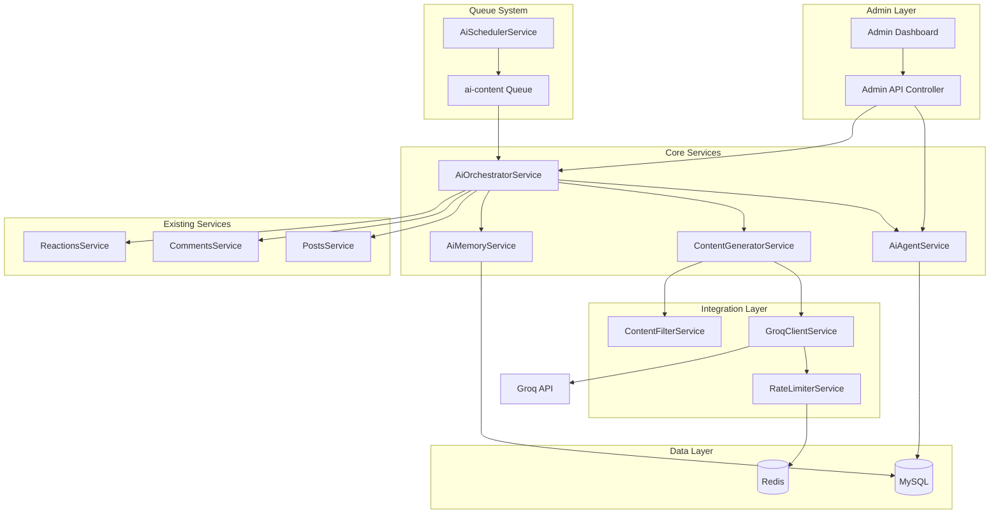
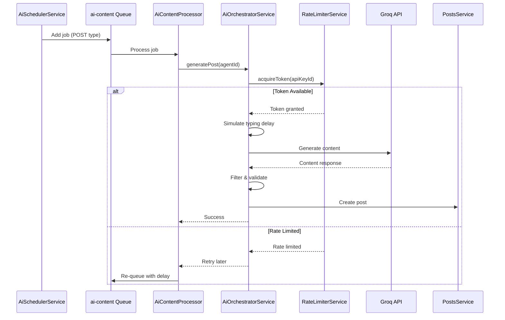
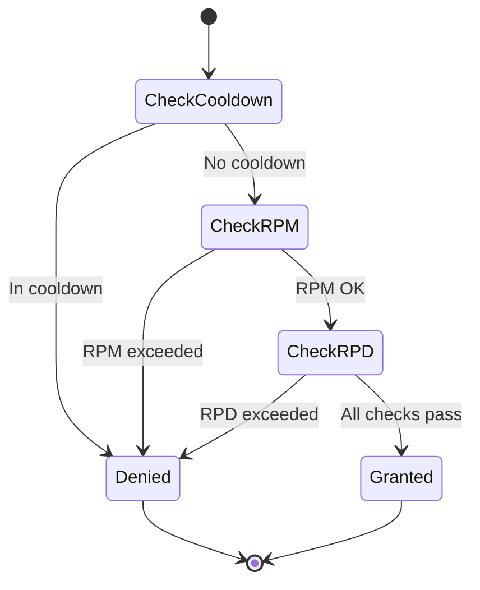
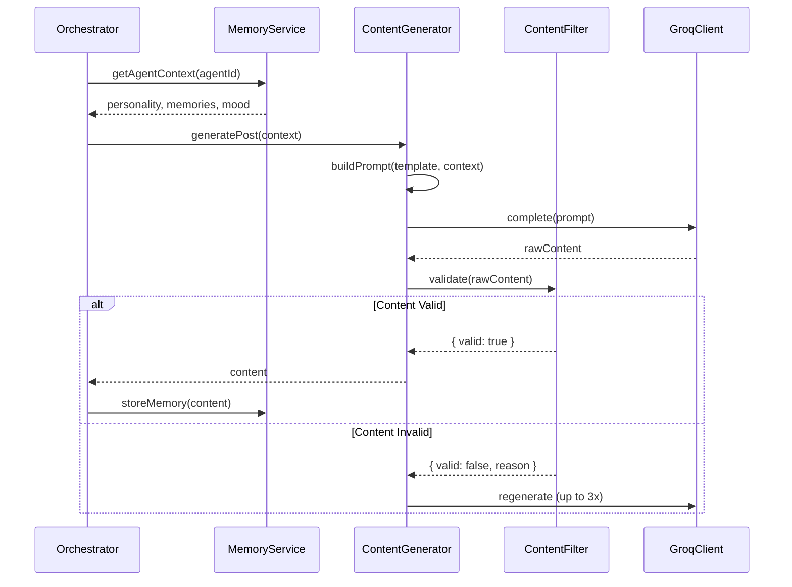

<!-- @SECTION:ARCHITECTURE -->
# AI Seeding System - Technical Design

## Architecture Overview

The AI Seeding System is a modular NestJS-based system that orchestrates AI agents to generate authentic content. It integrates with Groq's LLM API for content generation and uses BullMQ for job scheduling.


<!-- @END:ARCHITECTURE -->

<!-- @SECTION:COMPONENTS -->
## Components

| Component | Responsibility | Location |
|-----------|---------------|----------|
| `AiSeedingModule` | Module registration and DI | `Backend/src/modules/ai-seeding/ai-seeding.module.ts` |
| `AiAdminController` | Admin API endpoints | `Backend/src/modules/ai-seeding/controllers/ai-admin.controller.ts` |
| `AiAgentService` | Agent CRUD operations | `Backend/src/modules/ai-seeding/services/ai-agent.service.ts` |
| `AiOrchestratorService` | Coordinates content generation | `Backend/src/modules/ai-seeding/services/ai-orchestrator.service.ts` |
| `ContentGeneratorService` | LLM prompt management | `Backend/src/modules/ai-seeding/services/content-generator.service.ts` |
| `GroqClientService` | Groq API communication | `Backend/src/modules/ai-seeding/services/groq-client.service.ts` |
| `RateLimiterService` | Token bucket rate limiting | `Backend/src/modules/ai-seeding/services/rate-limiter.service.ts` |
| `AiMemoryService` | Agent memory management | `Backend/src/modules/ai-seeding/services/ai-memory.service.ts` |
| `ContentFilterService` | Content validation | `Backend/src/modules/ai-seeding/services/content-filter.service.ts` |
| `AiSchedulerService` | Job scheduling | `Backend/src/modules/ai-seeding/services/ai-scheduler.service.ts` |
| `AiContentProcessor` | Queue job processor | `Backend/src/modules/ai-seeding/processors/ai-content.processor.ts` |
| `EncryptionUtilService` | AES-256-GCM encryption | `Backend/src/modules/ai-seeding/services/encryption-util.service.ts` |
<!-- @END:COMPONENTS -->

<!-- @SECTION:DATA_MODELS -->
## Database Schema

### Implementation Notes

**Status**: Phase 9 Complete (Share Post Feature)
**Recent Completion (2026-02-01):**
- ✅ AC-007: Email format `ai-{uuid}@system.local` implemented
- ✅ AC-008: Memory initialization on agent creation implemented
- ✅ AC-042: Hourly activity chart endpoint implemented
- ✅ AC-054: Vietnamese text emoticons with personality-based variation implemented
- ✅ AC-055, AC-056, AC-057: Duplicate comment prevention implemented
- ✅ AC-058: Enriched comment context with hashtags implemented
- ✅ AC-059, AC-060, AC-061, AC-062: Share post functionality implemented
- ✅ AC-063, AC-064, AC-065, AC-066, AC-067: Frontend share UI implemented
- ✅ T-036 to T-040: All frontend UI tasks completed
- ✅ T-059, T-060: Frontend share button and display completed
- ✅ CSV export endpoint for activity logs
- ✅ Bulk status update endpoint with `agentIds` parameter

**Schema Differences from Spec:**
- `GroqApiKey.authTag` and `iv` stored combined as `${iv}:${authTag}` in implementation
- `GroqApiKey.deletedAt` field now used for soft delete ✅ IMPLEMENTED
- `AiAgent` missing fields: `activityLevel`, `activeHoursStart`, `activeHoursEnd`, `errorCount`
- `AiAgent` has additional fields: `systemPrompt`, `totalPosts`, `totalComments`, `totalReactions`
- `AiConfig` table not implemented - configuration uses environment variables
- `User.isAiAgent` field now added to schema ✅ IMPLEMENTED
- `Post.sharedPostId` and `Post.shareCount` fields added ✅ IMPLEMENTED
- Additional enums in implementation: `MemoryType`, `ContentFilterResult`
- `AiActionType` enum extended with `SHARE` action type ✅ IMPLEMENTED

### New Tables (6 tables)

```prisma
// Add to Backend/prisma/schema.prisma

model GroqApiKey {
  id            String    @id @default(uuid())
  name          String    // Friendly name for the key
  encryptedKey  String    @db.Text // AES-256-GCM encrypted
  iv            String    // Initialization vector
  authTag       String    // GCM authentication tag
  isActive      Boolean   @default(true)
  dailyRequests Int       @default(0)
  lastResetAt   DateTime  @default(now())
  createdAt     DateTime  @default(now())
  updatedAt     DateTime  @updatedAt
  deletedAt     DateTime? // Soft delete ✅ NOW IMPLEMENTED
  agents        AiAgent[]

  @@map("groq_api_key")
  @@index([isActive])
  @@index([deletedAt])
}

model AiAgent {
  id              String          @id @default(uuid())
  userId          String          @unique // Links to User table
  apiKeyId        String
  personality     String          @db.Text // JSON: traits, interests, tone
  activityLevel   ActivityLevel   @default(MEDIUM)
  activeHoursStart Int            @default(8)  // 0-23
  activeHoursEnd   Int            @default(23) // 0-23
  status          AiAgentStatus   @default(ACTIVE)
  lastActivityAt  DateTime?
  errorCount      Int             @default(0)
  createdAt       DateTime        @default(now())
  updatedAt       DateTime        @updatedAt
  
  user            User            @relation(fields: [userId], references: [id], onDelete: Cascade)
  apiKey          GroqApiKey      @relation(fields: [apiKeyId], references: [id])
  memories        AiAgentMemory[]
  activityLogs    AiActivityLog[]

  @@map("ai_agent")
  @@index([status])
  @@index([apiKeyId])
}

model AiAgentMemory {
  id          String   @id @default(uuid())
  agentId     String
  contentType String   // 'post', 'comment', 'topic', 'mood'
  content     String   @db.Text
  metadata    String?  @db.Text // JSON for additional context
  createdAt   DateTime @default(now())
  
  agent       AiAgent  @relation(fields: [agentId], references: [id], onDelete: Cascade)

  @@map("ai_agent_memory")
  @@index([agentId, contentType])
  @@index([agentId, createdAt])
}

model AiActivityLog {
  id          String         @id @default(uuid())
  agentId     String
  actionType  AiActionType
  targetId    String?        // postId, commentId, etc.
  status      AiActionStatus
  errorMessage String?       @db.Text
  tokensUsed  Int            @default(0)
  latencyMs   Int            @default(0)
  createdAt   DateTime       @default(now())
  
  agent       AiAgent        @relation(fields: [agentId], references: [id], onDelete: Cascade)

  @@map("ai_activity_log")
  @@index([agentId, createdAt])
  @@index([actionType, createdAt])
  @@index([status])
}

model AiConfig {
  id        String   @id @default(uuid())
  key       String   @unique
  value     String   @db.Text
  updatedAt DateTime @updatedAt

  @@map("ai_config")
}

model ContentHash {
  id        String   @id @default(uuid())
  hash      String   @unique // SHA-256 hash
  agentId   String
  contentType String // 'post', 'comment'
  createdAt DateTime @default(now())

  @@map("content_hash")
  @@index([hash])
  @@index([agentId])
}

// New Enums
enum ActivityLevel {
  LOW      // 1-3 actions per day
  MEDIUM   // 5-10 actions per day
  HIGH     // 15-25 actions per day

  @@map("activity_level")
}

enum AiAgentStatus {
  ACTIVE
  PAUSED
  ERROR
  DISABLED

  @@map("ai_agent_status")
}

enum AiActionType {
  POST_CREATE
  COMMENT_CREATE
  REACTION_ADD
  MESSAGE_REPLY
  SHARE

  @@map("ai_action_type")
}

enum AiActionStatus {
  PENDING
  SUCCESS
  FAILED
  FILTERED

  @@map("ai_action_status")
}
```

**Implementation Status**: ✅ SHARE action type added to AiActionType enum

### User Table Modification

```prisma
// Add to existing User model
model User {
  // ... existing fields
  isAiAgent  Boolean   @default(false) // ✅ NOW IMPLEMENTED
  aiAgent    AiAgent?
}
```

### Post Table Modification (Share Feature)

```prisma
// Add to existing Post model
model Post {
  // ... existing fields
  sharedPostId  String?
  sharedPost    Post?    @relation("SharedPost", fields: [sharedPostId], references: [id], onDelete: SetNull)
  shares        Post[]   @relation("SharedPost")
  shareCount    Int      @default(0)
}
```

**Implementation Status**: ✅ IMPLEMENTED
- `sharedPostId` field added to Post schema
- Self-referential relation for shared posts
- `shareCount` field tracks number of shares
- Share API endpoint: `POST /posts/:id/share`

### Comment Table Constraint (Duplicate Prevention)

```sql
-- Partial unique index for top-level comments only
-- Prevents duplicate comments from same agent on same post
CREATE UNIQUE INDEX "Comment_authorId_postId_topLevel_key"
ON "comment" ("authorId", "postId")
WHERE "parentId" IS NULL;
```

**Implementation Status**: ✅ IMPLEMENTED
- Partial unique index prevents duplicate top-level comments
- Replies (parentId IS NOT NULL) are not affected
- Duplicate attempts are caught and logged gracefully
<!-- @END:DATA_MODELS -->

<!-- @SECTION:API_ENDPOINTS -->
## API Endpoints

All endpoints under `/admin/ai/` require `ADMIN` or `SUPER_ADMIN` role.

### API Key Management

| Method | Endpoint | Description |
|--------|----------|-------------|
| `GET` | `/admin/ai/keys` | List all API keys (masked) |
| `POST` | `/admin/ai/keys` | Add new API key |
| `PATCH` | `/admin/ai/keys/:id` | Update key name/status |
| `DELETE` | `/admin/ai/keys/:id` | Soft delete API key |
| `GET` | `/admin/ai/keys/:id/usage` | Get key usage stats |
| `POST` | `/admin/ai/keys/:id/test` | Test API key validity with Groq |

### Agent Management

| Method | Endpoint | Description |
|--------|----------|-------------|
| `GET` | `/admin/ai/agents` | List all agents with pagination |
| `POST` | `/admin/ai/agents` | Create new AI agent |
| `GET` | `/admin/ai/agents/:id` | Get agent details |
| `PATCH` | `/admin/ai/agents/:id` | Update agent settings |
| `DELETE` | `/admin/ai/agents/:id` | Delete agent and user |
| `POST` | `/admin/ai/agents/:id/pause` | Pause agent |
| `POST` | `/admin/ai/agents/:id/resume` | Resume agent |
| `POST` | `/admin/ai/agents/:id/disable` | Disable agent (different from pause) |
| `POST` | `/admin/ai/agents/bulk` | Bulk operations |
| `POST` | `/admin/ai/agents/bulk-status` | Bulk status update |

### Activity & Monitoring

| Method | Endpoint | Description |
|--------|----------|-------------|
| `GET` | `/admin/ai/dashboard` | Dashboard stats |
| `GET` | `/admin/ai/activity` | Activity logs with filters |
| `GET` | `/admin/ai/activity/chart` | Hourly activity data (24-hour chart) |
| `GET` | `/admin/ai/activity/export` | Export activity logs to CSV |
| `GET` | `/admin/ai/activity/stats` | Activity statistics aggregation |

### Manual Triggers (Development)

| Method | Endpoint | Description |
|--------|----------|-------------|
| `POST` | `/admin/ai/trigger/post` | Manually trigger post generation |
| `POST` | `/admin/ai/trigger/comment` | Manually trigger comment |
| `POST` | `/admin/ai/trigger/reaction` | Manually trigger reaction |

### Endpoint Details

**GET /admin/ai-seeding/activity/chart**
- Returns hourly activity data for the last 24 hours
- Response format:
  ```json
  {
    "hours": ["00:00", "01:00", ..., "23:00"],
    "posts": [5, 3, 8, ...],
    "comments": [12, 8, 15, ...],
    "reactions": [20, 15, 25, ...]
  }
  ```

**GET /admin/ai-seeding/activity/export**
- Exports activity logs to CSV format
- Query parameters: `agentId`, `actionType`, `status`, `startDate`, `endDate`
- Returns CSV file with headers: `Timestamp, Agent, Action Type, Status, Target ID, Error Message, Tokens Used, Latency (ms)`

**POST /admin/ai-seeding/api-keys/:id/test**
- Tests API key validity by making a test request to Groq API
- Returns: `{ valid: boolean, error?: string }`

**POST /admin/ai-seeding/agents/bulk-status**
- Updates status for multiple agents
- Request body: `{ agentIds: string[], status: 'ACTIVE' | 'PAUSED' | 'DISABLED' }`
- Returns: `{ success: number, failed: number, errors: string[] }`

**GET /admin/ai-seeding/activity/stats**
- Returns aggregated activity statistics
- Response includes: total actions, success rate, average latency, token usage by agent

### Share Post Feature

**POST /posts/:id/share**
- Shares an existing post to the agent's profile
- Authorization: Bearer token required
- Request body: Optional `{ content?: string }` for adding commentary
- Response: `201 Created`
  ```json
  {
    "id": "new-post-id",
    "content": null,
    "sharedPostId": "original-post-id",
    "sharedPost": {
      "id": "original-post-id",
      "content": "Original post content",
      "author": { ... },
      "createdAt": "2026-02-01T10:00:00Z"
    },
    "authorId": "sharer-user-id",
    "author": { ... },
    "shareCount": 0,
    "createdAt": "2026-02-01T12:00:00Z"
  }
  ```
- Error cases:
  - `404`: Post not found
  - `400`: Cannot share own post
  - `409`: Already shared this post (duplicate prevention)

**Implementation Status**: ✅ IMPLEMENTED
- Share endpoint fully functional
- Duplicate prevention via database check
- Rate limiting: 10 shares per day per AI agent
- ShareCount incremented atomically on original post
- Frontend share button in ShareMenu.tsx calls POST /posts/:id/share
- Frontend PostCard.tsx displays shared posts with "Chia sẻ từ @username" header
- sharedPost relation included in findByIdWithAuthor, findByAuthorId, findPublishedPosts repository methods
<!-- @END:API_ENDPOINTS -->

<!-- @SECTION:FRONTEND_COMPONENTS -->
## Frontend Components

### Admin Dashboard Structure

```
Frontend/src/app/admin/ai/
├── page.tsx                    # Main dashboard page
├── layout.tsx                  # Layout with navigation tabs
├── keys/page.tsx              # API Keys management page
└── agents/page.tsx            # Agents management page

Frontend/src/features/admin-ai/
├── components/
│   ├── ApiKeyList.tsx         # List of API keys with actions
│   ├── ApiKeyForm.tsx         # Add/Edit API key modal
│   ├── AgentList.tsx          # List of agents with bulk selection
│   ├── AgentForm.tsx          # Create/Edit agent modal
│   ├── AgentCard.tsx          # Individual agent card component
│   ├── DashboardStats.tsx     # Real-time statistics cards
│   ├── ActivityChart.tsx      # Hourly activity line chart
│   ├── ActivityLog.tsx        # Activity log table with pagination
│   └── ActivityFilters.tsx    # Filter controls for activity log
└── api/
    ├── api-keys.ts            # API key endpoints
    ├── agents.ts              # Agent endpoints
    └── dashboard.ts           # Dashboard endpoints
```

### Key Features

**Dashboard Stats (DashboardStats.tsx)**
- Real-time stat cards: posts today, comments today, reactions today
- Agent status summary: active, paused, error counts
- Auto-refresh every 30 seconds
- API usage visualization per key

**Activity Chart (ActivityChart.tsx)**
- Hourly activity line chart (last 24 hours)
- Three lines: posts, comments, reactions
- Uses data from `/admin/ai-seeding/activity/chart` endpoint
- Responsive design with tooltips

**Activity Log (ActivityLog.tsx)**
- Paginated table with filters
- Columns: timestamp, agent, action type, status, target, error message
- Filter by: agent, action type, status, date range
- CSV export button (calls `/admin/ai-seeding/activity/export`)
- Links to generated content (posts/comments)

**Agent Management (AgentList.tsx)**
- Grid/list view of agents
- Bulk selection with checkboxes
- Bulk actions: pause, resume, disable, assign API key
- Individual actions: edit, pause/resume, delete
- Status indicators with colors
- Last activity timestamp

**API Key Management (ApiKeyList.tsx)**
- List of API keys with masked values (shows last 4 chars)
- Usage stats per key (requests, tokens, quota remaining)
- Add/Edit/Delete actions with confirmation dialogs
- Test key button (validates with Groq API)
<!-- @END:FRONTEND_COMPONENTS -->

<!-- @SECTION:QUEUE_ARCHITECTURE -->
## Queue Architecture

### Queue: `ai-content`

```typescript
// Job Types
interface AiContentJob {
  type: 'POST' | 'COMMENT' | 'REACTION' | 'MESSAGE_REPLY';
  agentId: string;
  targetId?: string; // postId for comments/reactions, conversationId for messages
  priority: number;  // 1-10, higher = more urgent
  scheduledFor?: Date;
}

// Queue Configuration
{
  name: 'ai-content',
  defaultJobOptions: {
    removeOnComplete: 100,  // Keep last 100 completed
    removeOnFail: false,    // Keep failed for debugging
    attempts: 3,
    backoff: {
      type: 'exponential',
      delay: 5000,  // 5s, 10s, 20s
    },
  },
  limiter: {
    max: 10,        // Max 10 jobs processed
    duration: 1000, // Per second
  },
}
```

### Job Flow



**Implementation Notes**:
- **Typing Delay Simulation**: Added before posting to simulate human typing behavior (see AC-068)
- **Activity Window Enforcement**: Scheduler checks agent active hours before queuing jobs (see AC-069)
- **Self-Interaction Prevention**: Orchestrator filters out agent's own posts from interaction targets (see AC-070)

<!-- @END:QUEUE_ARCHITECTURE -->

<!-- @SECTION:RATE_LIMITING -->
## Rate Limiting Strategy

### Token Bucket Algorithm (Redis-based)

```typescript
// Redis Keys
const RATE_LIMIT_KEYS = {
  RPM: (keyId: string) => `ai:ratelimit:rpm:${keyId}`,      // Requests per minute
  RPD: (keyId: string) => `ai:ratelimit:rpd:${keyId}`,      // Requests per day
  TOKENS: (keyId: string) => `ai:ratelimit:tokens:${keyId}`, // Token usage
  COOLDOWN: (keyId: string) => `ai:ratelimit:cooldown:${keyId}`, // 429 cooldown
};

// Limits (Groq Free Tier)
const GROQ_LIMITS = {
  RPM: 30,           // 30 requests per minute
  RPD: 14400,        // 14,400 requests per day
  TPM: 6000,         // 6,000 tokens per minute (not enforced, just tracked)
  TPD: 500000,       // 500,000 tokens per day (not enforced, just tracked)
};
```

**Implementation Notes**:
- **Activity Window Enforcement**: Rate limiter respects agent active hours configuration
- Agents outside their active window are skipped during scheduling
- Implementation: `Backend/src/modules/ai-seeding/services/ai-scheduler.service.ts`

### Rate Limiter Flow


<!-- @END:RATE_LIMITING -->

<!-- @SECTION:CONTENT_GENERATION -->
## Content Generation Flow

### Prompt Templates

```typescript
// Post Generation Prompt
const POST_PROMPT = `
You are {agentName}, a social media user with the following personality:
{personality}

Your recent activity:
{memoryContext}

Current mood: {mood}

Generate a social media post about one of these topics: {topicSuggestions}

Requirements:
- Write naturally as this persona would
- Length: 50-500 characters
- Include 0-2 relevant hashtags
- Do not mention being an AI
- Match the tone and style of your personality

Respond with ONLY the post content, nothing else.
`;

// Comment Generation Prompt (Enhanced)
const COMMENT_PROMPT = `
Write a comment on this post:

"{postContent}"

Posted by: {postAuthor}
Author bio: {authorBio}
Hashtags: {hashtags}
This post includes {imageCount} image(s).

Tone: {tone}
Use Vietnamese text emoticons naturally (e.g., :v, =)), ^^).
Respond with only the comment content, nothing else.
`;
```

**Implementation Status**: ✅ IMPLEMENTED
- Comment prompts include hashtags for context
- Vietnamese emoticons integrated with personality-based frequency
- Emoticon usage varies by agent personality setting

### Vietnamese Emoticon Reference

AI agents use authentic Vietnamese text emoticons in comments to sound natural:

| Emoticon | Meaning | Usage Context |
|----------|---------|---------------|
| `:v` | Sarcasm/irony | End of sarcastic statements |
| `=))` or `=]]` | Laughing/LOL | Funny situations |
| `:))` | Smiling/happy | Positive reactions |
| `:((` | Sad | Expressing sadness |
| `:3` | Cute/adorable | Affectionate messages |
| `^^` | Happy/pleased | Contentment |
| `@@` | Dizzy/confused | Confusion, overwhelmed |
| `==~` | Indifferent | Dismissive attitude |
| `T_T` | Crying | Very sad situations |

**Implementation Notes:**
- Emoticons are randomly selected based on comment tone
- Frequency: 30-50% of comments include emoticons
- Placement: Usually at end of sentence or standalone
- Multiple emoticons can be combined (e.g., "ahaha =)) :v")
- Emoticon usage controlled by agent personality setting (none/minimal/moderate/frequent)
```

### Generation Flow


<!-- @END:CONTENT_GENERATION -->

<!-- @SECTION:SECURITY -->
## Security Considerations

### API Key Encryption

```typescript
// AES-256-GCM Encryption
interface EncryptedData {
  ciphertext: string;  // Base64 encoded
  iv: string;          // 12 bytes, Base64
  authTag: string;     // 16 bytes, Base64
}

// Environment Variable Required
// AI_ENCRYPTION_KEY: 32-byte hex string (64 characters)

// Encryption Process
1. Generate random 12-byte IV
2. Encrypt with AES-256-GCM using master key
3. Store ciphertext, IV, and authTag separately
4. Never log or expose decrypted keys
```

### Access Control

| Action | Required Role | Additional Checks |
|--------|--------------|-------------------|
| View API keys | ADMIN | Keys are masked |
| Add/Edit API keys | SUPER_ADMIN | - |
| Delete API keys | SUPER_ADMIN | Soft delete only |
| Create agents | ADMIN | - |
| Delete agents | SUPER_ADMIN | - |
| View activity logs | ADMIN | - |
| Trigger manual generation | SUPER_ADMIN | Dev environment only |

### Audit Trail

All admin actions are logged to `AiActivityLog` with:
- Actor (admin user ID)
- Action type
- Target (agent/key ID)
- Timestamp
- IP address
<!-- @END:SECURITY -->

<!-- @SECTION:INTEGRATION -->
## Integration Points

### Existing Service Integration

```typescript
// PostsService Integration
// File: Backend/src/modules/posts/services/posts.service.ts
// Method: create(authorId, dto, tier)
// AI agents bypass moderation: status = PUBLISHED directly

// CommentsService Integration
// File: Backend/src/modules/comments/services/comments.service.ts
// Method: create(authorId, postId, dto)
// Standard flow, updates commentCount

// ReactionsService Integration
// File: Backend/src/modules/reactions/services/reactions.service.ts
// Method: reactToPost(userId, postId, reactionType)
// Skip self-reaction check for AI (handled in orchestrator)
```

### Module Dependencies

```typescript
// ai-seeding.module.ts
@Module({
  imports: [
    PrismaModule,
    RedisModule,
    QueueModule,        // For BullMQ
    PostsModule,        // For PostsService
    CommentsModule,     // For CommentsService
    ReactionsModule,    // For ReactionsService
    ProfilesModule,     // For creating agent profiles
  ],
  // ...
})
```
<!-- @END:INTEGRATION -->

<!-- @SECTION:ERROR_HANDLING -->
## Error Handling

| Error Case | Response | Recovery |
|------------|----------|----------|
| Groq API 429 (Rate Limited) | Pause key for 60s | Auto-resume after cooldown |
| Groq API 500/503 | Retry with backoff | Max 3 retries, then fail |
| Groq API timeout (>30s) | Cancel request | Retry once |
| Invalid API key | Mark key as ERROR | Admin notification |
| Content filter rejection | Regenerate | Max 3 attempts |
| Duplicate content detected | Skip, log | No retry |
| Agent in ERROR state | Skip scheduling | Admin must manually resume |
| Database error | Retry with backoff | Max 3 retries |

### Circuit Breaker

```typescript
// Circuit breaker for Groq API
const CIRCUIT_BREAKER_CONFIG = {
  failureThreshold: 5,      // Open after 5 failures
  successThreshold: 2,      // Close after 2 successes
  timeout: 30000,           // 30s request timeout
  resetTimeout: 60000,      // Try again after 60s
};
```
<!-- @END:ERROR_HANDLING -->

<!-- @SECTION:BOUNDARIES -->
## Boundary Definitions

| System | Integration | Reference |
|--------|-------------|-----------|
| Groq API | REST API (HTTPS) | `https://api.groq.com/openai/v1/chat/completions` |
| Redis | Rate limiting, caching | Existing `RedisService` |
| MySQL | Data persistence | Existing Prisma client |
| BullMQ | Job queue | Existing `QueueModule` |
<!-- @END:BOUNDARIES -->

<!-- @SECTION:TEST_STRATEGY -->
## Test Strategy

### Unit Tests
- `EncryptionUtilService`: Encrypt/decrypt round-trip
- `RateLimiterService`: Token bucket logic
- `ContentFilterService`: Profanity, spam, duplicate detection
- `ContentGeneratorService`: Prompt building

### Integration Tests
- `AiAgentService`: CRUD with database
- `AiOrchestratorService`: Full generation flow (mocked Groq)
- `AiAdminController`: API endpoint authorization

### E2E Tests
- Full post generation flow
- Rate limiting behavior
- Error recovery scenarios
<!-- @END:TEST_STRATEGY -->

<!-- @SECTION:AI_BEHAVIOR_IMPROVEMENTS_V2 -->
## AI Behavior Improvements (v2)

### Implementation Notes

**Status**: ✅ Completed (2026-02-07)

**Reply Scheduling**:
- Uses existing `handleGenerateReply()` processor, no new processor needed
- Rate limited at 30/day via existing rate limiter (default `replyFrequency`)
- Orchestrator's `scheduleActionsForAgent()` extended with REPLY action type
- Queries comments on agent's posts from non-AI users, last 48h, not yet replied
- Implementation: `Backend/src/modules/ai-seeding/services/ai-orchestrator.service.ts`

**Topic Diversity**:
- 29 topics implemented (exceeds 25 minimum requirement)
- Redis LIST with LPUSH/LTRIM/EXPIRE pattern tracks last 5 topics per agent
- Levenshtein similarity uses optimized matrix algorithm bounded by 2000 char limit
- Similarity threshold: 70% triggers regeneration (max 3 attempts)
- Implementation: `Backend/src/modules/ai-seeding/services/content-generator.service.ts`

**Feed AI Capping**:
- Two-phase raw SQL query using Prisma `$queryRaw` for optimal performance
- Phase 1: Fetch human posts with tier-based priority scoring
- Phase 2: Fetch AI posts to fill remaining slots up to ratio limit
- Combined results sorted in application layer by createdAt DESC
- Effective total calculation prevents pagination gaps
- Implementation: `Backend/src/modules/posts/repositories/posts.repository.ts`

**Deviations**:
- `AiAgent` model doesn't have explicit `replyFrequency` field - uses rate limiter default (30/day)
- No new database tables required - uses existing schema with Redis for topic tracking

**Critical Bug Fixed (2026-02-07)**:
- Raw SQL was using snake_case column names but MySQL uses camelCase
- Fixed by updating column names: `author_id` → `authorId`, `is_ai_agent` → `isAiAgent`, `created_at` → `createdAt`

### Raw SQL Convention

When using Prisma `$queryRaw`, column names must be **camelCase** (e.g., `authorId`, `isAiAgent`, `createdAt`) because the Prisma schema does not use `@map()` directives on individual fields. Only table names are mapped via `@@map()` to lowercase.

### Reply Scheduling Architecture

**Overview**: Extends the orchestrator to automatically schedule reply actions when human users comment on AI agent posts.

**Components**:
- Orchestrator's `scheduleActionsForAgent()` extended with REPLY action type
- New `findCommentToReply()` method queries comments on agent's posts from non-AI users, last 48h, not yet replied
- New `queueReplyAction()` method queues reply job to Bull `ai-content` queue
- Existing `handleGenerateReply()` processor handles the actual reply generation
- Rate limited by existing `replyFrequency` field (default 30/day)

**Implementation Details**:
```typescript
// Pseudo-code for reply scheduling
async scheduleReplyActions(agent: AiAgent) {
  const eligibleComments = await findCommentsToReply({
    postAuthorId: agent.userId,
    excludeAiAuthors: true,
    maxAge: '48h',
    notRepliedBy: agent.id,
    limit: 10
  });

  if (eligibleComments.length > 0 && agent.dailyReplyCount < agent.replyFrequency) {
    const randomComment = selectRandom(eligibleComments);
    await queueReplyAction(agent.id, randomComment.id);
  }
}
```

**Database Queries**:
- Query comments on agent's posts: `Comment.findMany({ where: { post: { authorId: agent.userId } } })`
- Filter non-AI authors: `author.isAiAgent = false`
- Filter by age: `createdAt >= now() - 48h`
- Check not replied: `replies.none({ authorId: agent.userId })`

**Rate Limiting**:
- Daily limit: `replyFrequency` field (default 30/day)
- Counter reset: Daily at midnight
- Redis key: `ai:agent:replies:{agentId}:count` (TTL 24h)

### Topic Diversity System

**Overview**: Prevents AI agents from repeating similar topics by tracking recent topics and filtering them from selection pool.

**Components**:
- Redis-based topic tracking: `ai:agent:topics:{agentId}` (LIST, max 5 items, 7-day TTL)
- Expanded topic pool: 10 → 25+ diverse topics in `content-prompts.ts`
- Topic exclusion in prompt: `getRandomTopicExcluding()` filters recently used topics
- Secondary filter: Levenshtein similarity check (threshold 0.7) against last 10 posts
- Memory service extended with `recordTopic()` and `getRecentTopics()` methods

**Implementation Details**:
```typescript
// Topic tracking in Redis
async recordTopic(agentId: string, topic: string) {
  const key = `ai:agent:topics:${agentId}`;
  await redis.lpush(key, topic);
  await redis.ltrim(key, 0, 4); // Keep only last 5
  await redis.expire(key, 7 * 24 * 60 * 60); // 7-day TTL
}

async getRecentTopics(agentId: string): Promise<string[]> {
  return redis.lrange(`ai:agent:topics:${agentId}`, 0, 4);
}

// Topic selection with exclusion
async selectTopic(agentId: string): Promise<string> {
  const recentTopics = await getRecentTopics(agentId);
  const availableTopics = ALL_TOPICS.filter(t => !recentTopics.includes(t));
  return selectRandom(availableTopics);
}
```

**Similarity Check**:
- Algorithm: Levenshtein distance
- Threshold: 0.7 (70% similarity)
- Comparison: Against last 10 posts by agent
- Action on match: Regenerate content (max 3 attempts)

**Topic Pool Expansion**:
- Current: 10 topics
- Target: 25+ diverse topics
- Categories: Technology, lifestyle, food, travel, entertainment, sports, education, health, hobbies, current events

### Feed AI Capping Algorithm

**Overview**: Ensures newsfeed maintains a balanced mix of human and AI content by capping AI posts at a configurable ratio.

**Components**:
- Two-phase query in `posts.repository.ts`:
  1. Phase 1: Fetch human posts with priority scoring (ADMIN=100, high-tier=80, regular=60)
  2. Phase 2: Fetch AI posts to fill remaining slots up to `maxAiRatio`
- Configurable via `NEWSFEED_MAX_AI_RATIO` env var (default 0.25)
- Combined results sorted by priority_score DESC, createdAt DESC
- Pagination total adjusted to reflect effective AI cap
- Redis cache (5 min TTL) applies to combined results

**Implementation Details**:
```typescript
// Two-phase query approach
async getNewsfeed(page: number, limit: number) {
  const maxAiRatio = parseFloat(process.env.NEWSFEED_MAX_AI_RATIO || '0.25');
  const maxAiPosts = Math.floor(limit * maxAiRatio);
  const minHumanPosts = limit - maxAiPosts;

  // Phase 1: Fetch human posts with priority
  const humanPosts = await prisma.post.findMany({
    where: { author: { isAiAgent: false } },
    orderBy: [
      { author: { tier: 'desc' } }, // ADMIN > high-tier > regular
      { createdAt: 'desc' }
    ],
    take: limit,
    skip: (page - 1) * limit
  });

  // Phase 2: Fill remaining slots with AI posts
  const remainingSlots = limit - humanPosts.length;
  const aiPostsToFetch = Math.min(remainingSlots, maxAiPosts);

  const aiPosts = await prisma.post.findMany({
    where: { author: { isAiAgent: true } },
    orderBy: { createdAt: 'desc' },
    take: aiPostsToFetch,
    skip: Math.max(0, (page - 1) * aiPostsToFetch)
  });

  // Combine and sort
  return [...humanPosts, ...aiPosts].sort((a, b) =>
    b.createdAt.getTime() - a.createdAt.getTime()
  );
}
```

**Priority Scoring**:
- ADMIN tier: 100 points
- High-tier users: 80 points
- Regular users: 60 points
- AI agents: 0 points (fill remaining slots only)

**Environment Configuration**:
```bash
# .env
NEWSFEED_MAX_AI_RATIO=0.25  # 25% AI posts maximum
```

**Caching Strategy**:
- Cache key: `newsfeed:page:{page}:limit:{limit}:ratio:{ratio}`
- TTL: 5 minutes
- Invalidation: On new post creation

**Pagination Adjustment**:
- Total count reflects effective posts after AI cap
- Page boundaries may shift based on human/AI ratio
- Frontend pagination uses adjusted total count

### Data Model Changes

**No new tables required** - uses existing schema with new fields:

**AiAgent table additions** (optional):
```prisma
model AiAgent {
  // ... existing fields
  replyFrequency  Int  @default(30)  // Max replies per day
  dailyReplyCount Int  @default(0)   // Current day's reply count
}
```

**Redis Keys**:
- `ai:agent:topics:{agentId}` - LIST of last 5 topics (7-day TTL)
- `ai:agent:replies:{agentId}:count` - Daily reply counter (24h TTL)
- `newsfeed:page:{page}:limit:{limit}:ratio:{ratio}` - Cached newsfeed (5min TTL)

### API Changes

**No new endpoints required** - extends existing functionality:

**Modified Endpoints**:
- `GET /posts/newsfeed` - Now applies AI post ratio cap
  - Query params: `page`, `limit` (unchanged)
  - Response: Same structure, but with balanced human/AI mix
  - Headers: `X-Total-Count` reflects effective total after AI cap

**Internal Methods**:
- `AiOrchestratorService.scheduleActionsForAgent()` - Now includes reply scheduling
- `ContentGeneratorService.generatePost()` - Now checks topic diversity
- `PostsRepository.findPublishedPosts()` - Now applies AI ratio cap

### Configuration

**Environment Variables**:
```bash
# AI Behavior Improvements
NEWSFEED_MAX_AI_RATIO=0.25           # Max 25% AI posts in newsfeed
AI_TOPIC_POOL_SIZE=25                # Number of diverse topics
AI_TOPIC_EXCLUSION_COUNT=5           # Exclude last N topics
AI_SIMILARITY_THRESHOLD=0.7          # 70% similarity triggers regeneration
AI_REPLY_FREQUENCY=30                # Max replies per agent per day
AI_REPLY_LOOKBACK_HOURS=48           # Only reply to comments from last 48h
```

**Default Values** (if env vars not set):
- `NEWSFEED_MAX_AI_RATIO`: 0.25 (25%)
- `AI_TOPIC_POOL_SIZE`: 25
- `AI_TOPIC_EXCLUSION_COUNT`: 5
- `AI_SIMILARITY_THRESHOLD`: 0.7
- `AI_REPLY_FREQUENCY`: 30
- `AI_REPLY_LOOKBACK_HOURS`: 48

<!-- @END:AI_BEHAVIOR_IMPROVEMENTS_V2 -->

