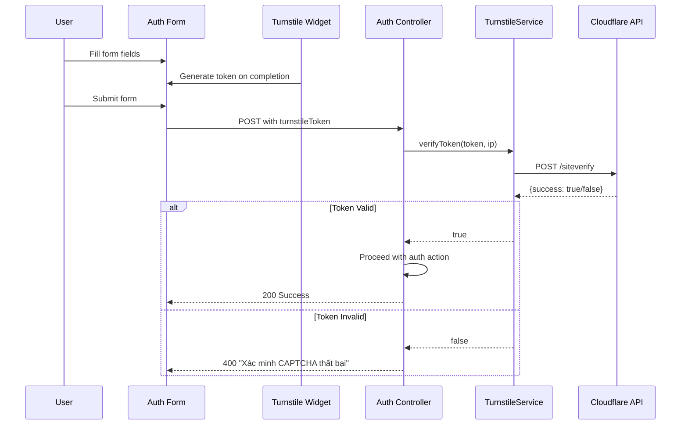

<!-- @SECTION:ARCHITECTURE -->
# Technical Design: Cloudflare Turnstile CAPTCHA

## Architecture

Replace @Throttle() rate limiting with Cloudflare Turnstile CAPTCHA verification on auth endpoints. Backend validates tokens via Cloudflare API, frontend displays Turnstile widget on forms.
<!-- @END:ARCHITECTURE -->

<!-- @SECTION:BACKEND_CHANGES -->
## Backend Changes

### 1. New Service: TurnstileService

**File**: `Backend/src/modules/auth/services/turnstile.service.ts`

| Responsibility | Details |
|----------------|---------|
| Verify Turnstile tokens | Call Cloudflare API |
| Method | `verifyToken(token: string, ip?: string): Promise<boolean>` |
| API Endpoint | `POST https://challenges.cloudflare.com/turnstile/v0/siteverify` |
| HTTP Client | Native `fetch` (existing pattern from GroqClientService) |
| Config | Inject `ConfigService` for `TURNSTILE_SECRET_KEY` |

### 2. Update DTOs

| File | Change |
|------|--------|
| `Backend/src/modules/auth/dto/register.dto.ts` | Add `@IsString() turnstileToken: string` |
| `Backend/src/modules/auth/dto/login.dto.ts` | Add `@IsString() turnstileToken: string` |
| `Backend/src/modules/auth/dto/forgot-password.dto.ts` | Add `@IsString() turnstileToken: string` |

### 3. Update AuthController

**File**: `Backend/src/modules/auth/controllers/auth.controller.ts`

| Change | Details |
|--------|---------|
| Import | `SkipThrottle` from `@nestjs/throttler` |
| Inject | `TurnstileService` in constructor |
| Decorator | Replace `@Throttle({...})` with `@SkipThrottle()` on register, login, forgotPassword |
| Verification | Call `turnstileService.verifyToken(dto.turnstileToken, req.ip)` at method start |
| Error | Throw `BadRequestException('Xác minh CAPTCHA thất bại')` if invalid |
| Register method | Add `@Req() req: Request` parameter (currently missing) |

### 4. Update AuthModule

**File**: `Backend/src/modules/auth/auth.module.ts`

- Add `TurnstileService` to providers array

### 5. Environment Variables

| File | Variable |
|------|----------|
| `Backend/.env` | `TURNSTILE_SECRET_KEY` |
| `Backend/src/config/configuration.ts` | `turnstile: { secretKey: process.env.TURNSTILE_SECRET_KEY }` |
<!-- @END:BACKEND_CHANGES -->

<!-- @SECTION:FRONTEND_CHANGES -->
## Frontend Changes

### 6. Install Package

```bash
npm install @marsidev/react-turnstile
```

### 7. Update Auth Forms

| File | Changes |
|------|---------|
| `Frontend/src/features/auth/components/RegisterForm.tsx` | Add Turnstile widget + turnstileToken to schema |
| `Frontend/src/features/auth/components/LoginForm.tsx` | Add Turnstile widget + turnstileToken to schema |
| `Frontend/src/features/auth/components/ForgotPasswordForm.tsx` | Add Turnstile widget + turnstileToken to schema |

### 8. Update Frontend Types

**File**: `Frontend/src/features/auth/types/auth.ts`

| Type | Change |
|------|--------|
| `RegisterInput` | Add `turnstileToken: string` |
| `LoginInput` | Add `turnstileToken: string` |
| `ForgotPasswordInput` | Add `turnstileToken: string` |

### 9. Frontend Environment

| File | Variable |
|------|----------|
| `Frontend/.env` | `NEXT_PUBLIC_TURNSTILE_SITE_KEY` |
<!-- @END:FRONTEND_CHANGES -->

<!-- @SECTION:KEY_FLOWS -->
## Data Flow


<!-- @END:KEY_FLOWS -->

<!-- @SECTION:ERROR_HANDLING -->
## Error Handling

| Error Case | Response |
|------------|----------|
| Missing turnstileToken | 400 "Xác minh CAPTCHA thất bại" |
| Invalid turnstileToken | 400 "Xác minh CAPTCHA thất bại" |
| Cloudflare API timeout | 400 "Xác minh CAPTCHA thất bại" |
| Cloudflare API error | 400 "Xác minh CAPTCHA thất bại" |
<!-- @END:ERROR_HANDLING -->

<!-- @SECTION:DEPENDENCIES -->
## Dependencies

| Layer | Package | Notes |
|-------|---------|-------|
| Backend | None | Uses native `fetch` |
| Frontend | `@marsidev/react-turnstile` | React component for Cloudflare Turnstile |
<!-- @END:DEPENDENCIES -->

