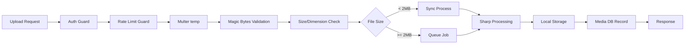
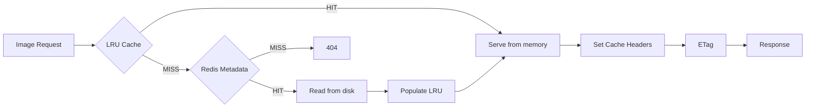

<!-- @SECTION:ARCHITECTURE -->
# Image Upload System - Technical Design

## System Architecture

### Upload Data Flow


### Serving Data Flow

<!-- @END:ARCHITECTURE -->

<!-- @SECTION:DATABASE -->
## Database Schema

### Media Model
```prisma
enum MediaStatus {
  PROCESSING
  READY
  FAILED
}

enum MediaType {
  AVATAR
  COVER
  POST_IMAGE
  BLOG_IMAGE
  AD_IMAGE
}

model Media {
  id            String      @id @default(uuid())
  userId        String?
  user          User?       @relation(fields: [userId], references: [id], onDelete: SetNull)
  // Note: Implement soft-delete flag on User model or archival process before hard user deletion
  // to preserve media ownership history. SetNull allows media to persist as orphaned records.

  filename      String      // Generated filename (hash-based)
  originalName  String      // Original upload filename
  mimeType      String      // Original MIME type
  size          Int         // File size in bytes (processed)
  originalSize  Int         // Original file size before compression
  width         Int?        // Image width
  height        Int?        // Image height
  hash          String      // SHA-256 content hash (unique per user, not globally)
  path          String      // Relative path on disk

  // Original file preservation fields
  originalPath      String?     // Path to original file with _original.{ext} suffix
  originalUrl       String?     // Public URL to original file
  originalMimeType  String?     // Original MIME type before conversion

  type          MediaType   @default(POST_IMAGE)
  status        MediaStatus @default(PROCESSING)
  variants      Json?       // { thumb: "path", medium: "path", large: "path", original: "path" }

  compressionRatio Float?   // processedSize / originalSize (value < 1 = good compression, e.g., 0.3 = 70% reduction)
  // Security: reject when compressionRatio > 100 (decompression bomb indicator)

  errorMessage  String?     // Stores failure reason for FAILED status

  createdAt     DateTime    @default(now())
  updatedAt     DateTime    @updatedAt

  @@unique([userId, hash]) // Per-user uniqueness (same user can't upload identical file twice)
  @@index([userId])
  @@index([hash])
  @@index([status])
  @@index([type])
}
```

### User Model Addition
```prisma
model User {
  // ... existing fields
  media         Media[]
}
```
<!-- @END:DATABASE -->

<!-- @SECTION:COMPONENTS -->
## Components

| Component | Responsibility | Location |
|-----------|---------------|----------|
| IStorageAdapter | Storage abstraction interface | `src/modules/upload/interfaces/storage.interface.ts` |
| LocalStorageAdapter | Local filesystem storage with hash sharding | `src/modules/upload/adapters/local-storage.adapter.ts` |
| ImageProcessorService | Sharp-based image processing | `src/modules/upload/services/image-processor.service.ts` |
| ImageCacheService | Two-tier LRU + Redis caching | `src/modules/upload/services/image-cache.service.ts` |
| UploadQuotaService | Rate limiting and quota management | `src/modules/upload/services/upload-quota.service.ts` |
| UploadRateLimitGuard | NestJS guard for upload limits | `src/modules/upload/guards/upload-rate-limit.guard.ts` |
| MagicBytesValidator | File type validation by magic bytes | `src/modules/upload/validators/file-type.validator.ts` |
| ImageProcessingProcessor | Bull queue processor | `src/modules/upload/processors/image-processing.processor.ts` |
| ImageServeController | Public image serving endpoint | `src/modules/upload/controllers/image-serve.controller.ts` |
| MediaRepository | Database operations for Media (includes deleteMediaBySystem) | `src/modules/upload/repositories/media.repository.ts` |
<!-- @END:COMPONENTS -->

<!-- @SECTION:INTERFACES -->
## Interface Definitions

### IStorageAdapter
```typescript
interface IStorageAdapter {
  save(filename: string, buffer: Buffer): Promise<string>; // returns path
  delete(path: string): Promise<void>;
  exists(path: string): Promise<boolean>;
  getFullPath(relativePath: string): string;
  getBuffer(path: string): Promise<Buffer>;
}
```

### ImageProcessorService Methods
- `processImage(buffer, options)`: Compress to WebP, strip EXIF, auto-rotate
- `generateVariants(buffer, sizes)`: Generate thumb/medium/large variants (skips variant if original is smaller than target size)
- `validateImage(buffer)`: Check magic bytes, dimensions, compression ratio
- `getMetadata(buffer)`: Extract width, height, format info
- `convertToJpeg(buffer)`: Convert image buffer to JPEG format for fallback serving

### ImageCacheService Methods
- `get(mediaId, variant)`: Check LRU → Redis → Disk
- `set(mediaId, variant, buffer)`: Store in LRU + Redis metadata
- `invalidate(mediaId)`: Remove from LRU + Redis

### UploadQuotaService Methods
- `checkRateLimit(userId)`: Returns boolean (fail-open on Redis failure)
- `checkDailyQuota(userId, fileSize)`: Returns boolean (fail-open on Redis failure)
- `incrementUsage(userId, fileSize)`: Update counters
<!-- @END:INTERFACES -->

<!-- @SECTION:CONFIGURATION -->
## Configuration

```typescript
// configuration.ts additions
upload: {
  storagePath: process.env.UPLOAD_STORAGE_PATH || './uploads',
  maxFileSize: (() => {
    const parsed = parseInt(process.env.UPLOAD_MAX_FILE_SIZE, 10);
    return Number.isNaN(parsed) ? 10 * 1024 * 1024 : parsed; // 10MB default
  })(),
  dailyQuota: (() => {
    const parsed = parseInt(process.env.UPLOAD_DAILY_QUOTA, 10);
    return Number.isNaN(parsed) ? 50 * 1024 * 1024 : parsed; // 50MB default
  })(),
  rateLimitPerHour: (() => {
    const parsed = parseInt(process.env.UPLOAD_RATE_LIMIT_PER_HOUR, 10);
    return Number.isNaN(parsed) ? 10 : parsed;
  })(),
  webpQuality: (() => {
    const parsed = parseInt(process.env.UPLOAD_WEBP_QUALITY, 10);
    return Number.isNaN(parsed) ? 80 : parsed;
  })(),
  maxDimension: 4096,
  maxFilesPerRequest: 5,
  variants: {
    thumb: { width: 150, height: 150, fit: 'cover' },
    medium: { width: 600, height: 600, fit: 'inside' },
    large: { width: 1200, height: 1200, fit: 'inside' },
  },
  // MediaType-to-variant mapping (skip upscaling if original is smaller)
  variantsByMediaType: {
    AVATAR: ['avatar', 'thumb'],           // Avatar → avatar size + thumb
    COVER: ['cover', 'medium'],            // Cover → cover size + medium
    POST_IMAGE: ['thumb', 'medium', 'large'], // Image → all standard variants
    BLOG_IMAGE: ['thumb', 'medium', 'large'],
    AD_IMAGE: ['thumb', 'medium', 'large'],
    VIDEO: ['video_thumbnail'],            // Video → thumbnail only (thumb size)
  },
  avatar: { width: 300, height: 300, fit: 'cover' },
  cover: { width: 1200, height: 400, fit: 'cover' },
  cache: {
    lruMaxSize: 100 * 1024 * 1024, // 100MB
    lruTtl: 60 * 60 * 1000, // 1 hour
    httpMaxAge: 31536000, // 1 year (only for content-addressed URLs)
    httpMaxAgeDefault: 3600, // 1 hour (for non-versioned URLs)
  }
},
redis: {
  // Queue Redis (for Bull)
  queue: {
    url: process.env.REDIS_QUEUE_URL, // or use host/port below
    host: process.env.REDIS_QUEUE_HOST || 'localhost',
    port: parseInt(process.env.REDIS_QUEUE_PORT, 10) || 6379,
    password: process.env.REDIS_QUEUE_PASSWORD,
    db: parseInt(process.env.REDIS_QUEUE_DB, 10) || 0,
    maxRetriesPerRequest: 3,
    retryStrategy: (times: number) => Math.min(times * 100, 3000), // exponential backoff, max 3s
    connectTimeout: 10000, // 10s
  },
  // Cache Redis (for metadata cache)
  cache: {
    url: process.env.REDIS_CACHE_URL,
    host: process.env.REDIS_CACHE_HOST || 'localhost',
    port: parseInt(process.env.REDIS_CACHE_PORT, 10) || 6379,
    password: process.env.REDIS_CACHE_PASSWORD,
    db: parseInt(process.env.REDIS_CACHE_DB, 10) || 1, // Different DB index
    maxConnections: 10,
    connectTimeout: 5000,
    idleTimeout: 30000,
    maxRetriesPerRequest: 2,
  }
}
```

### Environment Variables
```
UPLOAD_STORAGE_PATH=./uploads
UPLOAD_MAX_FILE_SIZE=10485760
UPLOAD_DAILY_QUOTA=52428800
UPLOAD_RATE_LIMIT_PER_HOUR=10
UPLOAD_WEBP_QUALITY=80
```
<!-- @END:CONFIGURATION -->

<!-- @SECTION:API_ENDPOINTS -->
## API Endpoints

| Method | Path | Auth | Description |
|--------|------|------|-------------|
| POST | /api/upload/image | Required | Upload single image |
| POST | /api/upload/images | Required | Upload multiple images (max 5) |
| POST | /api/upload/avatar | Required | Upload avatar (300x300 crop) |
| POST | /api/upload/cover | Required | Upload cover photo (1200x400 crop) |
| GET | /api/upload/status/:mediaId | Required | Check async upload status |
| GET | /api/images/:id | Public | Serve image (default: large variant) |
| GET | /api/images/:id/:variant | Public | Serve specific variant |
| DELETE | /api/upload/:mediaId | Required | Delete uploaded image |
<!-- @END:API_ENDPOINTS -->

<!-- @SECTION:ERROR_HANDLING -->
## Error Handling

| Error | HTTP Code | Message (Vietnamese) |
|-------|-----------|---------|
| Invalid file type | 400 | "Loại tệp không được phép. Hỗ trợ: jpg, png, gif, webp" |
| File too large | 413 | "Kích thước tệp vượt quá giới hạn 10MB" |
| Dimensions too large | 400 | "Kích thước ảnh vượt quá giới hạn 4096x4096" |
| Rate limit exceeded | 429 | "Vượt quá giới hạn tải lên. Thử lại sau X phút" |
| Daily quota exceeded | 429 | "Vượt quá hạn ngạch tải lên hàng ngày (50MB). Thử lại vào ngày mai" |
| Processing failed | 500 | "Xử lý ảnh thất bại. Vui lòng thử lại" |
| Image not found | 404 | "Không tìm thấy ảnh" |

**Note**: All user-facing error messages are in Vietnamese for consistency with the project.

### Failure Recovery and Cleanup

**On Processing Failure**:
- Set `Media.status = FAILED` (do NOT auto-delete DB record)
- Record error details in `Media.errorMessage` field (add to schema if needed)
- Set `Media.retryable = true` for transient failures (timeout, memory), `false` for permanent (invalid format)
- Delete partial/temporary files immediately
- Set canonical file path references to `null` (variants JSON cleared)

**Retry Path**:
- Provide `POST /api/upload/retry/:mediaId` endpoint for user-initiated retry
- Only allow retry if `Media.retryable = true` and `Media.status = FAILED`
- Re-queue job with original file (if preserved) or require re-upload

**Garbage Collection**:
- Schedule background `GarbageCollectorJob` to run daily
- Remove `FAILED` Media records older than configurable TTL (default: 7 days)
- Clean up orphaned files on disk with no DB reference
- Clean up stuck `PROCESSING` media older than 1 hour (prevents orphaned processing states)
- Log all cleanup actions for audit

**User-Visible Behavior**:
- Show `FAILED` status in upload history with "Retry" button (if retryable)
- Display user-friendly error message from `Media.errorMessage`
- Allow user to delete failed uploads manually

**Audit Logging**:
- Log entry on processing failure: `{ mediaId, userId, error, timestamp }`
- Log entry on cleanup: `{ mediaId, action: 'garbage_collected', timestamp }`
- Log entry on retry: `{ mediaId, userId, action: 'retry_initiated', timestamp }`
<!-- @END:ERROR_HANDLING -->

<!-- @SECTION:SECURITY -->
## Security Measures

1. **Magic bytes validation** - Validate file content, not just extension
2. **Dimension limit** - 4096x4096 max to prevent memory exhaustion
3. **Compression ratio check** - Calculate as `processedSize / originalSize`; reject if ratio > 100 (decompression bomb indicator where decompressed size is 100x+ larger than compressed). Value < 1 indicates good compression (e.g., 0.3 = 70% reduction).
4. **Per-user rate limiting** - 10 uploads/hour via Redis (fail-open on Redis failure)
5. **Per-user daily quota** - 50MB/day via Redis (fail-open on Redis failure)
6. **EXIF stripping** - Remove metadata for privacy
7. **Hash-based filenames** - No user-controlled paths
8. **No directory traversal** - Hash-based paths prevent path injection
<!-- @END:SECURITY -->

<!-- @SECTION:CACHE_STRATEGY -->
## Cache Strategy

### LRU In-Memory Cache
- Max size: 100MB
- TTL: 1 hour
- Key format: `img:{mediaId}:{variant}:{format}` (format-aware for content negotiation)
- updateAgeOnGet: true

### Redis Metadata Cache
- Stores file paths and variant info
- Key format: `image:meta:{mediaId}`
- TTL: 24 hours

### HTTP Cache Headers
```
# For content-addressed URLs (contains hash/version token in path):
Cache-Control: public, max-age=31536000, immutable
ETag: "{sha256-full-content-hash}"
Content-Type: image/webp (or image/jpeg based on Accept header)
Vary: Accept
X-Cache-Key: "img:{mediaId}:{variant}:{format}" (debug header)

# For non-versioned URLs (no hash in path):
Cache-Control: public, max-age=3600
ETag: "{sha256-full-content-hash}"
Content-Type: image/webp (or image/jpeg based on Accept header)
Vary: Accept
X-Cache-Key: "img:{mediaId}:{variant}:{format}" (debug header)
```

**Cache Strategy Notes**:
- Use `immutable` ONLY when URL contains content hash or version token (e.g., `/images/abc123_v2.webp`)
- For URLs without version info, use shorter `max-age=3600` to allow cache invalidation
- ETag should be full SHA-256 content hash for accurate conditional request validation
- **Content Negotiation**: Accept header parsed to determine format (WebP primary, JPEG fallback)
- **Vary: Accept header** set to ensure proper cache behavior across different client capabilities
- **Format-aware cache keys**: Include format in cache key (`{id}:{variant}:{format}`) to prevent serving wrong format
- **JPEG fallback**: Serve original file if available, otherwise convert WebP to JPEG on-the-fly via `convertToJpeg()` method

### Conditional Requests
- Support If-None-Match header
- Return 304 Not Modified when ETag matches
<!-- @END:CACHE_STRATEGY -->

<!-- @SECTION:QUEUE_CONFIG -->
## Queue Configuration

### Bull Queue: image-processing
- Concurrency: 2 jobs at a time
- Retry: 3 attempts with exponential backoff
- Job data: `{ mediaId, tempFilePath, options }`
- Job timeout: 60 seconds

### Job Producer
- Write uploaded buffer to temporary file on disk (e.g., `uploads/temp/{uuid}.tmp`)
- Enqueue job with `{ mediaId, tempFilePath, options }`
- Do NOT pass base64 buffer in job payload (memory/Redis size concerns)

### Job Processing Flow (Consumer)
1. Read buffer from tempFilePath
2. Validate image (dimensions, compression ratio)
3. Compress to WebP
4. Generate variants
5. Save to storage
6. Delete temp file (success path)
7. Update Media status to READY or FAILED
8. On failure: delete temp file immediately before retry/fail
<!-- @END:QUEUE_CONFIG -->

<!-- @SECTION:STORAGE_STRUCTURE -->
## Storage Structure

### Hash-Based Sharding
```
uploads/
├── a1/
│   ├── b2/
│   │   ├── a1b2c3d4e5f6.webp
│   │   ├── a1b2c3d4e5f6_thumb.webp
│   │   ├── a1b2c3d4e5f6_medium.webp
│   │   ├── a1b2c3d4e5f6_large.webp
│   │   └── a1b2c3d4e5f6_original.webp
```

Path format: `{storagePath}/{hash[0:2]}/{hash[2:4]}/{filename}_{variant}.webp`
<!-- @END:STORAGE_STRUCTURE -->

<!-- @SECTION:DEPENDENCIES -->
## Dependencies

| Package | Version | Purpose |
|---------|---------|---------|
| sharp | ^0.33.1 | Image processing, WebP conversion |
| file-type | ^19.0.0 | Magic bytes detection |
| lru-cache | ^10.0.0 | In-memory LRU cache |
| @nestjs/bull | existing | Queue management |
| multer | existing | File upload handling |
<!-- @END:DEPENDENCIES -->

