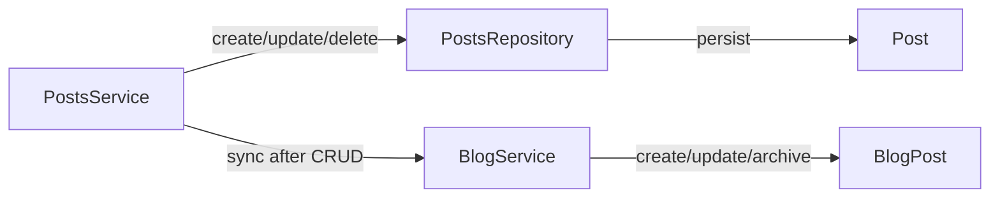
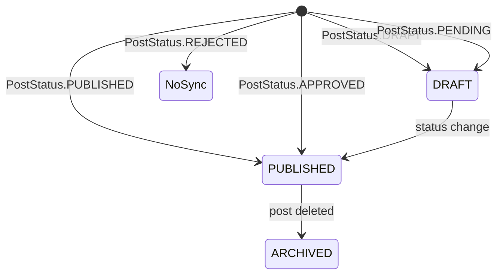
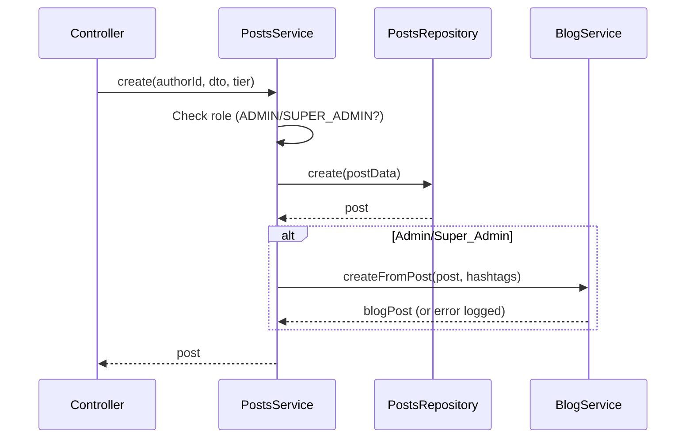
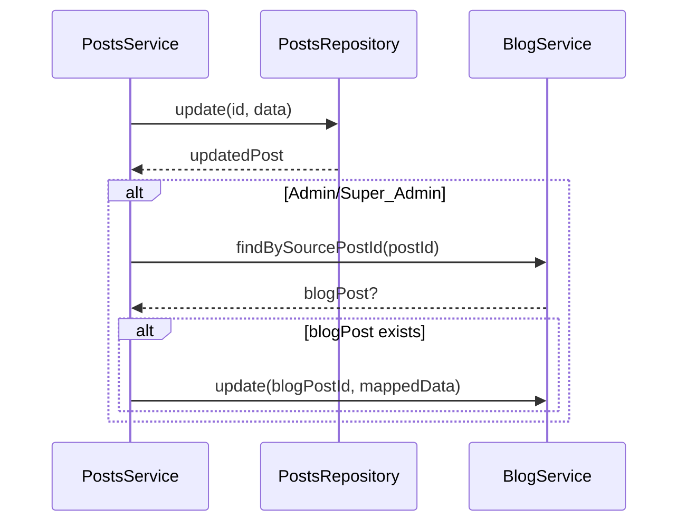

<!-- @SECTION:ARCHITECTURE -->
# Post-to-Blog Sync - Technical Design

## Architecture Decision: Direct Service Injection

PostsModule imports BlogModule, PostsService injects BlogService. Sync logic in private methods called after Post CRUD operations. One-way sync only (Post → Blog), no reverse sync.


<!-- @END:ARCHITECTURE -->

<!-- @SECTION:COMPONENTS -->
## Components

| Component | Responsibility | Location |
|-----------|---------------|----------|
| PostsService | Orchestrate Post CRUD + trigger sync | `Backend/src/modules/posts/services/posts.service.ts` |
| BlogService | Handle BlogPost CRUD | `Backend/src/modules/blog/services/blog.service.ts` |
| PostsModule | Import BlogModule for DI | `Backend/src/modules/posts/posts.module.ts` |
| BlogModule | Export BlogService | `Backend/src/modules/blog/blog.module.ts` |
<!-- @END:COMPONENTS -->

<!-- @SECTION:DATA_MODELS -->
## Data Model Changes

### BlogPost Schema Addition

Add to `Backend/prisma/schema.prisma` (lines 658-688):

```prisma
model BlogPost {
  // ... existing fields ...
  sourcePostId    String?        @unique  // NEW: Link to source Post
  sourcePost      Post?          @relation(fields: [sourcePostId], references: [id], onDelete: SetNull)
}
```

### Default Category Migration

Create `Backend/prisma/migrations/[timestamp]_add_blog_post_source/migration.sql`:

```sql
-- Add sourcePostId column
ALTER TABLE `blog_post` ADD COLUMN `sourcePostId` VARCHAR(191) NULL;
ALTER TABLE `blog_post` ADD CONSTRAINT `BlogPost_sourcePostId_key` UNIQUE (`sourcePostId`);
ALTER TABLE `blog_post` ADD CONSTRAINT `BlogPost_sourcePostId_fkey` 
  FOREIGN KEY (`sourcePostId`) REFERENCES `post`(`id`) ON DELETE SET NULL ON UPDATE CASCADE;

-- Create default category for synced posts
INSERT INTO `blog_category` (`id`, `name`, `slug`, `description`, `displayOrder`, `postCount`, `createdAt`, `updatedAt`)
VALUES (UUID(), 'Bài viết cộng đồng', 'bai-viet-cong-dong', 'Bài viết từ cộng đồng admin', 0, 0, NOW(), NOW())
ON DUPLICATE KEY UPDATE `name` = `name`;
```
<!-- @END:DATA_MODELS -->

<!-- @SECTION:FIELD_MAPPING -->
## Field Mapping

| Post Field | BlogPost Field | Mapping Strategy |
|------------|----------------|------------------|
| `content` | `title` | First line or first 100 chars, stripped of hashtags |
| `content` | `content` | Direct copy |
| `content` | `excerpt` | First 300 chars, stripped of HTML/markdown |
| `content` | `metaTitle` | Auto-generated from title, truncated to 70 chars |
| `content` | `metaDescription` | Auto-generated from excerpt, truncated to 160 chars |
| `images[0]` | `featuredImage` | First image URL from JSON array |
| `hashtags` | `tags` | Convert PostHashtag relations to JSON string array |
| `authorId` | `authorId` | Direct copy |
| `status` | `status` | See status mapping below |
| `publishAt` | `publishedAt` | Direct copy |
| - | `slug` | Regenerate globally unique from title |
| - | `readingTime` | Calculate: `Math.ceil(wordCount / 200)` |
| - | `categoryId` | Default "Bài viết cộng đồng" category ID |
| - | `sourcePostId` | Original Post.id |
| - | `postType` | Hardcoded to ARTICLE for all synced posts |
<!-- @END:FIELD_MAPPING -->

<!-- @SECTION:STATUS_MAPPING -->
## Status Mapping



| PostStatus | BlogPostStatus | Action |
|------------|----------------|--------|
| DRAFT | DRAFT | Create/Update |
| PENDING | DRAFT | Create/Update |
| PUBLISHED | PUBLISHED | Create/Update |
| APPROVED | PUBLISHED | Create/Update |
| REJECTED | - | Don't create / Archive existing |
<!-- @END:STATUS_MAPPING -->

<!-- @SECTION:CATEGORY_MANAGEMENT -->
## Category Management

When syncing Posts to BlogPosts, the system manages category post counts:

- **On BlogPost creation**: Category `postCount` is incremented by 1
- **On BlogPost archival**: Category `postCount` is decremented by 1

This ensures the "Bài viết cộng đồng" category accurately reflects the number of active synced blog posts.
<!-- @END:CATEGORY_MANAGEMENT -->

<!-- @SECTION:PUBLISHED_AT_HANDLING -->
## publishedAt Handling

When a BlogPost status changes to PUBLISHED:
- If `publishedAt` is not already set, it is set to the current timestamp
- If `publishedAt` is already set, it remains unchanged (preserves original publish date)

This ensures published blog posts have a proper publication timestamp for SEO and sorting purposes.
<!-- @END:PUBLISHED_AT_HANDLING -->

<!-- @SECTION:KEY_FLOWS -->
## Key Flows

### Create Flow



### Update Flow


<!-- @END:KEY_FLOWS -->

<!-- @SECTION:ERROR_HANDLING -->
## Error Handling

| Error Case | Response |
|------------|----------|
| BlogService.create fails | Log error, return Post (sync fails silently) |
| BlogService.update fails | Log error, return Post (sync fails silently) |
| Category not found | Log error, skip sync |
| Duplicate slug | Generate unique slug with suffix |

**Key Principle**: Post operation NEVER fails due to sync error. Sync errors are logged with `Logger.error()`.
<!-- @END:ERROR_HANDLING -->

<!-- @SECTION:TRANSACTION_BOUNDARIES -->
## Transaction Boundaries

- Post CRUD and Blog sync are NOT in same transaction
- Post operation completes first, then sync attempts
- If sync fails, post still succeeds
- No automatic retry; admin can manually edit blog post if needed
<!-- @END:TRANSACTION_BOUNDARIES -->

<!-- @SECTION:FILES_TO_MODIFY -->
## Files to Modify

1. `Backend/prisma/schema.prisma` - Add sourcePostId to BlogPost, add relation to Post
2. `Backend/prisma/migrations/[timestamp]_add_blog_post_source/migration.sql` - Migration for sourcePostId + default category
3. `Backend/src/modules/posts/posts.module.ts` - Import BlogModule
4. `Backend/src/modules/posts/services/posts.service.ts` - Add sync logic in create/update/delete methods
5. `Backend/src/modules/blog/services/blog.service.ts` - Add `findBySourcePostId()`, `createFromPost()`, `updateFromPost()`, `archiveBySourcePostId()` methods
6. `Backend/src/modules/blog/blog.module.ts` - Already exports BlogService (verified)
<!-- @END:FILES_TO_MODIFY -->

<!-- @SECTION:IMPLEMENTATION_NOTES -->
## Implementation Notes

### Role Check Pattern

```typescript
// In PostsService methods, check user role before sync
private shouldSyncToBlog(userRole: Role): boolean {
  return userRole === Role.ADMIN || userRole === Role.SUPER_ADMIN;
}
```

### Title Extraction

```typescript
private extractTitleFromContent(content: string): string {
  // Remove hashtags, get first line or first 100 chars
  const cleaned = content.replace(/#[\w\u00C0-\u024F]+/g, '').trim();
  const firstLine = cleaned.split('\n')[0];
  return firstLine.length > 100 ? firstLine.substring(0, 100) : firstLine;
}
```

### Excerpt Extraction

```typescript
private extractExcerpt(content: string): string {
  // Strip HTML/markdown, get first 300 chars
  const stripped = content.replace(/<[^>]*>/g, '').replace(/[#*_~`]/g, '');
  return stripped.substring(0, 300);
}
```

### Implementation Summary

**Status**: Completed
**Date**: 2026-02-11

**Key Implementation Details**:
- Direct service injection pattern used as designed (PostsModule imports BlogModule)
- Race condition in `getOrCreateDefaultCategory` fixed with upsert pattern for thread-safety
- Delete method updated to pass `Role` enum instead of boolean `isAdmin` for better type safety
- All field mappings implemented as specified in design.md
- Error handling ensures Post operations never fail due to sync errors
- Race condition guard added in createFromPost (checks existing before creating)
- Delete sync passes full post object for proper archival
- Error logs include action type for debugging

**Files Modified**: See requirements.md Implementation Notes section for complete list
<!-- @END:IMPLEMENTATION_NOTES -->

