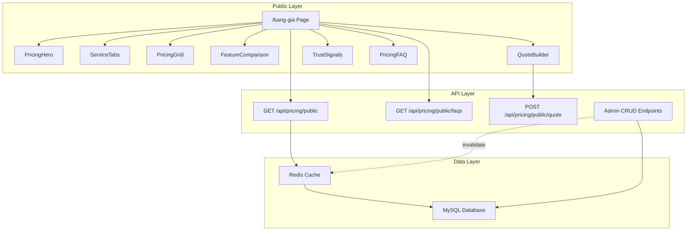
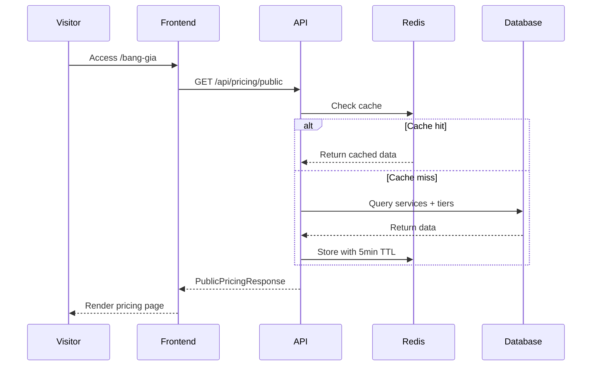
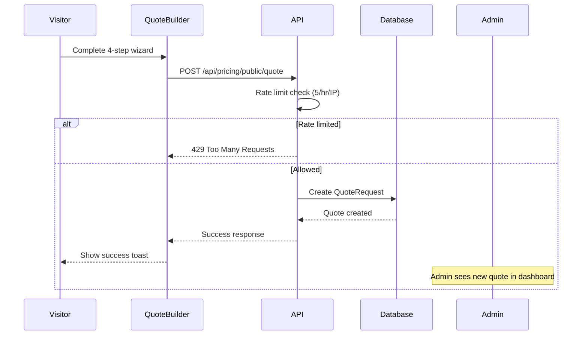
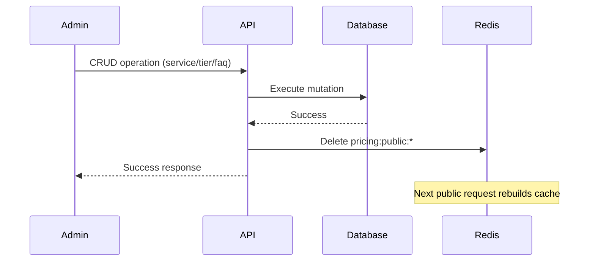
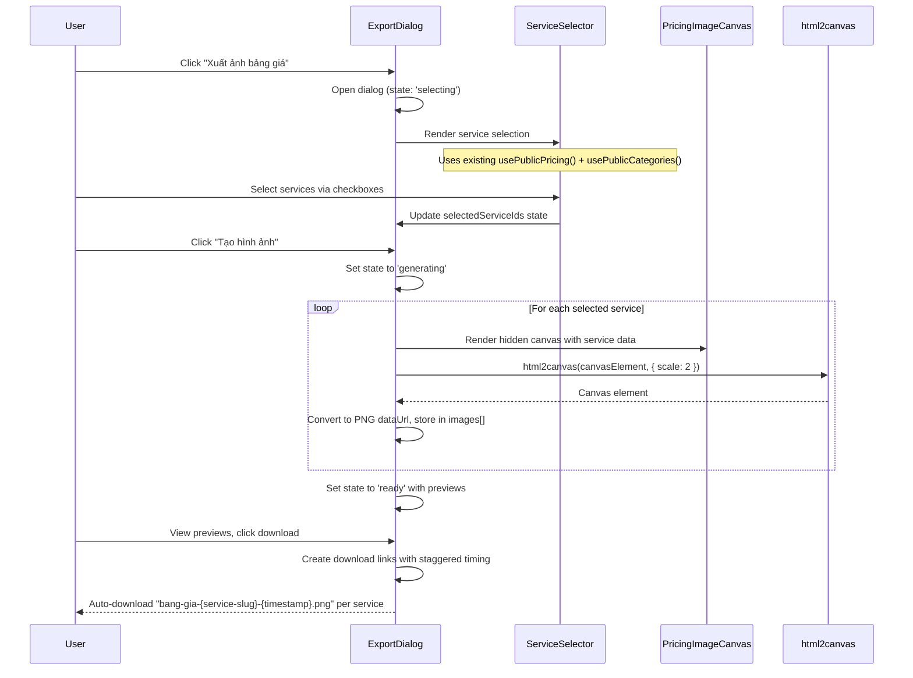

<!-- @SECTION:ARCHITECTURE -->
# Pricing Page - Technical Design

## Architecture Overview

The pricing page feature consists of three layers:
1. **Public Layer**: Next.js page at /bang-gia with pricing display, comparison table, quote builder
2. **API Layer**: NestJS endpoints for public data (cached) and admin CRUD operations
3. **Data Layer**: Prisma models for Service, PricingTier, PricingFAQ, QuoteRequest

Follow existing patterns in `Frontend/src/features/` and `Backend/src/modules/`.


<!-- @END:ARCHITECTURE -->

<!-- @SECTION:COMPONENTS -->
## Components

| Component | Responsibility | Location |
|-----------|---------------|----------|
| PricingPage | Main page container | `Frontend/src/app/(public)/bang-gia/page.tsx` |
| PricingHero | Hero section with headline | `Frontend/src/features/pricing/components/PricingHero.tsx` |
| ServiceTabs | Service category tabs with dynamic icon mapping | `Frontend/src/features/pricing/components/ServiceTabs.tsx` |
| PricingGrid | Grid of pricing cards | `Frontend/src/features/pricing/components/PricingGrid.tsx` |
| PricingCard | Individual tier card with feature exclusion syntax support | `Frontend/src/features/pricing/components/PricingCard.tsx` |
| FeatureComparison | Always-visible comparison table (no toggle) | `Frontend/src/features/pricing/components/FeatureComparison.tsx` |
| QuoteBuilder | 4-step wizard | `Frontend/src/features/pricing/components/QuoteBuilder/` |
| Step3Tier | Tier selection step with always-visible FeatureComparison | `Frontend/src/features/pricing/components/wizard/Step3Tier.tsx` |
| TrustSignals | Stats and testimonials | `Frontend/src/features/pricing/components/TrustSignals.tsx` |
| PricingFAQ | FAQ accordion | `Frontend/src/features/pricing/components/PricingFAQ.tsx` |
| PricingService | Backend service | `Backend/src/modules/pricing/services/pricing.service.ts` |
| PricingController | API endpoints | `Backend/src/modules/pricing/controllers/pricing.controller.ts` |
| PricingImageExportDialog | Export dialog with service selection | `Frontend/src/features/pricing/components/export/PricingImageExportDialog.tsx` |
| PricingImageCanvas | Hidden render target for PNG generation | `Frontend/src/features/pricing/components/export/PricingImageCanvas.tsx` |
| ServiceSelector | Accordion + Checkbox service selection | `Frontend/src/features/pricing/components/export/ServiceSelector.tsx` |

### Component Behavior Notes

**Feature Exclusion Syntax**: PricingCard and FeatureComparison components support a "!" prefix syntax for features. When a feature string starts with "!", it displays with an X mark instead of a checkmark, indicating the feature is NOT included in that tier.
- Example: `"!Advanced Analytics"` → Displays as "❌ Advanced Analytics"
- Implementation: `Frontend/src/features/pricing/components/PricingCard.tsx:72-73`

**Dynamic Icon Mapping**: ServiceTabs uses a centralized ICON_MAP constant to dynamically map Lucide icon names to React components, enabling flexible icon selection without code changes.
- Icon names stored in Service.icon field (e.g., "globe", "message-square", "smartphone", "wrench")
- Mapping location: `Frontend/src/features/pricing/constants/icons.ts`
<!-- @END:COMPONENTS -->

<!-- @SECTION:DATA_MODELS -->
## Data Models

### Prisma Schema

Add to `Backend/prisma/schema.prisma`:

```prisma
model Service {
  id           String        @id @default(uuid())
  name         String        // "Website", "Zalo Mini App", etc.
  slug         String        @unique
  description  String?       @db.Text
  icon         String?       // Lucide icon name (e.g., "globe", "message-square", "smartphone", "wrench")
  isActive     Boolean       @default(true)
  displayOrder Int           @default(0)
  createdAt    DateTime      @default(now())
  updatedAt    DateTime      @updatedAt
  pricingTiers PricingTier[]
  categoryId   String?
  category     ServiceCategory? @relation(fields: [categoryId], references: [id])

  @@map("service")
  @@index([isActive, displayOrder])
}

model PricingTier {
  id            String   @id @default(uuid())
  serviceId     String
  name          String   // "Basic", "Standard", "Premium", "Enterprise"
  description   String?  @db.Text
  price         Decimal  @db.Decimal(15, 0) // VND, no decimals
  priceNote     String?  // "từ", "liên hệ", etc.
  currency      String   @default("VND")
  billingType   String   @default("one-time") // "one-time", "monthly", "yearly"
  features      String   @db.LongText // JSON array of feature strings (supports "!" prefix for exclusions)
  isPopular     Boolean  @default(false)
  isRecommended Boolean  @default(false)
  displayOrder  Int      @default(0)
  ctaText       String   @default("Liên hệ tư vấn")
  ctaLink       String?
  isActive      Boolean  @default(true)
  createdAt     DateTime @default(now())
  updatedAt     DateTime @updatedAt
  service       Service  @relation(fields: [serviceId], references: [id], onDelete: Cascade)

  @@map("pricing_tier")
  @@index([serviceId, isActive, displayOrder])
}

model PricingFAQ {
  id           String   @id @default(uuid())
  question     String
  answer       String   @db.Text
  category     String?
  displayOrder Int      @default(0)
  isActive     Boolean  @default(true)
  createdAt    DateTime @default(now())
  updatedAt    DateTime @updatedAt

  @@map("pricing_faq")
  @@index([isActive, displayOrder])
}

model QuoteRequest {
  id           String      @id @default(uuid())
  name         String
  email        String
  phone        String?
  company      String?
  serviceId    String?
  tierId       String?
  budget       String?
  timeline     String?
  requirements String?     @db.Text
  source       String?     // Optional analytics field (e.g., "pricing-page-wizard", "direct-form")
  status       QuoteStatus @default(PENDING)
  notes        String?     @db.Text
  createdAt    DateTime    @default(now())
  updatedAt    DateTime    @updatedAt

  @@map("quote_request")
  @@index([status, createdAt])
  @@index([email])
}

enum QuoteStatus {
  PENDING      // Initial status when quote is submitted
  CONTACTED    // Admin has reached out to customer
  QUOTED       // Formal quote has been sent
  NEGOTIATING  // In negotiation phase
  ACCEPTED     // Customer accepted the quote
  REJECTED     // Customer rejected the quote
  CANCELLED    // Quote was cancelled (neither accepted nor rejected)

  @@map("quote_status")
}

model ServiceCategory {
  id           String    @id @default(uuid())
  name         String    // "Website", "Mobile Apps", "Custom Tools"
  slug         String    @unique
  description  String?   @db.Text
  displayOrder Int       @default(0)
  isActive     Boolean   @default(true)
  createdAt    DateTime  @default(now())
  updatedAt    DateTime  @updatedAt
  services     Service[]

  @@map("service_category")
  @@index([isActive, displayOrder])
}
```

### Data Model Notes

**QuoteStatus.CANCELLED**: The 7th status allows admins to mark quotes as cancelled without implying rejection. This is useful for quotes that were withdrawn by the customer or became irrelevant due to external factors.

**QuoteRequest.source**: Optional field for tracking where the quote originated (e.g., "pricing-page-wizard", "direct-form", "chatbot"). Enables analytics on conversion channels without requiring user input.

**PricingTier.features**: JSON array supports "!" prefix syntax for excluded features. Example: `["Feature A", "Feature B", "!Advanced Analytics"]` where the last item displays with an X mark.

**Service.icon**: Stores Lucide icon name as string. Frontend dynamically maps these to React components via ICON_MAP constant.

**ServiceCategory**: Groups services for better organization in wizard UI and image export dialog. Services can optionally belong to a category.
<!-- @END:DATA_MODELS -->

<!-- @SECTION:API_CONTRACTS -->
## API Contracts

### Public Endpoints

```typescript
// GET /api/pricing/public
interface PublicPricingResponse {
  services: Array<{
    id: string;
    name: string;
    slug: string;
    description: string | null;
    icon: string | null;
    tiers: Array<{
      id: string;
      name: string;
      description: string | null;
      price: string; // Decimal as string
      priceNote: string | null;
      currency: string;
      billingType: string;
      features: string[]; // Parsed JSON
      isPopular: boolean;
      isRecommended: boolean;
      ctaText: string;
      ctaLink: string | null;
    }>;
  }>;
}

// GET /api/pricing/public/faqs
interface PublicFAQsResponse {
  faqs: Array<{
    id: string;
    question: string;
    answer: string;
    category: string | null;
  }>;
}

// POST /api/pricing/public/quote
interface CreateQuoteInput {
  name: string;           // Required
  email: string;          // Required, valid email
  phone?: string;
  company?: string;
  serviceId?: string;
  tierId?: string;
  budget?: string;
  timeline?: string;
  requirements?: string;
  source?: string;        // Optional analytics field (e.g., "pricing-page-wizard", "direct-form")
}

interface CreateQuoteResponse {
  success: boolean;
  message: string;
  quoteId?: string;
}
```

### Admin Endpoints

| Method | Endpoint | Description |
|--------|----------|-------------|
| GET | /api/pricing/services | List with pagination |
| POST | /api/pricing/services | Create service |
| GET | /api/pricing/services/:id | Get by ID |
| PUT | /api/pricing/services/:id | Update service |
| DELETE | /api/pricing/services/:id | Delete service |
| PATCH | /api/pricing/services/:id/toggle | Toggle active |
| PATCH | /api/pricing/services/reorder | Reorder services |
| GET | /api/pricing/tiers | List with service filter |
| POST | /api/pricing/tiers | Create tier |
| PUT | /api/pricing/tiers/:id | Update tier |
| DELETE | /api/pricing/tiers/:id | Delete tier |
| GET | /api/pricing/faqs | List all FAQs |
| POST | /api/pricing/faqs | Create FAQ |
| PUT | /api/pricing/faqs/:id | Update FAQ |
| DELETE | /api/pricing/faqs/:id | Delete FAQ |
| PATCH | /api/pricing/faqs/reorder | Reorder FAQs |
| GET | /api/pricing/quotes | List with filters |
| GET | /api/pricing/quotes/:id | Get details |
| PATCH | /api/pricing/quotes/:id/status | Update status |
| PATCH | /api/pricing/quotes/:id/notes | Update notes |
| DELETE | /api/pricing/quotes/:id | Delete quote |
| GET | /api/pricing/quotes/export | Export CSV |

<!-- @END:API_CONTRACTS -->

<!-- @SECTION:KEY_FLOWS -->
## Key Flows

### Public Pricing Data Flow



### Quote Submission Flow



### Admin Cache Invalidation Flow


<!-- @END:KEY_FLOWS -->

<!-- @SECTION:CACHE_STRATEGY -->
## Cache Strategy

```typescript
// Cache Keys
const PRICING_CACHE_KEYS = {
  PUBLIC_SERVICES: 'pricing:public:services',
  PUBLIC_FAQS: 'pricing:public:faqs',
};

// TTL: 5 minutes
const PRICING_CACHE_TTL = 5 * 60;

// Invalidation: On any service/tier/faq mutation
async function invalidatePricingCache(redis: Redis) {
  await redis.del(PRICING_CACHE_KEYS.PUBLIC_SERVICES);
  await redis.del(PRICING_CACHE_KEYS.PUBLIC_FAQS);
}
```

Follow existing cache patterns in `Backend/src/common/services/cache.service.ts`.
<!-- @END:CACHE_STRATEGY -->

<!-- @SECTION:SEO_SCHEMA -->
## SEO Schema (JSON-LD)

```json
{
  "@context": "https://schema.org",
  "@type": "WebPage",
  "name": "Bảng giá dịch vụ thiết kế website - ChungToiXayWeb",
  "description": "Bảng giá thiết kế website, Zalo Mini App, Mobile App chuyên nghiệp. Giá cả minh bạch, không phí ẩn.",
  "url": "https://chungtoixayweb.vn/bang-gia",
  "mainEntity": {
    "@type": "ItemList",
    "itemListElement": [
      {
        "@type": "Service",
        "name": "Thiết kế Website",
        "description": "Dịch vụ thiết kế website chuyên nghiệp",
        "offers": {
          "@type": "AggregateOffer",
          "priceCurrency": "VND",
          "lowPrice": "5000000",
          "highPrice": "50000000",
          "offerCount": "4"
        }
      }
    ]
  },
  "provider": {
    "@type": "Organization",
    "name": "ChungToiXayWeb",
    "url": "https://chungtoixayweb.vn"
  }
}
```
<!-- @END:SEO_SCHEMA -->

<!-- @SECTION:FILE_STRUCTURE -->
## File Structure

### Backend

```
Backend/
├── prisma/schema.prisma              # Add 4 models
└── src/modules/pricing/
    ├── pricing.module.ts
    ├── controllers/
    │   ├── pricing.controller.ts     # Services, tiers, FAQs
    │   └── quote.controller.ts       # Quote requests
    ├── services/
    │   └── pricing.service.ts
    └── dto/
        ├── index.ts
        ├── create-service.dto.ts
        ├── update-service.dto.ts
        ├── create-tier.dto.ts
        ├── update-tier.dto.ts
        ├── create-faq.dto.ts
        ├── update-faq.dto.ts
        └── create-quote.dto.ts
```

### Frontend

```
Frontend/
├── src/app/(public)/bang-gia/
│   └── page.tsx                      # Public pricing page
├── src/app/admin/pricing/
│   ├── page.tsx                      # Services management
│   ├── tiers/page.tsx                # Tiers management
│   ├── faqs/page.tsx                 # FAQs management
│   └── quotes/page.tsx               # Quotes management
├── src/features/pricing/
│   ├── index.ts                      # Exports
│   ├── api/
│   │   ├── pricing.ts                # Public hooks
│   │   └── pricing-admin.ts          # Admin hooks
│   ├── components/
│   │   ├── PricingHero.tsx
│   │   ├── ServiceTabs.tsx           # Uses ICON_MAP for dynamic icons
│   │   ├── PricingGrid.tsx
│   │   ├── PricingCard.tsx           # Supports "!" prefix for excluded features
│   │   ├── FeatureComparison.tsx     # Always-visible table (no toggle)
│   │   ├── wizard/
│   │   │   ├── QuoteBuilder.tsx
│   │   │   ├── Step1Service.tsx
│   │   │   ├── Step2Requirements.tsx
│   │   │   ├── Step3Tier.tsx         # Renders FeatureComparison unconditionally
│   │   │   └── Step4Contact.tsx
│   │   ├── TrustSignals.tsx
│   │   ├── PricingFAQ.tsx
│   │   ├── QuoteForm.tsx
│   │   └── export/
│   │       ├── index.ts
│   │       ├── PricingImageExportDialog.tsx  # Contains inlined export logic
│   │       ├── PricingImageCanvas.tsx        # Contains inline TierItem component
│   │       └── ServiceSelector.tsx
│   ├── constants/
│   │   ├── icons.ts                  # Centralized ICON_MAP for Lucide icons
│   │   ├── categories.ts
│   │   └── index.ts
│   ├── stores/
│   │   └── wizard-store.ts           # Quote wizard state
│   └── types/
│       └── pricing.ts
└── src/types/pricing.ts              # Shared types
```
<!-- @END:FILE_STRUCTURE -->

<!-- @SECTION:DESIGN_TOKENS -->
## Design Tokens

```typescript
// Colors for pricing badges and CTAs
const PRICING_COLORS = {
  accent: '#E11D48',      // Rose Red - CTAs
  popular: '#3B82F6',     // Blue - Popular badge
  recommended: '#10B981', // Emerald - Recommended badge
  enterprise: '#F59E0B',  // Amber - Enterprise badge
};

// Vietnamese Price Formatting
const formatVNDPrice = (price: number): string => {
  return new Intl.NumberFormat('vi-VN').format(price) + 'đ';
};
// Example: 5000000 → "5.000.000đ"

// Icon Mapping (Frontend/src/features/pricing/constants/icons.ts)
import { Globe, MessageSquare, Smartphone, Wrench } from 'lucide-react';

export const ICON_MAP = {
  'globe': Globe,
  'message-square': MessageSquare,
  'smartphone': Smartphone,
  'wrench': Wrench,
} as const;

// Usage: Services store icon name as string, frontend maps to React component
// Example: Service.icon = "globe" → renders <Globe /> component
```
<!-- @END:DESIGN_TOKENS -->

<!-- @SECTION:ERROR_HANDLING -->
## Error Handling

| Error Case | Response | User Experience |
|------------|----------|-----------------|
| Pricing data fetch fails | 500 with fallback | Show cached data or error state |
| Quote rate limited | 429 Too Many Requests | "Vui lòng thử lại sau" message |
| Invalid quote data | 400 Bad Request | Field-level validation errors |
| Service not found | 404 Not Found | Redirect to pricing page |
| Admin unauthorized | 401/403 | Redirect to login |
| Cache unavailable | Fallback to DB | Transparent to user |
<!-- @END:ERROR_HANDLING -->

<!-- @SECTION:IMAGE_EXPORT -->
## Pricing Image Export Feature

### New Components

#### PricingImageExportDialog
- Location: `Frontend/src/features/pricing/components/export/PricingImageExportDialog.tsx`
- Uses: Radix UI Dialog, Accordion, Checkbox
- State: Dialog state machine with 4 states: 'selecting' | 'generating' | 'ready' | 'error'
- Trigger: "Xuất ảnh bảng giá" button on Step 1 (/bang-gia#buoc-1)
- Features: Preview panel showing generated images before download
- Export logic: Inlined in component (no separate hook)
- Multi-image export: Each selected service generates a separate PNG

#### PricingImageCanvas
- Location: `Frontend/src/features/pricing/components/export/PricingImageCanvas.tsx`
- Hidden render target for image generation (positioned off-screen)
- Fixed width: 1200px, dynamic height based on content
- Styling: Light gradient background (sky-50 to sky-100), clean card design
- Logo text: "chungtoixayweb.vn" with styled typography
- Vietnamese font: system-ui (already supports Vietnamese)
- pixelRatio: 2 for retina quality
- Contains inline TierItem component (simplified tier card for export)

#### ServiceSelector
- Location: `Frontend/src/features/pricing/components/export/ServiceSelector.tsx`
- Accordion with category headers (Website, Zalo Mini App, Mobile App, Custom Tools)
- Checkbox list of services per category
- "Select All" per category
- Selection count display with warning at >8 services

### New Dependency

```bash
npm install html2canvas
```

- Library: `html2canvas@1.4.1` (client-side HTML to PNG conversion)
- Why: Mature library with good browser support
- No server-side processing required

### Refactoring Completed

1. **Centralize ICON_MAP**: Moved to `Frontend/src/features/pricing/constants/icons.ts`
2. **Add export button**: Modified `Step1Category.tsx` to include export trigger
3. **Inline export logic**: Export logic inlined in PricingImageExportDialog (no separate hook)

### Image Export Data Flow



### Export Image Layout (per service)

```
┌─────────────────────────────────────────────────────────────┐
│  ═══════════════════════════════════════════════════════    │
│  chungtoixayweb.vn                        DD tháng MM, YYYY │
│  Bảng Giá Dịch Vụ                                           │
│  ───────────────────────────────────────────────────────    │
│                                                             │
│  📱 Website Doanh Nghiệp                                    │
│  Giải pháp website chuyên nghiệp cho doanh nghiệp          │
│  ───────────────────────────────────────────────────────    │
│                                                             │
│  ┌─────────┐ ┌─────────┐ ┌─────────┐ ┌─────────┐          │
│  │ Basic   │ │Standard │ │Premium  │ │Enterprise│          │
│  │5.000.000│ │10.000.000│ │20.000.000│ │Liên hệ │          │
│  │ ✓ feat1 │ │ ✓ feat1 │ │ ✓ feat1 │ │ ✓ feat1 │          │
│  │ ✓ feat2 │ │ ✓ feat2 │ │ ✓ feat2 │ │ ✓ feat2 │          │
│  │ ✗ feat3 │ │ ✓ feat3 │ │ ✓ feat3 │ │ ✓ feat3 │          │
│  └─────────┘ └─────────┘ └─────────┘ └─────────┘          │
│                                                             │
│  ─────────────────────────────────────────────────────────  │
│  🌐 chungtoixayweb.vn | 📞 Hotline: xxx | 📧 Email: xxx    │
└─────────────────────────────────────────────────────────────┘
```

### Export Styling (inline in PricingImageCanvas)

Styles are defined inline in `PricingImageCanvas.tsx` for html2canvas compatibility:

```typescript
// Canvas container
{
  width: '1200px',
  fontFamily: 'system-ui, -apple-system, sans-serif',
}

// Background
{
  background: 'linear-gradient(to bottom right, #F0F9FF, #E0F2FE)', // sky-50 to sky-100
}

// Header gradient bar
{
  background: 'linear-gradient(to right, #0EA5E9, #10B981)', // sky-500 to emerald-500
}

// Tier cards
{
  background: 'white',
  borderRadius: '12px',
  boxShadow: '0 1px 3px rgba(0,0,0,0.1)',
}

// Popular/Recommended badges
{
  popular: { background: '#3B82F6', color: 'white' },
  recommended: { background: '#10B981', color: 'white' },
}
```

### Implementation Notes

**Status**: Completed 2026-02-22

**Key Implementation Details**:
1. **State Machine Pattern**: Dialog uses sophisticated state management ('selecting' | 'generating' | 'ready' | 'error') instead of simple boolean flags for better UX control
2. **Multi-Image Export**: Each selected service generates a separate PNG file (not a single combined image)
3. **Filename Format**: `bang-gia-{service-slug}-{timestamp}.png` using Vietnamese slug utility (`generateSlug` from `utils.ts`)
4. **Button Text**: "Xuất ảnh bảng giá" (more descriptive than original "Xuất bảng giá")
5. **Component Simplification**: TierItem is an inline component within PricingImageCanvas.tsx (not a separate file)
6. **Accessibility**: Radix Dialog handles focus trap and keyboard navigation automatically
7. **Staggered Downloads**: 150ms delay between downloads to prevent browser blocking

**Dependencies Installed**:
- html2canvas@1.4.1

**Files Created**:
- `Frontend/src/features/pricing/components/export/index.ts`
- `Frontend/src/features/pricing/components/export/PricingImageExportDialog.tsx`
- `Frontend/src/features/pricing/components/export/PricingImageCanvas.tsx`
- `Frontend/src/features/pricing/components/export/ServiceSelector.tsx`

<!-- @END:IMAGE_EXPORT -->

<!-- @SECTION:SECURITY -->
## Security Considerations

| Concern | Mitigation |
|---------|------------|
| Quote spam | Rate limiting: 5 requests/hour/IP |
| XSS in FAQ answers | Sanitize rich text with DOMPurify |
| Admin access | JwtAuthGuard + RolesGuard (ADMIN role) |
| Input validation | Zod schemas for all inputs |
| CSRF | Existing middleware handles |
| SQL injection | Prisma parameterized queries |
<!-- @END:SECURITY -->

<!-- @SECTION:IMPLEMENTATION_PHASES -->
## Implementation Phases

| Phase | Description | Effort | Dependencies |
|-------|-------------|--------|--------------|
| 1 | Prerequisites & Schema | 2h | None |
| 2 | Backend API | 4h | Phase 1 |
| 3 | Frontend Types & Hooks | 2h | Phase 2 |
| 4 | Public Pricing Page | 8h | Phase 3 |
| 5 | Admin Panel | 6h | Phase 3 |
| 6 | SEO & Polish | 2h | Phase 4, 5 |
| **Total** | | **24h** | |

### Phase 7: Pricing Image Export (New)

| Task | Effort | Dependencies |
|------|--------|--------------|
| Install html-to-image dependency | 5min | None |
| Create useImageExport hook | 1h | None |
| Create export constants (icons.ts, export-styles.ts) | 30min | None |
| Create ExportTierCard component | 1h | Constants |
| Create ServiceSelector component | 1.5h | usePublicPricing hook |
| Create PricingImageCanvas component | 2h | ExportTierCard, export-styles |
| Create PricingImageExportDialog component | 1.5h | All above |
| Add export button to Step1Category.tsx | 30min | Dialog |
| Testing and polish | 1h | All above |
| **Phase 7 Total** | **9h** | |

### Phase Details

**Phase 1: Prerequisites & Schema**
- Add Prisma models (Service, PricingTier, PricingFAQ, QuoteRequest)
- Run migration
- Seed initial data

**Phase 2: Backend API**
- Create pricing module
- Implement public endpoints with caching
- Implement admin CRUD endpoints
- Add rate limiting for quotes

**Phase 3: Frontend Types & Hooks**
- Define TypeScript types
- Create React Query hooks for public data
- Create React Query hooks for admin operations

**Phase 4: Public Pricing Page**
- PricingHero, ServiceTabs, PricingGrid, PricingCard
- FeatureComparison table
- QuoteBuilder wizard
- TrustSignals, PricingFAQ

**Phase 5: Admin Panel**
- Services management page
- Tiers management page
- FAQs management page
- Quotes management page

**Phase 6: SEO & Polish**
- JSON-LD schema
- Meta tags, Open Graph
- Sitemap entry
- Performance optimization
<!-- @END:IMPLEMENTATION_PHASES -->

