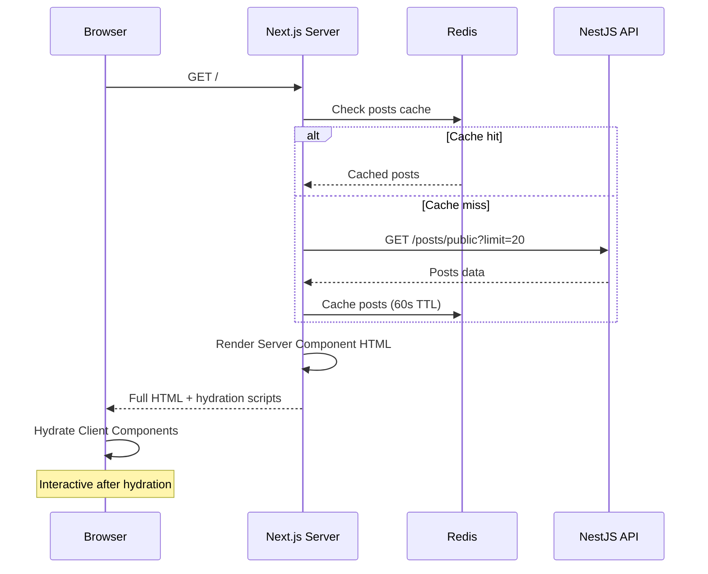
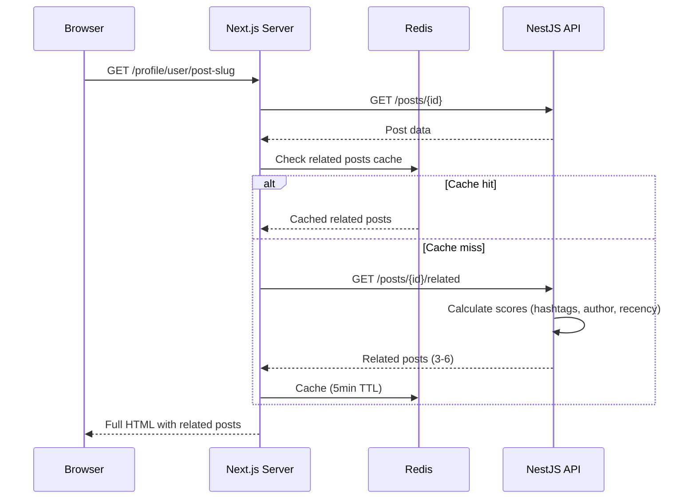
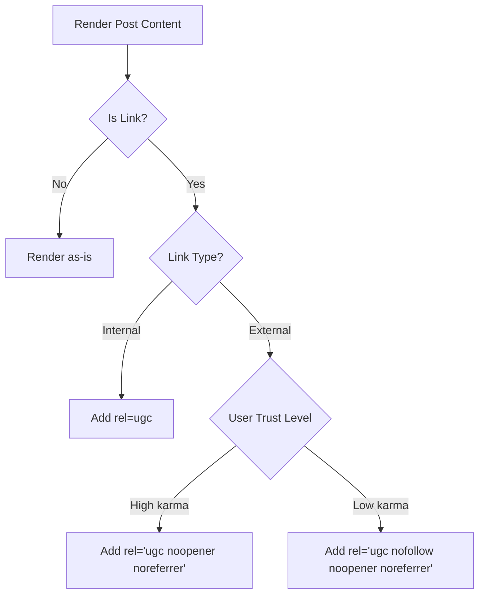
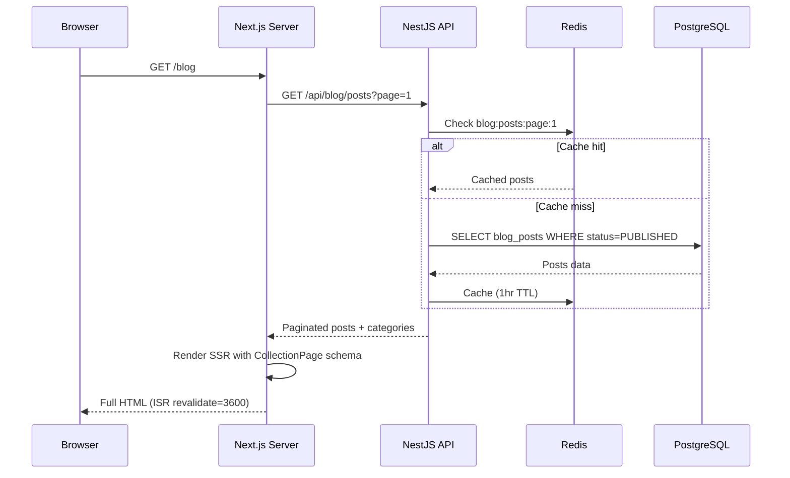
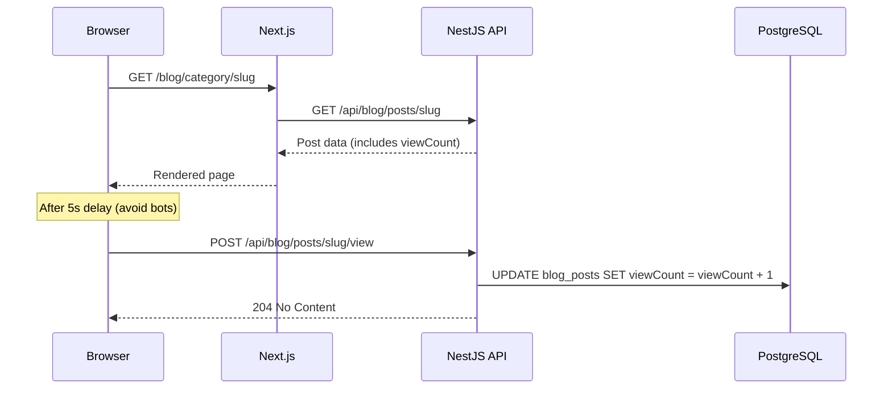

<!-- @SECTION:ARCHITECTURE -->
# SEO Optimization - Technical Design

## Architecture Overview

SEO optimization spans Frontend (Next.js SSR, meta tags, structured data) and Backend (related posts API, sitemap). Key architectural decisions prioritize crawlability while maintaining interactive UX.

### Homepage SSR Strategy

**Decision**: Convert homepage from Client Component to Server Component with hybrid rendering.

```
┌─────────────────────────────────────────────────────────────┐
│                    Homepage Architecture                      │
├─────────────────────────────────────────────────────────────┤
│  Server Component (page.tsx)                                 │
│  ├── Fetch initial 20 posts (Redis cached, 60s TTL)         │
│  ├── Render static HTML with posts content                   │
│  ├── Include meta tags, JSON-LD schemas                      │
│  └── Hydrate with Client Components for interactivity        │
│                                                              │
│  Client Components (embedded)                                │
│  ├── NewsfeedClient - infinite scroll, reactions             │
│  ├── PostComposer - create new posts                         │
│  └── LoginPromptModal - auth prompts                         │
└─────────────────────────────────────────────────────────────┘
```

**Trade-offs**:
- Slightly slower TTFB (~50-100ms) vs dramatically better crawlability
- Initial posts visible without JS, interactions require hydration
<!-- @END:ARCHITECTURE -->

<!-- @SECTION:COMPONENTS -->
## Components

| Component | Responsibility | Location |
|-----------|---------------|----------|
| HomepageServer | SSR homepage with initial posts | `Frontend/src/app/(main)/page.tsx` |
| NewsfeedClient | Interactive feed (infinite scroll) | `Frontend/src/app/(main)/NewsfeedClient.tsx` |
| Breadcrumb | Visual nav + BreadcrumbList schema | `Frontend/src/components/seo/Breadcrumb.tsx` |
| RelatedPosts | SSR related posts section | `Frontend/src/features/posts/components/RelatedPosts.tsx` |
| OrganizationSchema | JSON-LD for Organization | `Frontend/src/components/seo/OrganizationSchema.tsx` |
| WebSiteSchema | JSON-LD for WebSite + SearchAction | `Frontend/src/components/seo/WebSiteSchema.tsx` |
| FAQSchema | JSON-LD for FAQPage | `Frontend/src/components/seo/FAQSchema.tsx` |
| SitemapProxy | Next.js route handlers for sitemap | `Frontend/src/app/sitemap.xml/route.ts` |
| RelatedPostsService | Backend algorithm for related posts | `Backend/src/modules/posts/services/related-posts.service.ts` |
<!-- @END:COMPONENTS -->

<!-- @SECTION:DATA_MODELS -->
## Data Models

### Related Posts Algorithm

```typescript
// Score calculation for related posts
interface RelatedPostScore {
  postId: string;
  score: number; // Higher = more related
}

// Algorithm weights
const WEIGHTS = {
  SHARED_HASHTAG: 3,    // Per shared hashtag
  SAME_AUTHOR: 2,       // Same author bonus
  RECENCY: 1,           // Based on publish date
};

// Query: Find posts with shared hashtags, exclude current post
// Sort by score DESC, limit 6
// Cache in Redis with 5-minute TTL per post
```

### Image Alt Text Storage

Images stored in post content JSON already. Alt text added as property:

```typescript
// Current: { url: "https://...", width: 800, height: 600 }
// New: { url: "https://...", width: 800, height: 600, alt: "Hình 1 trong bài viết: ..." }
```

### Breadcrumb Items

```typescript
interface BreadcrumbItem {
  name: string;      // Display text
  href: string;      // URL path
  current?: boolean; // Is current page
}

// Example for post page:
// [{ name: "Trang chủ", href: "/" }, { name: "@username", href: "/profile/username" }, { name: "Post Title", href: "...", current: true }]
```
<!-- @END:DATA_MODELS -->

<!-- @SECTION:KEY_FLOWS -->
## Key Flows

### Homepage SSR Flow



### Related Posts Flow



### UGC Link Processing Flow


<!-- @END:KEY_FLOWS -->

<!-- @SECTION:STRUCTURED_DATA -->
## Structured Data Schemas

### Organization Schema (Homepage)

```json
{
  "@context": "https://schema.org",
  "@type": "Organization",
  "name": "ChungToiXayWeb",
  "url": "https://chungtoixayweb.vn",
  "logo": "https://chungtoixayweb.vn/logo.png",
  "description": "Nền tảng mạng xã hội và thiết kế website chuyên nghiệp tại Việt Nam",
  "sameAs": [
    "https://facebook.com/chungtoixayweb",
    "https://zalo.me/chungtoixayweb"
  ],
  "contactPoint": {
    "@type": "ContactPoint",
    "contactType": "customer service",
    "availableLanguage": "Vietnamese"
  }
}
```

### WebSite Schema with SearchAction (Homepage)

```json
{
  "@context": "https://schema.org",
  "@type": "WebSite",
  "name": "ChungToiXayWeb",
  "url": "https://chungtoixayweb.vn",
  "potentialAction": {
    "@type": "SearchAction",
    "target": {
      "@type": "EntryPoint",
      "urlTemplate": "https://chungtoixayweb.vn/search?q={search_term_string}"
    },
    "query-input": "required name=search_term_string"
  }
}
```

### BreadcrumbList Schema

```json
{
  "@context": "https://schema.org",
  "@type": "BreadcrumbList",
  "itemListElement": [
    { "@type": "ListItem", "position": 1, "name": "Trang chủ", "item": "https://chungtoixayweb.vn" },
    { "@type": "ListItem", "position": 2, "name": "@username", "item": "https://chungtoixayweb.vn/profile/username" },
    { "@type": "ListItem", "position": 3, "name": "Post Title" }
  ]
}
```

### FAQPage Schema (Pricing)

```json
{
  "@context": "https://schema.org",
  "@type": "FAQPage",
  "mainEntity": [
    {
      "@type": "Question",
      "name": "Chi phí thiết kế website là bao nhiêu?",
      "acceptedAnswer": {
        "@type": "Answer",
        "text": "Chi phí thiết kế website tại ChungToiXayWeb từ 5 triệu đến 50 triệu VNĐ tùy theo yêu cầu..."
      }
    }
  ]
}
```
<!-- @END:STRUCTURED_DATA -->

<!-- @SECTION:POST_DETAIL_SEO -->
## Post Detail Page SEO Architecture

### Enhanced SocialMediaPosting Schema

```json
{
  "@context": "https://schema.org",
  "@type": "SocialMediaPosting",
  "headline": "Post title (max 110 chars)",
  "articleBody": "Full post content",
  "datePublished": "2026-02-09T08:00:00+07:00",
  "dateModified": "2026-02-09T14:30:00+07:00",
  "inLanguage": "vi",
  "isAccessibleForFree": true,
  "wordCount": 350,
  "commentCount": 12,
  "keywords": ["keyword1", "keyword2"],
  "timeRequired": "PT2M",
  "author": {
    "@type": "Person",
    "name": "Author Name",
    "url": "https://chungtoixayweb.vn/profile/username",
    "image": "https://r2.cloudflarestorage.com/avatar.jpg",
    "description": "Author bio text"
  },
  "publisher": {
    "@type": "Organization",
    "name": "ChungToiXayWeb",
    "logo": { "@type": "ImageObject", "url": "https://chungtoixayweb.vn/logo.png" }
  },
  "mainEntityOfPage": { "@type": "WebPage", "@id": "canonical-url" },
  "image": [
    { "@type": "ImageObject", "url": "image-url", "caption": "Hình 1 trong bài viết: title" }
  ],
  "interactionStatistic": [
    { "@type": "InteractionCounter", "interactionType": "LikeAction", "userInteractionCount": 42 },
    { "@type": "InteractionCounter", "interactionType": "CommentAction", "userInteractionCount": 12 }
  ]
}
```

### New Utility Functions

| Function | Signature | Description |
|----------|-----------|-------------|
| `calculateReadingTime` | `(content: string, imageCount: number) => { minutes: number, wordCount: number }` | Calculate reading time based on word count and images |
| `generateMetaDescription` | `(content: string, maxLength?: number) => string` | Strip HTML/hashtags, truncate at word boundary |
| `stripHtmlTags` | `(html: string) => string` | Remove all HTML tags from content |
| `stripHashtags` | `(text: string) => string` | Remove hashtag patterns from text |
| `truncateAtWordBoundary` | `(text: string, maxLength: number) => string` | Truncate text at word boundary |

Location: `Frontend/src/lib/seo/reading-time.ts`, `Frontend/src/lib/seo/meta-description.ts`

### Canonical URL Logic

```
if post.sharedPostId AND post.sharedPost exists:
  canonical = /profile/{originalAuthor}/{originalSlug || originalId}
else:
  canonical = /profile/{author}/{slug || id}  (self-referencing)
```

### Reading Time Calculation

```typescript
// Formula: ceil(wordCount / 200) + ceil(imageCount * 12 / 60) minutes
// - 200 words per minute reading speed
// - 12 seconds per image viewing time
// - Hide for posts with < 50 words

function calculateReadingTime(content: string, imageCount: number) {
  const strippedContent = stripHtmlTags(content);
  const wordCount = strippedContent.split(/\s+/).filter(Boolean).length;

  if (wordCount < 50) return { minutes: 0, wordCount, shouldShow: false };

  const readingMinutes = Math.ceil(wordCount / 200);
  const imageMinutes = Math.ceil((imageCount * 12) / 60);
  const totalMinutes = readingMinutes + imageMinutes;

  return { minutes: totalMinutes, wordCount, shouldShow: true };
}
```

### ISR Strategy

Post detail pages use Incremental Static Regeneration:
- `revalidate = 300` (5 minutes)
- Balances content freshness with caching performance
- Allows updates to propagate within 5 minutes

Blog pages use ISR:
- `revalidate = 3600` (1 hour)
- Editorial content changes less frequently
- Reduces server load for blog pages
<!-- @END:POST_DETAIL_SEO -->

<!-- @SECTION:EEAT_PAGES -->
## E-E-A-T Foundation Pages Architecture (Phase 5)

### Page Structure

```
Frontend/src/app/(public)/
├── about/page.tsx          # About Us - Organization schema
├── privacy/page.tsx        # Privacy Policy - static Vietnamese content
├── terms/page.tsx          # Terms of Service - static Vietnamese content
└── contact/page.tsx        # Contact - ContactPoint schema + form
```

All pages are Server Components with static rendering for maximum performance.

### Enhanced Organization Schema (About Page)

```json
{
  "@context": "https://schema.org",
  "@type": "Organization",
  "name": "ChungToiXayWeb",
  "url": "https://chungtoixayweb.vn",
  "logo": "https://chungtoixayweb.vn/logo.png",
  "description": "Nền tảng mạng xã hội và thiết kế website chuyên nghiệp tại Việt Nam",
  "foundingDate": "2024",
  "founders": [{ "@type": "Person", "name": "Founder Name" }],
  "numberOfEmployees": { "@type": "QuantitativeValue", "value": 10 },
  "address": {
    "@type": "PostalAddress",
    "addressLocality": "Hồ Chí Minh",
    "addressCountry": "VN"
  },
  "contactPoint": {
    "@type": "ContactPoint",
    "telephone": "+84-xxx-xxx-xxx",
    "email": "contact@chungtoixayweb.vn",
    "contactType": "customer service",
    "availableLanguage": "Vietnamese"
  },
  "sameAs": [
    "https://facebook.com/chungtoixayweb",
    "https://zalo.me/chungtoixayweb"
  ]
}
```

### ContactPoint Schema (Contact Page)

```json
{
  "@context": "https://schema.org",
  "@type": "ContactPage",
  "name": "Liên hệ ChungToiXayWeb",
  "description": "Liên hệ với chúng tôi để được tư vấn thiết kế website",
  "mainEntity": {
    "@type": "Organization",
    "name": "ChungToiXayWeb",
    "contactPoint": [{
      "@type": "ContactPoint",
      "telephone": "+84-xxx-xxx-xxx",
      "email": "contact@chungtoixayweb.vn",
      "contactType": "customer service",
      "availableLanguage": ["Vietnamese"],
      "hoursAvailable": {
        "@type": "OpeningHoursSpecification",
        "dayOfWeek": ["Monday","Tuesday","Wednesday","Thursday","Friday"],
        "opens": "08:00",
        "closes": "18:00"
      }
    }]
  }
}
```
<!-- @END:EEAT_PAGES -->

### Implementation Notes (Phase 5)

**Completed**: 2026-02-09

**Files Created:**
- Frontend/src/app/(public)/terms/page.tsx - Terms of Service with Vietnamese content
- Frontend/src/app/(public)/contact/page.tsx - Contact page with ContactPoint JSON-LD

**Files Modified:**
- Frontend/src/features/landing/components/Footer.tsx - All href="#" replaced with actual routes
- Backend/src/modules/seo/services/sitemap.service.ts - Added /about, /privacy, /terms, /contact

**Pre-existing (already implemented):**
- Frontend/src/app/(public)/about/page.tsx - About page with Organization JSON-LD
- Frontend/src/app/(public)/privacy/page.tsx - Privacy Policy page

**Known Limitation:**
- Contact form is UI-only (no backend submission handler). Will need backend implementation in future phase.
- Organization schema uses placeholder founder name "ChungToiXayWeb Team"

**Build Status:** All pages are Server Components with proper Metadata exports.


<!-- @SECTION:BLOG_SYSTEM -->
## Blog/Content Hub Architecture (Phase 6)

### Database Models

```prisma
model BlogPost {
  id              String        @id @default(cuid())
  title           String
  slug            String        @unique
  excerpt         String?       @db.Text
  content         String        @db.Text
  featuredImage   String?
  categoryId      String
  category        BlogCategory  @relation(fields: [categoryId], references: [id])
  authorId        String
  author          User          @relation(fields: [authorId], references: [id])
  status          BlogPostStatus @default(DRAFT)
  postType        BlogPostType   @default(ARTICLE)
  publishedAt     DateTime?
  viewCount       Int           @default(0)
  readingTime     Int           @default(0)
  tableOfContents Json?
  takeaways       Json?
  metaTitle       String?
  metaDescription String?
  createdAt       DateTime      @default(now())
  updatedAt       DateTime      @updatedAt

  @@index([status, publishedAt])
  @@index([categoryId])
  @@index([authorId])
  @@index([slug])
}

model BlogCategory {
  id           String        @id @default(cuid())
  name         String
  slug         String        @unique
  description  String?
  parentId     String?
  parent       BlogCategory? @relation("CategoryHierarchy", fields: [parentId], references: [id])
  children     BlogCategory[] @relation("CategoryHierarchy")
  displayOrder Int           @default(0)
  postCount    Int           @default(0)
  posts        BlogPost[]
  createdAt    DateTime      @default(now())
  updatedAt    DateTime      @updatedAt

  @@index([slug])
  @@index([parentId])
}

enum BlogPostStatus {
  DRAFT
  PUBLISHED
  ARCHIVED
}

enum BlogPostType {
  ARTICLE
  TUTORIAL
  COMPARISON
  FAQ
}
```

### Blog System Flow



### Article Schema (Blog Detail)

```json
{
  "@context": "https://schema.org",
  "@type": "Article",
  "headline": "Hướng dẫn thiết kế website chuyên nghiệp",
  "description": "Bài viết hướng dẫn chi tiết...",
  "image": "https://chungtoixayweb.vn/blog/featured.jpg",
  "datePublished": "2026-02-09T08:00:00+07:00",
  "dateModified": "2026-02-09T14:30:00+07:00",
  "inLanguage": "vi",
  "wordCount": 2500,
  "timeRequired": "PT13M",
  "author": {
    "@type": "Person",
    "name": "Author Name",
    "url": "https://chungtoixayweb.vn/profile/username",
    "jobTitle": "Senior Web Developer",
    "worksFor": { "@type": "Organization", "name": "ChungToiXayWeb" },
    "knowsAbout": ["React", "Next.js", "Web Design"],
    "sameAs": ["https://github.com/username"]
  },
  "publisher": {
    "@type": "Organization",
    "name": "ChungToiXayWeb",
    "logo": { "@type": "ImageObject", "url": "https://chungtoixayweb.vn/logo.png" }
  },
  "mainEntityOfPage": { "@type": "WebPage", "@id": "https://chungtoixayweb.vn/blog/tutorials/thiet-ke-website" }
}
```

### Implementation Notes (Phase 6)

**Completed**: 2026-02-09

**Backend Files Created:**
- Backend/src/modules/blog/blog.module.ts - Blog NestJS module
- Backend/src/modules/blog/controllers/blog.controller.ts - Public + Admin endpoints
- Backend/src/modules/blog/services/blog.service.ts - CRUD, caching, slug generation
- Backend/src/modules/blog/dto/create-blog-post.dto.ts - Create DTO with validation
- Backend/src/modules/blog/dto/update-blog-post.dto.ts - Update DTO (partial)
- Backend/src/modules/blog/dto/blog-query.dto.ts - Query DTO with pagination

**Frontend Files Created:**
- Frontend/src/types/blog.ts - TypeScript interfaces
- Frontend/src/features/blog/api/blog.ts - React Query hooks
- Frontend/src/app/(public)/blog/page.tsx - Blog list with SSR, CollectionPage schema
- Frontend/src/app/(public)/blog/[category]/[slug]/page.tsx - Blog detail with ISR, Article schema
- Frontend/src/components/seo/ArticleSchema.tsx - Reusable Article JSON-LD
- Frontend/src/components/seo/TableOfContents.tsx - Client component with scroll tracking

**Files Modified:**
- Backend/prisma/schema.prisma - Added BlogPost, BlogCategory models, enums
- Backend/src/app.module.ts - Registered BlogModule
- Backend/src/redis/cache-keys.ts - Added blog cache keys and TTLs
- Backend/src/modules/seo/services/sitemap.service.ts - Added generateBlogSitemap()
- Backend/src/modules/seo/controllers/sitemap.controller.ts - Added blog.xml route
- Frontend/src/components/seo/index.ts - Added ArticleSchema, TableOfContents exports

**Pending:** Run prisma migrate dev to create blog tables in database.
<!-- @END:BLOG_SYSTEM -->

<!-- @SECTION:AUTHOR_AUTHORITY -->
## Author Authority Enhancement Architecture (Phase 7)

### Profile Model Extension

```prisma
model Profile {
  // ... existing fields ...
  jobTitle          String?
  company           String?
  expertise         Json?     // ["React", "Next.js", "Web Design"]
  credentials       Json?     // [{"title": "AWS Certified", "issuer": "Amazon", "year": 2024}]
  isVerifiedExpert  Boolean   @default(false)
}
```

### AuthorCard Component Design

```
┌─────────────────────────────────────────────┐
│  ┌──────┐  Author Name                      │
│  │Avatar│  Senior Web Developer @ Company    │
│  └──────┘  ──────────────────────────────    │
│  Bio text here...                            │
│                                              │
│  Chuyên môn: [React] [Next.js] [TypeScript]  │
│                                              │
│  🔗 GitHub  🔗 LinkedIn  🔗 Website          │
│  📝 12 bài viết trên ChungToiXayWeb          │
└─────────────────────────────────────────────┘
```

### Enhanced Person Schema (Author)

```json
{
  "@type": "Person",
  "name": "Author Name",
  "url": "https://chungtoixayweb.vn/profile/username",
  "image": "https://chungtoixayweb.vn/avatars/author.jpg",
  "description": "Senior Web Developer với 5 năm kinh nghiệm...",
  "jobTitle": "Senior Web Developer",
  "worksFor": {
    "@type": "Organization",
    "name": "Company Name"
  },
  "knowsAbout": ["React", "Next.js", "TypeScript", "Web Design"],
  "hasCredential": [
    {
      "@type": "EducationalOccupationalCredential",
      "credentialCategory": "certification",
      "name": "AWS Certified Developer",
      "recognizedBy": { "@type": "Organization", "name": "Amazon Web Services" }
    }
  ],
  "sameAs": [
    "https://github.com/username",
    "https://linkedin.com/in/username"
  ]
}
```

### Author Profile Page Enhancement

Profile page (`/profile/[username]`) adds a "Bài viết" (Blog Posts) tab:
- Fetches blog posts authored by user via `GET /api/blog/posts?authorId=xxx`
- Displays blog post cards with title, excerpt, category, date
- Person schema includes `knowsAbout`, `hasCredential`, `jobTitle`

### Implementation Notes (Phase 7)

**Completed**: 2026-02-09

**Files Created:**
- Frontend/src/features/blog/components/AuthorCard.tsx - Author card with expertise, credentials, verified badge

**Files Modified:**
- Backend/prisma/schema.prisma - Added jobTitle, company, expertise, credentials, isVerifiedExpert to Profile
- Backend/src/modules/profiles/dto/profile.dto.ts - Added validation for new fields
- Frontend/src/types/profile.ts - Added new fields to UserProfile, UpdateProfileInput
- Frontend/src/types/blog.ts - Added new fields to BlogPostAuthor
- Frontend/src/features/profiles/components/ProfileEditModal.tsx - Added jobTitle, company, expertise form fields
- Frontend/src/app/(public)/blog/[category]/[slug]/page.tsx - Replaced author section with AuthorCard
- Frontend/src/app/(main)/profile/[username]/page.tsx - Enhanced Person schema with expertise
- Frontend/src/app/(main)/profile/[username]/[postId]/page.tsx - Added author bio to SocialMediaPosting JSON-LD

**Known Limitation:**
- Post API response may not include full profile data (jobTitle, company). Uses type casting as fallback.
- Credentials editing not yet in ProfileEditModal (complex nested form). Only expertise as comma-separated input.

**Pending:** Run prisma migrate dev to add new columns to Profile table.
<!-- @END:AUTHOR_AUTHORITY -->

<!-- @SECTION:HOWTO_SCHEMA -->
## HowTo Schema & GEO Architecture (Phase 8)

### HowTo JSON-LD Component

For blog posts with `postType: TUTORIAL`, generates HowTo structured data:

```json
{
  "@context": "https://schema.org",
  "@type": "HowTo",
  "name": "Cách thiết kế website responsive với Tailwind CSS",
  "description": "Hướng dẫn từng bước thiết kế website responsive...",
  "totalTime": "PT30M",
  "estimatedCost": {
    "@type": "MonetaryAmount",
    "currency": "VND",
    "value": "0"
  },
  "tool": [
    { "@type": "HowToTool", "name": "VS Code" },
    { "@type": "HowToTool", "name": "Node.js 18+" }
  ],
  "supply": [
    { "@type": "HowToSupply", "name": "Tailwind CSS v4" }
  ],
  "step": [
    {
      "@type": "HowToStep",
      "position": 1,
      "name": "Cài đặt Tailwind CSS",
      "text": "Chạy lệnh npm install tailwindcss...",
      "url": "https://chungtoixayweb.vn/blog/tutorials/thiet-ke-responsive#buoc-1",
      "image": "https://chungtoixayweb.vn/blog/step1.jpg"
    },
    {
      "@type": "HowToStep",
      "position": 2,
      "name": "Cấu hình responsive breakpoints",
      "text": "Thêm các breakpoints vào tailwind.config.js..."
    }
  ]
}
```

### KeyTakeaways Component

Renders at top of blog posts with `takeaways` field:

```html
<aside role="note" aria-label="Điểm chính">
  <h2>📌 Điểm chính trong bài viết</h2>
  <ul>
    <li>Tailwind CSS v4 sử dụng CSS-first configuration</li>
    <li>Container queries thay thế media queries cho components</li>
    <li>Performance tốt hơn 40% so với CSS truyền thống</li>
  </ul>
</aside>
```

Purpose: Optimized for AI extraction (GEO) - structured summaries help AI search engines cite content.

### ComparisonTable Component

For `postType: COMPARISON` blog posts:

```html
<figure>
  <table>
    <caption>So sánh React vs Vue vs Angular 2026</caption>
    <thead>
      <tr><th>Tiêu chí</th><th>React</th><th>Vue</th><th>Angular</th></tr>
    </thead>
    <tbody>
      <tr><td>Learning Curve</td><td>Trung bình</td><td>Dễ</td><td>Khó</td></tr>
      <!-- ... -->
    </tbody>
  </table>
  <figcaption>Nguồn: State of JS 2025</figcaption>
</figure>
```

### FAQ Schema on Static Pages

About page and Contact page include FAQPage schema:

```json
{
  "@context": "https://schema.org",
  "@type": "FAQPage",
  "mainEntity": [
    {
      "@type": "Question",
      "name": "ChungToiXayWeb là gì?",
      "acceptedAnswer": {
        "@type": "Answer",
        "text": "ChungToiXayWeb là nền tảng mạng xã hội..."
      }
    }
  ]
}
```

### Implementation Notes (Phase 8)

**Completed**: 2026-02-09

**Files Created:**
- Frontend/src/components/seo/HowToSchema.tsx - HowTo JSON-LD for tutorial posts
- Frontend/src/features/blog/components/KeyTakeaways.tsx - Semantic aside with key points
- Frontend/src/features/blog/components/ComparisonTable.tsx - Semantic comparison table

**Files Modified:**
- Frontend/src/app/(public)/blog/[category]/[slug]/page.tsx - HowTo schema for TUTORIAL posts
- Frontend/src/app/(public)/about/page.tsx - FAQ section with FAQSchema (5 questions)
- Frontend/src/app/(public)/contact/page.tsx - FAQ section with FAQSchema (4 questions)
- Frontend/src/components/seo/index.ts - Added HowToSchema export

**Notes:**
- HowTo schema uses tableOfContents items as steps for TUTORIAL type posts
- FAQ sections use native HTML details/summary for accordion (no JS required)
- T-106 was already done in Phase 6 (postType and takeaways fields exist)
<!-- @END:HOWTO_SCHEMA -->

<!-- @SECTION:INTERNAL_LINKING -->
## Internal Linking Architecture (Phase 9)

### Topic Hub Pages

```
Frontend/src/app/(public)/topics/[topic]/page.tsx
```

Aggregates content from both blog posts and UGC posts tagged with the same topic:

```
┌─────────────────────────────────────────────────┐
│  Chủ đề: React                                   │
│  ─────────────────────────────────────────────    │
│                                                   │
│  📚 Bài viết chuyên sâu (Blog)                   │
│  ├── Hướng dẫn React Server Components           │
│  ├── So sánh React vs Vue 2026                    │
│  └── Xem thêm →                                  │
│                                                   │
│  💬 Thảo luận cộng đồng (UGC)                    │
│  ├── Ai đang dùng React 19?                       │
│  ├── Tips tối ưu performance React                │
│  └── Xem thêm →                                  │
│                                                   │
│  CollectionPage JSON-LD                           │
└─────────────────────────────────────────────────┘
```

### CollectionPage Schema (Topic Hub)

```json
{
  "@context": "https://schema.org",
  "@type": "CollectionPage",
  "name": "Chủ đề: React - ChungToiXayWeb",
  "description": "Tổng hợp bài viết và thảo luận về React",
  "url": "https://chungtoixayweb.vn/topics/react",
  "mainEntity": {
    "@type": "ItemList",
    "itemListElement": [
      {
        "@type": "ListItem",
        "position": 1,
        "url": "https://chungtoixayweb.vn/blog/tutorials/react-server-components"
      }
    ]
  }
}
```

### Popular Posts Widget (RightSidebar)

```
┌──────────────────────────┐
│  🔥 Bài viết phổ biến    │
│  ─────────────────────    │
│  1. Thiết kế website...   │
│     👁 1.2k · 💬 45       │
│  2. React vs Vue 2026     │
│     👁 980 · 💬 32        │
│  3. Tối ưu SEO cho...     │
│     👁 756 · 💬 28        │
│  4. Hướng dẫn Tailwind    │
│     👁 650 · 💬 19        │
│  5. NestJS best practices │
│     👁 520 · 💬 15        │
└──────────────────────────┘
```

Engagement score formula: `views * 0.3 + likes * 0.4 + comments * 0.3`
Cached in Redis with 1-hour TTL.

### Breadcrumb Strategy

All new pages include BreadcrumbList schema:

| Page | Breadcrumb Path |
|------|----------------|
| Blog list | Home > Blog |
| Blog detail | Home > Blog > Category > Title |
| About | Home > Giới thiệu |
| Contact | Home > Liên hệ |
| Privacy | Home > Chính sách bảo mật |
| Terms | Home > Điều khoản sử dụng |
| Topic hub | Home > Chủ đề > Topic Name |

```json
{
  "@context": "https://schema.org",
  "@type": "BreadcrumbList",
  "itemListElement": [
    { "@type": "ListItem", "position": 1, "name": "Trang chủ", "item": "https://chungtoixayweb.vn" },
    { "@type": "ListItem", "position": 2, "name": "Blog", "item": "https://chungtoixayweb.vn/blog" },
    { "@type": "ListItem", "position": 3, "name": "Tutorials", "item": "https://chungtoixayweb.vn/blog/tutorials" },
    { "@type": "ListItem", "position": 4, "name": "Thiết kế website responsive" }
  ]
}
```

### Implementation Notes (Phase 9)

**Completed**: 2026-02-09

**Files Created:**
- Frontend/src/app/(public)/topics/[topic]/page.tsx - Topic hub page with SSR, CollectionPage JSON-LD
- Frontend/src/components/layout/PopularPostsWidget.tsx - Popular posts widget for sidebar

**Files Modified:**
- Backend/src/redis/cache-keys.ts - Added BY_TOPIC and POPULAR_POSTS cache keys
- Backend/src/modules/blog/services/blog.service.ts - Added getPostsByTopic() with Redis caching
- Backend/src/modules/blog/controllers/blog.controller.ts - Added GET /blog/posts/by-topic/:topic
- Backend/src/modules/posts/services/posts.service.ts - Added getPopularPosts() with Redis caching
- Backend/src/modules/posts/repositories/posts.repository.ts - Added findPopularPosts()
- Backend/src/modules/posts/controllers/posts.controller.ts - Added GET /posts/popular
- Frontend/src/features/posts/api/posts.ts - Added usePopularPosts hook
- Frontend/src/features/blog/api/blog.ts - Added useBlogPostsByTopic hook
- Frontend/src/components/layout/RightSidebar.tsx - Integrated PopularPostsWidget
- Frontend/src/components/layout/index.ts - Added PopularPostsWidget export

**Notes:**
- Breadcrumbs already existed on blog list, blog detail, about, and contact pages (T-114, T-115, T-116 verified)
- Popular posts uses likeCount as primary sort (Prisma limitation for computed columns)
- Topic matching uses case-insensitive string contains on tags JSON field

<!-- @END:INTERNAL_LINKING -->

<!-- @SECTION:ENGAGEMENT -->
## Searcher Engagement Architecture (Phase 11)

### Reading Progress Bar

Client Component mounted on blog detail pages:

```
┌─████████████████░░░░░░░░░░░░░░░░░░░░░░░░┐  45%
│                                           │
│  Blog content here...                     │
│                                           │
└───────────────────────────────────────────┘
```

Implementation:
- Uses `scroll` event listener with `requestAnimationFrame` throttling
- Calculates progress: `scrollTop / (scrollHeight - clientHeight) * 100`
- Fixed position at top of viewport, z-index above navbar
- Gradient color: `bg-gradient-to-r from-blue-500 to-purple-600`
- Height: 3px, transition: `width 150ms ease-out`

### Social Share Buttons

```
┌──────────────────────────────────────┐
│  Chia sẻ bài viết:                    │
│  [📘 Facebook] [💬 Zalo] [🐦 X] [🔗] │
└──────────────────────────────────────┘
```

Share URLs:
- Facebook: `https://www.facebook.com/sharer/sharer.php?u={url}`
- Zalo: `https://zalo.me/share?url={url}`
- Twitter/X: `https://twitter.com/intent/tweet?url={url}&text={title}`
- Copy Link: `navigator.clipboard.writeText(url)` with toast notification

### View Count Tracking



View count rules:
- 5-second delay before counting (filters bots/bounces)
- Debounced: max 1 view per IP per post per 24 hours (stored in Redis)
- Displayed as "👁 1.2k lượt xem" on blog cards and detail pages

### Scroll to Top Button

```
                                    ┌───┐
                                    │ ↑ │  Appears after 500px scroll
                                    └───┘  Fixed bottom-right
```

- `position: fixed; bottom: 24px; right: 24px;`
- Fade in/out animation with `opacity` transition
- `window.scrollTo({ top: 0, behavior: 'smooth' })`
- Hidden on mobile when virtual keyboard is open (detect via `visualViewport`)

### Reading Time Display

Formula: `Math.ceil(wordCount / 200)` (200 words/min for Vietnamese)
Display: "⏱ X phút đọc" on blog list cards and detail page header

```
┌─────────────────────────────────────┐
│  📂 Tutorials · ⏱ 8 phút đọc       │
│  👁 1.2k lượt xem · 📅 09/02/2026   │
│                                      │
│  Hướng dẫn thiết kế website...       │
└─────────────────────────────────────┘
```

### Implementation Notes (Phase 11)

**Completed**: 2026-02-09

**Files Created:**
- Frontend/src/features/blog/components/ReadingProgressBar.tsx - Scroll-based progress bar with gradient, requestAnimationFrame
- Frontend/src/features/blog/components/ScrollToTop.tsx - Floating button with fade animation, visible after 500px
- Frontend/src/features/blog/components/SocialShareButtons.tsx - Facebook, Zalo, Twitter/X, Copy Link with branded colors

**Files Modified:**
- Frontend/src/app/(public)/blog/[category]/[slug]/page.tsx - Integrated ReadingProgressBar, ScrollToTop, SocialShareButtons

**Already Complete (verified):**
- Reading time display: "{X} phút đọc" format (T-136)
- View count display: "{N} lượt xem" with Vietnamese locale (T-136)

**Notes:**
- ReadingProgressBar uses requestAnimationFrame + passive scroll listener for optimal performance
- SocialShareButtons includes Zalo for Vietnamese market
- Copy link uses Clipboard API with toast notification from sonner
- All components use dark theme tokens (bg-card, text-foreground, etc.)

<!-- @END:ENGAGEMENT -->

<!-- @SECTION:ERROR_HANDLING -->
## Error Handling

| Error Case | Response |
|------------|----------|
| Redis cache unavailable | Fallback to direct API call, log warning |
| Related posts API fails | Show empty section, don't break page |
| Sitemap proxy timeout | Return 504, cache previous valid response |
| Invalid image for alt text | Use generic alt "Hình ảnh trong bài viết" |
| SSR data fetch fails | Return cached version or show loading state |
<!-- @END:ERROR_HANDLING -->

<!-- @SECTION:BOUNDARIES -->
## Boundary Definitions

| System | Integration | Reference |
|--------|-------------|-----------|
| Google Search Console | Sitemap submission, indexing API | Manual setup |
| Cloudflare | Cache headers, edge caching | Existing CDN config |
| Redis | Caching layer for SSR data | `Backend/src/modules/redis/` |
| Backend API | Related posts endpoint | New endpoint needed |
<!-- @END:BOUNDARIES -->

<!-- @SECTION:TEST_STRATEGY -->
## Test Strategy

### Unit Tests
- Breadcrumb component renders correct items and schema
- Alt text generator produces expected format
- Link processor adds correct rel attributes
- Related posts scoring algorithm

### Integration Tests
- Homepage SSR returns full HTML with posts
- Sitemap proxy returns valid XML
- Related posts API returns scored results

### E2E Tests
- Google Rich Results Test validation (manual)
- Lighthouse SEO audit ≥ 95
- Core Web Vitals pass on mobile

### SEO Validation
- Google Search Console URL Inspection
- Schema markup validator
- Mobile-friendly test
### Implementation Notes (Phase 4)

**Completed**: 2026-02-09

**Files Created:**
- `Frontend/src/lib/seo/reading-time.ts` - Reading time calculation utilities
- `Frontend/src/lib/seo/meta-description.ts` - Meta description generation utilities

**Files Modified:**
- `Frontend/src/lib/seo/index.ts` - Barrel exports updated
- `Frontend/src/app/(main)/profile/[username]/[postId]/page.tsx` - Enhanced metadata, JSON-LD, canonical, reading time, ISR

**Known Limitation:**
- Author bio (`description` field in Person schema) not available in Post API response. Would require backend API change to include `profile.bio` in post author data.

**Build Status:** ✅ 0 errors, 0 warnings (both Frontend and Backend)

### Implementation Notes (Phase 10)

**Completed**: 2026-02-09

**Files Created:**
- Frontend/src/lib/utils/inp-optimization.ts - yieldToMain, yieldingDebounce, yieldingAsync utilities

**Files Modified:**
- Frontend/src/features/posts/components/RelatedPosts.tsx - Migrated native img to next/image with fill prop
- Frontend/src/components/upload/ImageUploader.tsx - Added comment explaining blob URL limitation (native img kept intentionally)
- Frontend/src/app/layout.tsx - Added hreflang alternates for vi and x-default
- Frontend/next.config.js - Added security headers (X-Content-Type-Options, X-Frame-Options, X-XSS-Protection, Referrer-Policy)

**Already Complete (verified):**
- robots.txt properly configured (T-121)
- Image optimization with AVIF/WebP formats (T-124)
- Sitemap includes all new pages (T-126)

**Notes:**
- ImageUploader.tsx keeps native  for blob URL previews - Next.js Image cannot optimize blob: URLs
- Security headers improve trust signals for Google ranking