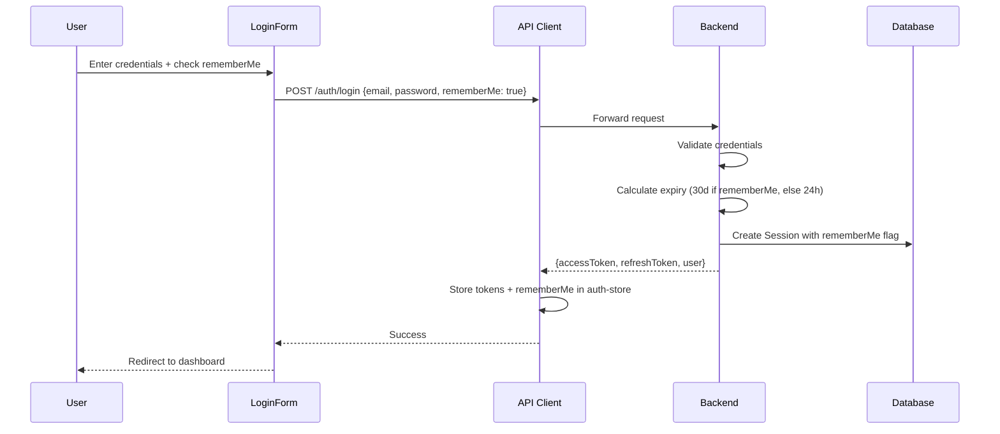
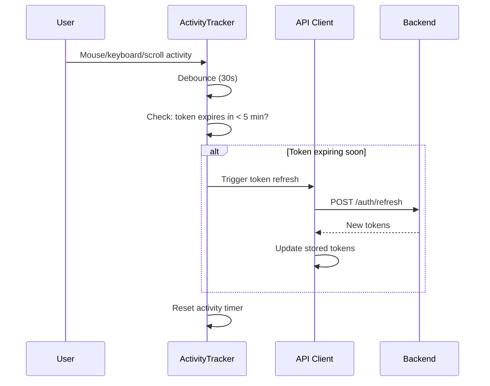
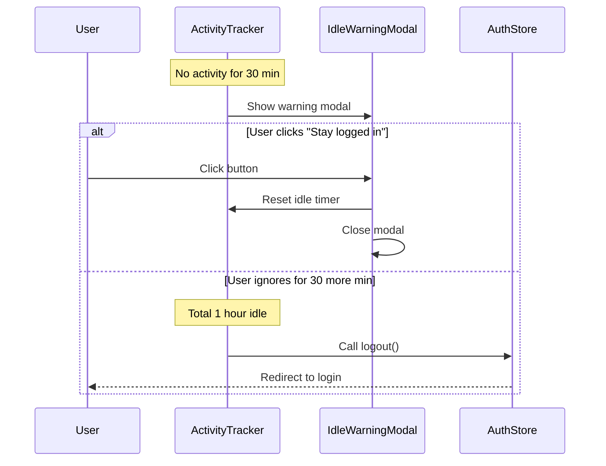

<!-- @SECTION:ARCHITECTURE -->
# Remember Me with Smart Session Renewal - Technical Design

## Architecture Overview

The feature extends the existing authentication flow with:
1. **Frontend**: RememberMe checkbox, activity tracker hook, idle warning modal
2. **Backend**: Dynamic session expiry based on rememberMe flag
3. **Storage**: rememberMe persisted in both Zustand store and Session model

Follow existing patterns in `Frontend/src/features/auth/` and `Backend/src/modules/auth/`.
<!-- @END:ARCHITECTURE -->

<!-- @SECTION:COMPONENTS -->
## Components

| Component | Responsibility | Location |
|-----------|---------------|----------|
| LoginForm | Add rememberMe checkbox | `Frontend/src/features/auth/components/LoginForm.tsx` |
| useActivityTracker | Track user activity, trigger refresh | `Frontend/src/features/auth/hooks/useActivityTracker.ts` (NEW) |
| IdleWarningModal | Display idle warning, handle user response | `Frontend/src/features/auth/components/IdleWarningModal.tsx` (NEW) |
| auth-store | Store rememberMe preference | `Frontend/src/features/auth/stores/auth-store.ts` |
| api-client | Smart renewal logic integration | `Frontend/src/lib/api-client.ts` |
| LoginDto | Accept rememberMe field | `Backend/src/modules/auth/dto/login.dto.ts` |
| AuthService | Dynamic session expiry logic | `Backend/src/modules/auth/services/auth.service.ts` |
| SessionService | Store rememberMe in session | `Backend/src/modules/auth/services/session.service.ts` |
| Session model | Add rememberMe column | `Backend/prisma/schema.prisma` |
<!-- @END:COMPONENTS -->

<!-- @SECTION:DATA_MODELS -->
## Data Models

### Frontend Types

Extend `LoginInput` in `Frontend/src/features/auth/types/auth.ts:17-20`:
```typescript
export interface LoginInput {
  email: string;
  password: string;
  rememberMe?: boolean;  // NEW
}
```

Extend `AuthState` in `Frontend/src/features/auth/types/auth.ts:35-41`:
```typescript
export interface AuthState {
  // ... existing fields
  rememberMe: boolean;  // NEW
}
```

### Backend DTO

Extend `LoginDto` in `Backend/src/modules/auth/dto/login.dto.ts`:
```typescript
export class LoginDto {
  @IsEmail({}, { message: 'Email không hợp lệ' })
  email: string;

  @IsString()
  password: string;

  @IsOptional()
  @IsBoolean()
  rememberMe?: boolean;  // NEW
}
```

### Prisma Schema

Extend Session model in `Backend/prisma/schema.prisma:305-319`:
```prisma
model Session {
  // ... existing fields
  rememberMe   Boolean  @default(false)  // NEW
}
```
<!-- @END:DATA_MODELS -->

<!-- @SECTION:KEY_FLOWS -->
## Key Flows

### Login Flow with RememberMe



### Smart Session Renewal Flow



### Idle Timeout Flow (Non-RememberMe)


<!-- @END:KEY_FLOWS -->

<!-- @SECTION:API_CHANGES -->
## API Changes

### POST /auth/login

**Request** (updated):
```json
{
  "email": "user@example.com",
  "password": "password123",
  "rememberMe": true
}
```

**Response** (unchanged):
```json
{
  "user": { "id": "...", "email": "...", ... },
  "accessToken": "eyJ...",
  "refreshToken": "eyJ..."
}
```

### POST /auth/refresh

No changes to request/response. Backend uses stored `rememberMe` flag from Session to determine new token expiry.

### JWT Access Token Payload

**Updated** (2026-02-11):
```json
{
  "sub": "user-id",
  "email": "user@example.com",
  "role": "USER",
  "tier": "FREE",
  "username": "johndoe",
  "iat": 1234567890,
  "exp": 1234568790
}
```

**Changes:**
- Added `username` field (optional) - fetched from user profile
- Used by WebSocket connections for real-time features (typing indicators, presence)
- Included in all token generation paths: login, 2FA, refresh, password change

<!-- @END:API_CHANGES -->

<!-- @SECTION:CONFIGURATION -->
## Configuration

Add to `Backend/src/config/configuration.ts`:
```typescript
session: {
  defaultExpiryHours: 24,           // Without rememberMe
  rememberMeExpiryDays: 30,         // With rememberMe
  accessTokenExpiryMinutes: 15,     // Unchanged
  absoluteMaxDays: 30,              // Hard limit
}
```

Frontend constants in `useActivityTracker.ts`:
```typescript
const ACTIVITY_DEBOUNCE_MS = 30_000;      // 30 seconds
const TOKEN_REFRESH_THRESHOLD_MS = 300_000; // 5 minutes
const IDLE_WARNING_MS = 1_800_000;         // 30 minutes
const IDLE_LOGOUT_MS = 3_600_000;          // 1 hour
```
<!-- @END:CONFIGURATION -->

<!-- @SECTION:ERROR_HANDLING -->
## Error Handling

| Error Case | Response | User Experience |
|------------|----------|-----------------|
| Token refresh fails | Clear auth state, redirect to login | "Session expired" message |
| Network error during refresh | Retry up to 3 times with exponential backoff | Silent retry, then error |
| Session not found in DB | Return 401 Unauthorized | Redirect to login |
| Absolute timeout exceeded | Reject refresh, return 401 | "Please log in again" |
| Activity tracker fails | Log error, continue without tracking | Graceful degradation |
<!-- @END:ERROR_HANDLING -->

<!-- @SECTION:SECURITY -->
## Security Considerations

### Accepted Risks

| Risk | Severity | Mitigation | Future Enhancement |
|------|----------|------------|-------------------|
| XSS token theft with 30-day tokens | HIGH | Existing XSS protections | HttpOnly cookies |
| Token stored in localStorage | MEDIUM | Short access token (15m) | Secure cookie storage |

### Security Controls

1. **Token Rotation**: New refresh token issued on each refresh (existing behavior)
2. **Absolute Timeout**: 30-day maximum regardless of activity
3. **Access Token**: Kept at 15 minutes to limit exposure window
4. **Idle Timeout**: Non-rememberMe sessions auto-logout after 1 hour idle
5. **Server Validation**: rememberMe stored in Session model for server-side enforcement

### Implementation Notes

- Activity tracker pauses when tab is hidden (prevents background battery drain)
- Debounced activity detection prevents excessive refresh calls
- Existing retry logic in `api-client.ts` handles race conditions
<!-- @END:SECURITY -->

<!-- @SECTION:FILES_TO_MODIFY -->
## Files to Modify

### Frontend (6 files)
| File | Change |
|------|--------|
| `Frontend/src/features/auth/types/auth.ts` | Add `rememberMe` to `LoginInput` and `AuthState` |
| `Frontend/src/features/auth/components/LoginForm.tsx` | Add checkbox UI |
| `Frontend/src/features/auth/stores/auth-store.ts` | Store `rememberMe` preference |
| `Frontend/src/features/auth/api/auth.ts` | Pass `rememberMe` to backend |
| `Frontend/src/lib/api-client.ts` | Integrate smart renewal logic |
| `Frontend/src/features/auth/hooks/useActivityTracker.ts` | NEW: Activity tracking hook |
| `Frontend/src/features/auth/components/IdleWarningModal.tsx` | NEW: Idle warning modal |

### Backend (5 files)
| File | Change |
|------|--------|
| `Backend/src/modules/auth/dto/login.dto.ts` | Add `rememberMe` field |
| `Backend/src/modules/auth/services/auth.service.ts` | Dynamic session expiry |
| `Backend/src/modules/auth/services/session.service.ts` | Accept `rememberMe` param |
| `Backend/src/modules/auth/controllers/auth.controller.ts` | Pass `rememberMe` through |
| `Backend/src/config/configuration.ts` | Session duration configs |
| `Backend/prisma/schema.prisma` | Add `rememberMe` to Session model |
<!-- @END:FILES_TO_MODIFY -->

<!-- @SECTION:IMPLEMENTATION_NOTES -->
## Implementation Notes

### Completed: 2026-01-30 (Remember Me Feature)

**Status**: Completed

**Files Modified:**
- **Backend (6 files)**:
  - `Backend/prisma/schema.prisma` - Added `rememberMe Boolean @default(false)` to Session model
  - `Backend/src/config/configuration.ts` - Added session duration configs
  - `Backend/src/modules/auth/dto/login.dto.ts` - Added `rememberMe?: boolean` field
  - `Backend/src/modules/auth/services/auth.service.ts` - Dynamic session expiry logic
  - `Backend/src/modules/auth/services/session.service.ts` - Store rememberMe in session
  - `Backend/src/modules/auth/services/auth.service.spec.ts` - Updated tests

- **Frontend (8 files)**:
  - `Frontend/src/features/auth/types/auth.ts` - Added rememberMe to LoginInput and AuthState
  - `Frontend/src/features/auth/api/auth.ts` - Pass rememberMe to backend
  - `Frontend/src/features/auth/stores/auth-store.ts` - Store rememberMe preference
  - `Frontend/src/features/auth/components/LoginForm.tsx` - Added checkbox UI
  - `Frontend/src/features/auth/hooks/useActivityTracker.ts` - NEW: Activity tracking hook
  - `Frontend/src/features/auth/components/IdleWarningModal.tsx` - NEW: Idle warning modal
  - `Frontend/src/app/(dashboard)/layout.tsx` - Integrated activity tracker
  - `Frontend/src/components/ui/checkbox.tsx` - NEW: Checkbox component

**Dependencies Added:**
- `jwt-decode` - For decoding JWT tokens to check expiry
- `@radix-ui/react-checkbox` - For checkbox UI component

**Database Migration:**
- `20260130100000_add_remember_me_to_session` - Added `rememberMe Boolean @default(false)` to Session model

**Deviations from Original Design:**
- None - implementation follows spec exactly

**Known Limitations:**
- Tokens stored in localStorage (XSS risk accepted for now)
- Activity tracking pauses when tab is hidden (by design)

### Updated: 2026-02-11 (JWT Token Enhancement)

**Status**: Synced from implementation

**Change Summary:**
- Added username field to JWT access token payload for WebSocket real-time features

**Files Modified:**
- **Backend (1 file)**:
  - `Backend/src/modules/auth/services/auth.service.ts:670-678` - Modified `generateAccessToken()` to include username in JWT payload
  - Updated in methods: `login()` (line 205), `refreshTokens()` (line 294), `changePassword()` (line 409), `verifyLogin2FA()` (line 606)

**Implementation Details:**
- Username is fetched from user profile via `findByIdWithProfile()` before token generation
- All token generation paths (login, 2FA, refresh, password change) now include username
- Username field is optional in JWT payload to handle edge cases where profile might not exist

**Purpose:**
- Enables WebSocket connections to identify users without additional database queries
- Supports real-time features like typing indicators in P2P messaging

**Deviations from Original Design:**
- None - this is a backward-compatible enhancement

<!-- @END:IMPLEMENTATION_NOTES -->
