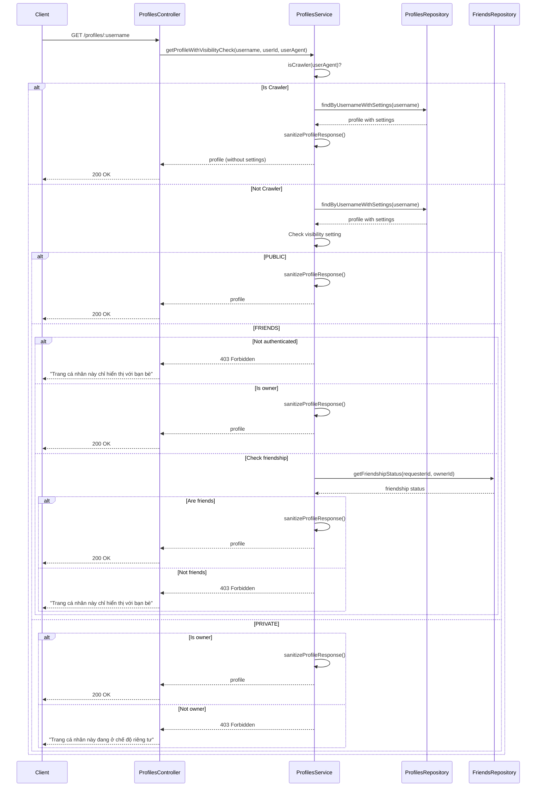
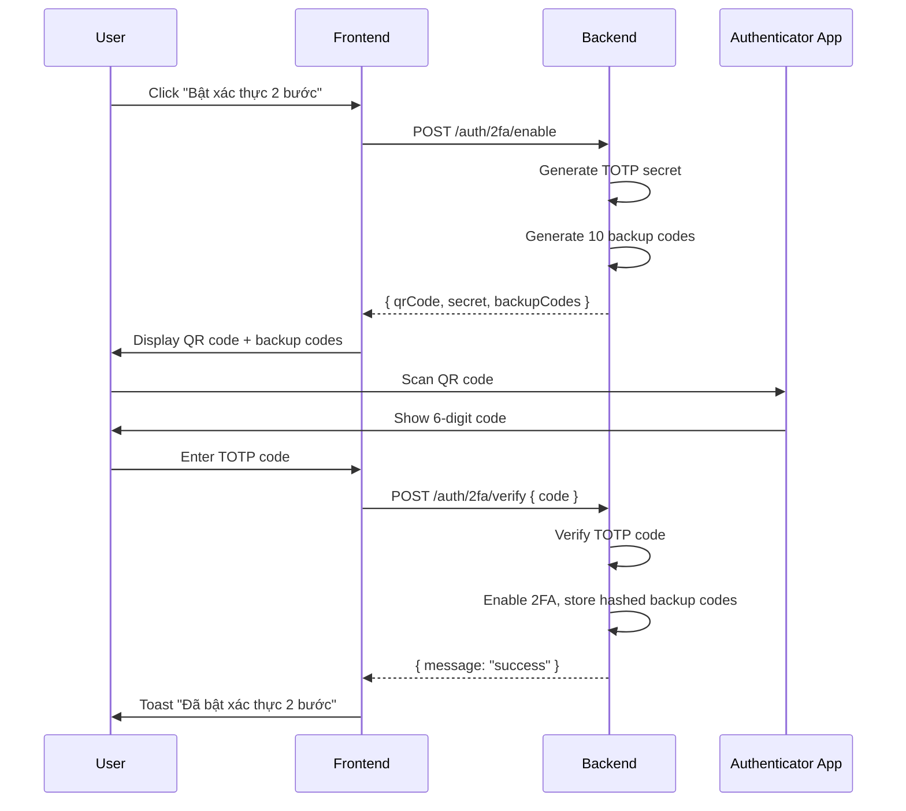
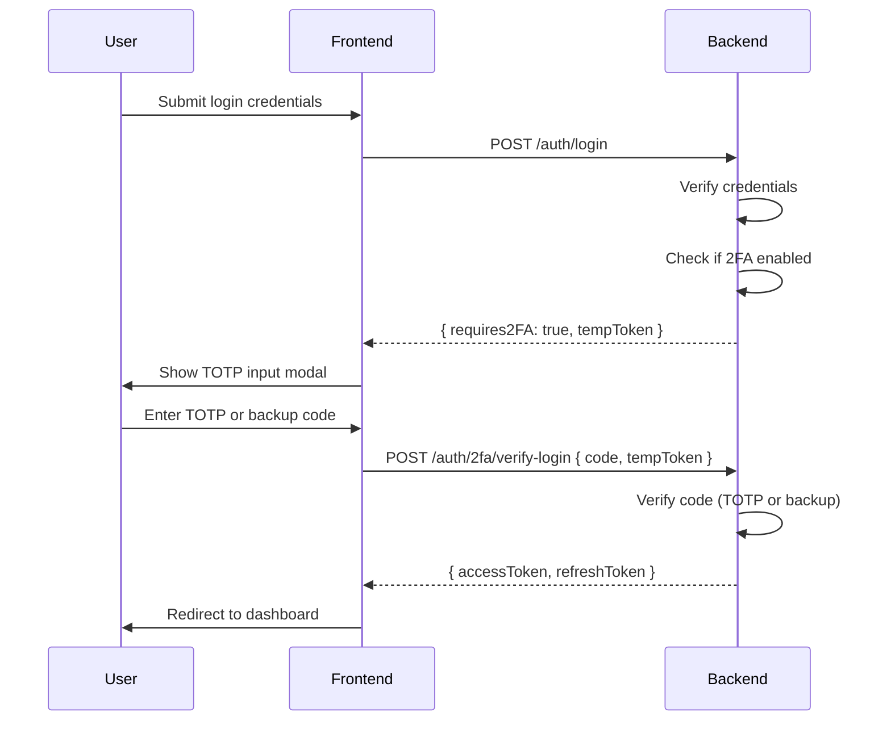
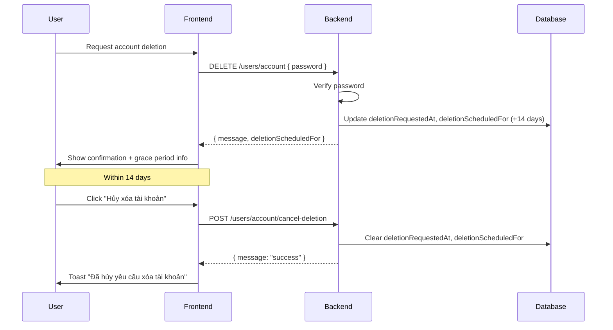

<!-- @SECTION:ARCHITECTURE -->
# User Settings Management - Technical Design

## Architecture

This feature provides comprehensive user settings management with security-focused functionality, privacy controls, and notification preferences. Follow patterns established in `Backend/src/modules/auth/`, `Backend/src/modules/users/`, and `Frontend/src/features/settings/`.

### Key Principles
- Backend validates all security operations with password verification
- Frontend uses Sonner toast for all user feedback (no browser alerts)
- All components support dark mode via Tailwind CSS variables
- WCAG 2.1 AA compliance with proper ARIA attributes
- Profile visibility enforced at API level with SEO crawler bypass
- Unified settings API for account, privacy, and notification preferences
<!-- @END:ARCHITECTURE -->

<!-- @SECTION:COMPONENTS -->
## Components

### Backend Components

| Component | Responsibility | Location |
|-----------|---------------|----------|
| `UsersController` | Settings endpoints (GET/PATCH), account deletion | `Backend/src/modules/users/controllers/users.controller.ts` |
| `UsersService` | Settings business logic, deletion with grace period | `Backend/src/modules/users/services/users.service.ts` |
| `UsersRepository` | Settings CRUD, deletion status, soft delete | `Backend/src/modules/users/repositories/users.repository.ts` |
| `ProfilesService` | Profile visibility enforcement, crawler detection | `Backend/src/modules/profiles/services/profiles.service.ts` |
| `ProfilesRepository` | Profile queries with settings for visibility check | `Backend/src/modules/profiles/repositories/profiles.repository.ts` |
| `TwoFactorService` | TOTP generation, verification, backup codes | `Backend/src/modules/auth/services/two-factor.service.ts` |
| `AuthController` | 2FA and password endpoints | `Backend/src/modules/auth/controllers/auth.controller.ts` |
| `SessionController` | Session listing and revocation | `Backend/src/modules/auth/controllers/session.controller.ts` |

### Frontend Components

| Component | Responsibility | Location |
|-----------|---------------|----------|
| `TwoFactorSetup` | 2FA wizard with QR code, secret, backup codes | `Frontend/src/features/settings/components/TwoFactorSetup.tsx` |
| `SessionsManager` | Active sessions list with revoke buttons | `Frontend/src/features/settings/components/SessionsManager.tsx` |
| `PasswordStrengthIndicator` | Visual password strength meter | `Frontend/src/features/settings/components/PasswordStrengthIndicator.tsx` |
| `AccountDeletionBanner` | Grace period warning banner | `Frontend/src/features/settings/components/AccountDeletionBanner.tsx` |
| `SecuritySettings` | Integrate security components, toast notifications | `Frontend/src/features/settings/components/SecuritySettings.tsx` |
| `ProfilePageClient` | Privacy error UI with lock/users icons | `Frontend/src/app/(main)/profile/[username]/ProfilePageClient.tsx` |
<!-- @END:COMPONENTS -->

<!-- @SECTION:API_CONTRACTS -->
## API Contracts

### User Settings

```
GET /users/settings
Response: UserSettingsResponse {
  id, userId, email, displayName, username, bio,
  profileVisibility: 'public' | 'friends' | 'private',
  showActivityStatus, emailNotifications, pushNotifications,
  notifyOnLike, notifyOnComment, notifyOnFollow, notifyOnMention,
  twoFactorEnabled, lastPasswordChange,
  deletionStatus?: { isScheduledForDeletion, deletionRequestedAt, deletionScheduledFor, daysRemaining }
}

PATCH /users/settings/account
Request: { displayName?: string, bio?: string, email?: string }
Response: UserSettingsResponse

PATCH /users/settings/privacy
Request: { profileVisibility?: 'public' | 'friends' | 'private', showActivityStatus?: boolean }
Response: UserSettingsResponse

PATCH /users/settings/notifications
Request: { emailNotifications?, pushNotifications?, notifyOnLike?, notifyOnComment?, notifyOnFollow?, notifyOnMention? }
Response: UserSettingsResponse
```

### Password Change
```
POST /auth/change-password
Request: { currentPassword: string, newPassword: string }
Response: { message: string, accessToken: string, refreshToken: string }
Errors: 401 "Mật khẩu hiện tại không đúng", 400 "Mật khẩu mới không đủ mạnh"
```

### Two-Factor Authentication
```
POST /auth/2fa/enable
Response: { qrCode: string (data URL), secret: string, backupCodes: string[] }

POST /auth/2fa/verify
Request: { code: string }
Response: { message: string }
Errors: 400 "Mã xác thực không hợp lệ"

POST /auth/2fa/disable
Request: { password: string }
Response: { message: string }
Errors: 401 "Mật khẩu không đúng"

POST /auth/2fa/verify-login
Request: { code: string, tempToken: string }
Response: { accessToken: string, refreshToken: string }
```

### Session Management
```
GET /auth/sessions
Response: { data: Session[], currentSessionId: string }

DELETE /auth/sessions/:id
Response: { message: string }
Errors: 404 "Phiên không tồn tại", 400 "Không thể xóa phiên hiện tại"

DELETE /auth/sessions (logout all others)
Response: { message: string, revokedCount: number }
```

### Account Deletion
```
DELETE /users/account
Request: { password: string }
Response: { message: string, deletionScheduledFor: string }
Errors: 401 "Mật khẩu không đúng"

POST /users/account/cancel-deletion
Response: { message: string }
Errors: 404 "Không có yêu cầu xóa tài khoản nào đang chờ xử lý"
```

### Profile Visibility
```
GET /profiles/:username
Headers: { 'user-agent': string }
Response: Profile (sanitized, without user.settings)
Errors: 403 "Trang cá nhân này chỉ hiển thị với bạn bè" | "Trang cá nhân này đang ở chế độ riêng tư"
Note: Bypasses visibility check for search engine crawlers
```
<!-- @END:API_CONTRACTS -->

<!-- @SECTION:DATA_MODELS -->
## Data Models

### Database Schema

**UserSettings model** (see `Backend/prisma/schema.prisma:264-288`):
```prisma
model UserSettings {
  id                  String              @id @default(uuid())
  userId              String              @unique
  // Privacy settings
  profileVisibility   ProfileVisibility   @default(PUBLIC)
  showActivityStatus  Boolean             @default(true)
  // Notification settings
  emailNotifications  Boolean             @default(true)
  pushNotifications   Boolean             @default(true)
  notifyOnLike        Boolean             @default(true)
  notifyOnComment     Boolean             @default(true)
  notifyOnFollow      Boolean             @default(true)
  notifyOnMention     Boolean             @default(true)
  // Security
  twoFactorEnabled    Boolean             @default(false)
  twoFactorSecret     String?
  backupCodes         String?             @db.Text  // JSON array of hashed codes
  lastPasswordChange  DateTime?
  createdAt           DateTime            @default(now())
  updatedAt           DateTime            @updatedAt
  user                User                @relation(...)
}
```

**ProfileVisibility enum** (see `Backend/prisma/schema.prisma:290-296`):
```prisma
enum ProfileVisibility {
  PUBLIC
  FRIENDS
  PRIVATE
}
```

**User model** - Deletion tracking (see `Backend/prisma/schema.prisma:239-241`):
```prisma
model User {
  // ... existing fields
  deletionRequestedAt   DateTime?
  deletionScheduledFor  DateTime?
  // ... relations
}
```

### TypeScript Types

See `Backend/src/modules/users/dto/user-settings.dto.ts` for DTOs and response types.
See `Frontend/src/features/settings/types/settings.ts` for frontend types.

Key types:
```typescript
interface UserSettingsResponse {
  id: string;
  userId: string;
  email: string;
  displayName: string;
  username: string;
  bio: string | null;
  profileVisibility: 'public' | 'friends' | 'private';
  showActivityStatus: boolean;
  emailNotifications: boolean;
  pushNotifications: boolean;
  notifyOnLike: boolean;
  notifyOnComment: boolean;
  notifyOnFollow: boolean;
  notifyOnMention: boolean;
  twoFactorEnabled: boolean;
  lastPasswordChange: string | null;
  deletionStatus?: {
    isScheduledForDeletion: boolean;
    deletionRequestedAt: string | null;
    deletionScheduledFor: string | null;
    daysRemaining: number | null;
  };
}

interface Session {
  id: string;
  deviceInfo: string | null;
  ipAddress: string | null;
  lastActiveAt: string;
  createdAt: string;
  isCurrent: boolean;
}

interface TwoFactorSetupResponse {
  qrCode: string;      // data:image/png;base64,...
  secret: string;      // Base32 encoded
  backupCodes: string[]; // 10 plain text codes (show once)
}
```
<!-- @END:DATA_MODELS -->

<!-- @SECTION:KEY_FLOWS -->
## Key Flows

### Profile Visibility Check Flow


### 2FA Enable Flow


### Login with 2FA Flow


### Account Deletion Flow

<!-- @END:KEY_FLOWS -->

<!-- @SECTION:ERROR_HANDLING -->
## Error Handling

| Error Case | HTTP Code | Response | UI Action |
|------------|-----------|----------|-----------|
| Invalid current password | 401 | "Mật khẩu hiện tại không đúng" | Error toast |
| Weak new password | 400 | "Mật khẩu mới không đủ mạnh" | Inline validation |
| Invalid TOTP code | 400 | "Mã xác thực không hợp lệ" | Error toast + retry |
| Backup code already used | 400 | "Mã dự phòng đã được sử dụng" | Error toast |
| Session not found | 404 | "Phiên không tồn tại" | Error toast + refresh list |
| Cannot revoke current session | 400 | "Không thể xóa phiên hiện tại" | Error toast |
| Profile visibility: friends only | 403 | "Trang cá nhân này chỉ hiển thị với bạn bè" | Lock icon + message |
| Profile visibility: private | 403 | "Trang cá nhân này đang ở chế độ riêng tư" | Lock icon + message |
| No pending deletion | 404 | "Không có yêu cầu xóa tài khoản nào đang chờ xử lý" | Error toast |
| Rate limit exceeded | 429 | "Quá nhiều yêu cầu" | Error toast + countdown |
<!-- @END:ERROR_HANDLING -->

<!-- @SECTION:SECURITY -->
## Security Considerations

- **Password verification**: All sensitive operations require current password
- **TOTP secrets**: Stored encrypted in database using AES-256
- **Backup codes**: Stored as bcrypt hashes, marked used after single use
- **Session tokens**: Regenerated after password change
- **Rate limiting**: 5 attempts per 15 minutes for password/2FA operations
- **Audit logging**: Log all security-related actions with IP and user agent
- **Profile visibility enforcement**: Checked at API level, not client-side
- **Crawler detection**: 20+ patterns including googlebot, bingbot, facebookexternalhit, twitterbot, etc.
- **Response sanitization**: Remove user.settings from profile responses to prevent privacy leaks
- **Friendship verification**: Not cached, checked in real-time for FRIENDS visibility
<!-- @END:SECURITY -->

<!-- @SECTION:BOUNDARIES -->
## Boundary Definitions

| System | Integration | Reference |
|--------|-------------|-----------|
| TOTP Library | `otplib` npm package | Backend 2FA service |
| QR Code | `qrcode` npm package | Generate QR data URL |
| Email Service | Existing mail service | `Backend/src/modules/mail/` |
| Redis | Profile caching, session caching | `Backend/src/modules/redis/` |
| Friends System | Friendship status check | `Backend/src/modules/friends/repositories/friends.repository.ts` |
<!-- @END:BOUNDARIES -->

<!-- @SECTION:TEST_STRATEGY -->
## Test Strategy

### Unit Tests
- TwoFactorService: TOTP generation, verification, backup code handling
- UsersService: Settings CRUD, deletion with grace period, days remaining calculation
- ProfilesService: Visibility check logic, crawler detection, response sanitization
- Password strength validation logic

### Integration Tests
- Full 2FA enable/disable flow
- Session revocation with token invalidation
- Account deletion and cancellation within grace period
- Profile visibility enforcement for PUBLIC/FRIENDS/PRIVATE
- Crawler bypass for SEO
- Unified settings API (GET/PATCH endpoints)

### E2E Tests
- Password change with session regeneration
- 2FA login flow with authenticator app simulation
- Account deletion and cancellation within grace period
- Profile access with different visibility settings
- Privacy error UI display for restricted profiles
<!-- @END:TEST_STRATEGY -->

<!-- @SECTION:IMPLEMENTATION_NOTES -->
## Implementation Notes

**Status**: Completed
**Implementation Date**: 2026-01-30
**Last Synced**: 2026-02-11
**Quality Score**: 9.5/10

**Key Files**:
- Backend: `Backend/src/modules/auth/` (controllers, services)
- Backend: `Backend/src/modules/users/` (controllers, services, repositories, DTOs)
- Backend: `Backend/src/modules/profiles/` (services, repositories, controllers)
- Frontend: `Frontend/src/features/settings/components/` (SecuritySettings, TwoFactorSetup, SessionsManager, etc.)
- Frontend: `Frontend/src/app/(main)/profile/[username]/ProfilePageClient.tsx`

**Deviations**: None - all acceptance criteria met as specified

**Limitations**: Unit tests not yet created (integration testing completed)

**Undocumented Features Discovered**:

1. **2FA Backup Code Auto-Detection**
   - Implementation: `Backend/src/modules/auth/services/two-factor.service.ts:isBackupCode()`
   - Automatically detects backup code (8 hex chars) vs TOTP (6 digits)
   - Users don't need to specify code type during login

2. **Session Current Flag**
   - Implementation: `Backend/src/modules/auth/services/session.service.ts`
   - `isCurrent` boolean identifies current session via refresh token comparison
   - Prevents accidental self-logout

3. **Password Strength 4-Level System**
   - Implementation: `Frontend/src/features/settings/components/PasswordStrengthIndicator.tsx`
   - Levels: weak/medium/strong/very-strong with color-coded progress bar

4. **2FA Setup Multi-Step Wizard**
   - Implementation: `Frontend/src/features/settings/components/TwoFactorSetup.tsx`
   - 3-step flow: qrcode → verify → backup with guided navigation

5. **Device Type Parsing**
   - Implementation: `Frontend/src/features/settings/components/SessionsManager.tsx:parseDeviceInfo()`
   - User-agent parsing with Vietnamese labels for user-friendly display

6. **Deletion Days Remaining Calculation**
   - Implementation: `Frontend/src/features/settings/components/AccountDeletionBanner.tsx`
   - Real-time countdown keeps users informed of deadline

7. **Avatar Upload Endpoint**
   - Implementation: `Backend/src/modules/users/controllers/users.controller.ts`
   - POST /users/avatar (multipart/form-data) for profile customization

8. **Unified Settings API**
   - Implementation: `Backend/src/modules/users/controllers/users.controller.ts`
   - Endpoints: GET /users/settings, PATCH /users/settings/{account,privacy,notifications}
   - Response: Unified UserSettingsResponse with all settings + deletion status
   - Benefit: Single source of truth for all user preferences

9. **Profile Visibility Enforcement with SEO Crawler Bypass**
   - Implementation: `Backend/src/modules/profiles/services/profiles.service.ts:getProfileWithVisibilityCheck()`
   - Enforces PUBLIC/FRIENDS/PRIVATE at API level, bypasses for 20+ crawler patterns
   - Crawlers: googlebot, bingbot, slurp, duckduckbot, facebookexternalhit, twitterbot, linkedinbot, applebot, msnbot, ia_archiver, semrushbot, ahrefsbot, dotbot, rogerbot, embedly, quora link preview, showyoubot, outbrain, pinterest, slackbot, vkshare, w3c_validator, redditbot, discordbot, whatsapp, telegrambot
   - Benefit: Privacy protection without sacrificing SEO

10. **Privacy Error UI**
    - Implementation: `Frontend/src/app/(main)/profile/[username]/ProfilePageClient.tsx`
    - Detects 403 errors, shows lock/users icon based on error message
    - Display: Vietnamese error messages with login prompt for unauthenticated users

11. **Settings Response Sanitization**
    - Implementation: `Backend/src/modules/profiles/services/profiles.service.ts:sanitizeProfileResponse()`
    - Removes user.settings from profile responses to prevent exposure
    - Benefit: Privacy settings not leaked in public API responses

12. **Profile Caching with Visibility**
    - Implementation: `Backend/src/modules/profiles/services/profiles.service.ts`
    - Profile data cached in Redis, but visibility checks not cached (requester-dependent)
    - Friendship status checked in real-time for FRIENDS visibility
    - Cache key: `profile:${username}`
<!-- @END:IMPLEMENTATION_NOTES -->

