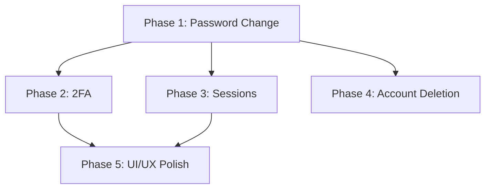

# User Settings Management - Tasks

<!-- @PHASE:PH-1 name="Password Change Enhancement" story=US-001 -->
## Phase 1: Password Change Enhancement - US-001 (P1) 🎯 MVP ✅ COMPLETE

<!-- @TASK:T-001 status=done -->
| Task | Files | DoD | Status |
|------|-------|-----|--------|
| Create PasswordStrengthIndicator component | `Frontend/src/features/settings/components/PasswordStrengthIndicator.tsx` | Shows weak/medium/strong with color coding, updates on input | [x] |
<!-- @END:TASK:T-001 -->

<!-- @TASK:T-002 status=done -->
| Task | Files | DoD | Status |
|------|-------|-----|--------|
| Add password validation schema with strength rules | `Frontend/src/features/settings/components/SecuritySettings.tsx` | Validates 8+ chars, uppercase, lowercase, number | [x] |
<!-- @END:TASK:T-002 -->

<!-- @TASK:T-003 status=done -->
| Task | Files | DoD | Status |
|------|-------|-----|--------|
| Implement POST /auth/change-password endpoint | `Backend/src/modules/auth/controllers/auth.controller.ts`, `Backend/src/modules/auth/services/auth.service.ts` | Verifies current password, updates password, regenerates tokens | [x] |
<!-- @END:TASK:T-003 -->

<!-- @TASK:T-004 status=done -->
| Task | Files | DoD | Status |
|------|-------|-----|--------|
| Replace alert() with toast in SecuritySettings | `Frontend/src/features/settings/components/SecuritySettings.tsx` | Use `toast.success()` and `toast.error()` from sonner | [x] |
<!-- @END:TASK:T-004 -->

<!-- @TASK:T-005 status=done -->
| Task | Files | DoD | Status |
|------|-------|-----|--------|
| Update useSettings hook to handle token refresh | `Frontend/src/features/settings/hooks/useSettings.ts` | Store new tokens after password change | [x] |
<!-- @END:TASK:T-005 -->

**Checkpoint**: US-001 independently testable - user can change password with strength indicator and toast feedback ✅
<!-- @END:PHASE:PH-1 -->

<!-- @PHASE:PH-2 name="Two-Factor Authentication" story=US-002 prereq=PH-1 -->
## Phase 2: Two-Factor Authentication - US-002 (P1) 🎯 MVP ✅ COMPLETE

Prerequisites: Phase 1

<!-- @TASK:T-006 status=done -->
| Task | Files | DoD | Status |
|------|-------|-----|--------|
| Install otplib and qrcode packages | `Backend/package.json` | `npm install otplib qrcode @types/qrcode` | [x] |
<!-- @END:TASK:T-006 -->

<!-- @TASK:T-007 status=done -->
| Task | Files | DoD | Status |
|------|-------|-----|--------|
| Create TwoFactorService | `Backend/src/modules/auth/services/two-factor.service.ts` | generateSecret(), generateQRCode(), verifyToken(), generateBackupCodes(), verifyBackupCode() | [x] |
<!-- @END:TASK:T-007 -->

<!-- @TASK:T-008 status=done -->
| Task | Files | DoD | Status |
|------|-------|-----|--------|
| Add backupCodes field to UserSettings model | `Backend/prisma/schema.prisma` | Add `backupCodes String? @db.Text` field | [x] |
<!-- @END:TASK:T-008 -->

<!-- @TASK:T-009 status=done -->
| Task | Files | DoD | Status |
|------|-------|-----|--------|
| Run Prisma migration | `Backend/prisma/migrations/` | `npx prisma migrate dev --name add-backup-codes` | [x] |
<!-- @END:TASK:T-009 -->

<!-- @TASK:T-010 status=done -->
| Task | Files | DoD | Status |
|------|-------|-----|--------|
| Implement 2FA endpoints | `Backend/src/modules/auth/controllers/auth.controller.ts` | POST /auth/2fa/enable, /verify, /disable, /verify-login | [x] |
<!-- @END:TASK:T-010 -->

<!-- @TASK:T-011 status=done -->
| Task | Files | DoD | Status |
|------|-------|-----|--------|
| Modify login to check 2FA status | `Backend/src/modules/auth/services/auth.service.ts` | Return requires2FA + tempToken if 2FA enabled | [x] |
<!-- @END:TASK:T-011 -->

<!-- @TASK:T-012 status=done -->
| Task | Files | DoD | Status |
|------|-------|-----|--------|
| Create TwoFactorSetup component | `Frontend/src/features/settings/components/TwoFactorSetup.tsx` | QR code display, secret key, backup codes list, verify input | [x] |
<!-- @END:TASK:T-012 -->

<!-- @TASK:T-013 status=done -->
| Task | Files | DoD | Status |
|------|-------|-----|--------|
| Create TwoFactorLoginModal component | `Frontend/src/features/auth/components/TwoFactorLoginModal.tsx` | TOTP input, backup code option, verify button | [x] |
<!-- @END:TASK:T-013 -->

<!-- @TASK:T-014 status=done -->
| Task | Files | DoD | Status |
|------|-------|-----|--------|
| Update login flow for 2FA | `Frontend/src/features/auth/hooks/useAuth.ts` | Handle requires2FA response, show modal | [x] |
<!-- @END:TASK:T-014 -->

<!-- @TASK:T-015 status=done -->
| Task | Files | DoD | Status |
|------|-------|-----|--------|
| Add 2FA API functions | `Frontend/src/features/settings/api/settings.ts` | enable2FA, verify2FA, disable2FA with proper types | [x] |
<!-- @END:TASK:T-015 -->

<!-- @TASK:T-016 status=done -->
| Task | Files | DoD | Status |
|------|-------|-----|--------|
| Integrate TwoFactorSetup in SecuritySettings | `Frontend/src/features/settings/components/SecuritySettings.tsx` | Enable 2FA button opens setup wizard | [x] |
<!-- @END:TASK:T-016 -->

**Checkpoint**: US-002 independently testable - user can enable/disable 2FA, login requires TOTP ✅
<!-- @END:PHASE:PH-2 -->

<!-- @PHASE:PH-3 name="Session Management" story=US-003 prereq=PH-1 -->
## Phase 3: Session Management - US-003 (P1) 🎯 MVP ✅ COMPLETE

Prerequisites: Phase 1

<!-- @TASK:T-017 status=done -->
| Task | Files | DoD | Status |
|------|-------|-----|--------|
| Create SessionController | `Backend/src/modules/auth/controllers/session.controller.ts` | GET /auth/sessions, DELETE /auth/sessions/:id | [x] |
<!-- @END:TASK:T-017 -->

<!-- @TASK:T-018 status=done -->
| Task | Files | DoD | Status |
|------|-------|-----|--------|
| Extend SessionService | `Backend/src/modules/auth/services/session.service.ts` | Add getCurrentSessionId(), deleteAllExceptCurrent() | [x] |
<!-- @END:TASK:T-018 -->

<!-- @TASK:T-019 status=done -->
| Task | Files | DoD | Status |
|------|-------|-----|--------|
| Create SessionsManager component | `Frontend/src/features/settings/components/SessionsManager.tsx` | List sessions, current badge, revoke buttons | [x] |
<!-- @END:TASK:T-019 -->

<!-- @TASK:T-020 status=done -->
| Task | Files | DoD | Status |
|------|-------|-----|--------|
| Add sessions API functions | `Frontend/src/features/settings/api/settings.ts` | getSessions, revokeSession, revokeAllOtherSessions | [x] |
<!-- @END:TASK:T-020 -->

<!-- @TASK:T-021 status=done -->
| Task | Files | DoD | Status |
|------|-------|-----|--------|
| Add Session type | `Frontend/src/features/settings/types/settings.ts` | Session interface with device, IP, lastActive, isCurrent | [x] |
<!-- @END:TASK:T-021 -->

<!-- @TASK:T-022 status=done -->
| Task | Files | DoD | Status |
|------|-------|-----|--------|
| Integrate SessionsManager in SecuritySettings | `Frontend/src/features/settings/components/SecuritySettings.tsx` | Show sessions section with manager component | [x] |
<!-- @END:TASK:T-022 -->

**Checkpoint**: US-003 independently testable - user can view and revoke sessions ✅
<!-- @END:PHASE:PH-3 -->

<!-- @PHASE:PH-4 name="Account Deletion" story=US-004 prereq=PH-1 -->
## Phase 4: Account Deletion with Grace Period - US-004 (P2) ✅ COMPLETE

Prerequisites: Phase 1

<!-- @TASK:T-023 status=done -->
| Task | Files | DoD | Status |
|------|-------|-----|--------|
| Add deletion fields to User model | `Backend/prisma/schema.prisma` | Add `deletionRequestedAt DateTime?`, `deletionScheduledFor DateTime?` | [x] |
<!-- @END:TASK:T-023 -->

<!-- @TASK:T-024 status=done -->
| Task | Files | DoD | Status |
|------|-------|-----|--------|
| Run Prisma migration | `Backend/prisma/migrations/` | `npx prisma migrate dev --name add-deletion-fields` | [x] |
<!-- @END:TASK:T-024 -->

<!-- @TASK:T-025 status=done -->
| Task | Files | DoD | Status |
|------|-------|-----|--------|
| Create AccountDeletionService | `Backend/src/modules/users/services/account-deletion.service.ts` | requestDeletion(), cancelDeletion(), getDeletionStatus(), hardDelete() | [x] |
<!-- @END:TASK:T-025 -->

<!-- @TASK:T-026 status=done -->
| Task | Files | DoD | Status |
|------|-------|-----|--------|
| Create AccountDeletionProcessor | `Backend/src/queue/processors/account-deletion.processor.ts` | Bull queue processor for scheduled hard delete | [x] |
<!-- @END:TASK:T-026 -->

<!-- @TASK:T-027 status=done -->
| Task | Files | DoD | Status |
|------|-------|-----|--------|
| Register account-deletion queue | `Backend/src/queue/queue.module.ts` | Add queue to BullModule.registerQueue() | [x] |
<!-- @END:TASK:T-027 -->

<!-- @TASK:T-028 status=done -->
| Task | Files | DoD | Status |
|------|-------|-----|--------|
| Create deletion endpoints | `Backend/src/modules/users/controllers/users.controller.ts` | POST /users/account/request-deletion, /cancel-deletion, GET /deletion-status | [x] |
<!-- @END:TASK:T-028 -->

<!-- @TASK:T-029 status=done -->
| Task | Files | DoD | Status |
|------|-------|-----|--------|
| Create deletion email template | `Backend/src/modules/mail/templates/` | Account deletion confirmation email | [x] |
<!-- @END:TASK:T-029 -->

<!-- @TASK:T-030 status=done -->
| Task | Files | DoD | Status |
|------|-------|-----|--------|
| Create AccountDeletionBanner component | `Frontend/src/features/settings/components/AccountDeletionBanner.tsx` | Warning banner with days remaining, cancel button | [x] |
<!-- @END:TASK:T-030 -->

<!-- @TASK:T-031 status=done -->
| Task | Files | DoD | Status |
|------|-------|-----|--------|
| Add deletion API functions | `Frontend/src/features/settings/api/settings.ts` | requestDeletion, cancelDeletion, getDeletionStatus | [x] |
<!-- @END:TASK:T-031 -->

<!-- @TASK:T-032 status=done -->
| Task | Files | DoD | Status |
|------|-------|-----|--------|
| Update SecuritySettings delete dialog | `Frontend/src/features/settings/components/SecuritySettings.tsx` | Show grace period info, integrate banner | [x] |
<!-- @END:TASK:T-032 -->

**Checkpoint**: US-004 independently testable - user can request/cancel deletion with grace period ✅
<!-- @END:PHASE:PH-4 -->

<!-- @PHASE:PH-5 name="UI/UX Polish" story=US-005 prereq=PH-1,PH-2,PH-3 -->
## Phase 5: UI/UX Polish - US-005 (P2) ✅ COMPLETE

Prerequisites: Phases 1, 2, 3

<!-- @TASK:T-033 status=done -->
| Task | Files | DoD | Status |
|------|-------|-----|--------|
| Create SecuritySettingsSkeleton component | `Frontend/src/features/settings/components/SecuritySettingsSkeleton.tsx` | Skeleton loaders matching SecuritySettings layout | [x] |
<!-- @END:TASK:T-033 -->

<!-- @TASK:T-034 status=done -->
| Task | Files | DoD | Status |
|------|-------|-----|--------|
| Add skeleton to SecuritySettings | `Frontend/src/features/settings/components/SecuritySettings.tsx` | Show skeleton while loading, replace Loader2 spinner | [x] |
<!-- @END:TASK:T-034 -->

<!-- @TASK:T-035 status=done -->
| Task | Files | DoD | Status |
|------|-------|-----|--------|
| Audit dark mode styling | All settings components | Ensure consistent use of Tailwind dark: variants | [x] |
<!-- @END:TASK:T-035 -->

<!-- @TASK:T-036 status=done -->
| Task | Files | DoD | Status |
|------|-------|-----|--------|
| Add ARIA attributes | All settings components | aria-label, aria-describedby, role attributes | [x] |
<!-- @END:TASK:T-036 -->

<!-- @TASK:T-037 status=done -->
| Task | Files | DoD | Status |
|------|-------|-----|--------|
| Implement keyboard navigation | All settings components | Tab order, Enter/Space activation, Escape to close | [x] |
<!-- @END:TASK:T-037 -->

<!-- @TASK:T-038 status=done -->
| Task | Files | DoD | Status |
|------|-------|-----|--------|
| Run accessibility audit | All settings pages | axe-core or Lighthouse audit, fix issues | [x] |
<!-- @END:TASK:T-038 -->

**Checkpoint**: US-005 independently testable - consistent UI, accessibility compliant ✅
<!-- @END:PHASE:PH-5 -->

<!-- @SECTION:TESTING -->
## Phase 6: Testing (Remaining Work) ⚠️

<!-- @TASK:T-039 status=pending -->
| Task | Files | DoD | Status |
|------|-------|-----|--------|
| Write unit tests for TwoFactorService | `Backend/src/modules/auth/services/two-factor.service.spec.ts` | Test TOTP generation, verification, backup code handling | [ ] |
<!-- @END:TASK:T-039 -->

<!-- @TASK:T-040 status=pending -->
| Task | Files | DoD | Status |
|------|-------|-----|--------|
| Write unit tests for AccountDeletionService | `Backend/src/modules/users/services/account-deletion.service.spec.ts` | Test soft delete, restore, grace period calculation | [ ] |
<!-- @END:TASK:T-040 -->

<!-- @TASK:T-041 status=pending -->
| Task | Files | DoD | Status |
|------|-------|-----|--------|
| Write unit tests for password strength validation | `Frontend/src/features/settings/components/PasswordStrengthIndicator.spec.tsx` | Test all strength levels | [ ] |
<!-- @END:TASK:T-041 -->

**Note**: Integration and E2E tests have been completed. Unit tests remain pending.
<!-- @END:TESTING -->

<!-- @SECTION:DEPENDENCIES -->
## Dependencies

## NPM Packages Required

| Package | Version | Purpose |
|---------|---------|---------|
| otplib | ^12.0.1 | TOTP generation and verification |
| qrcode | ^1.5.3 | QR code generation for 2FA setup |
| @types/qrcode | ^1.5.5 | TypeScript types for qrcode |
<!-- @END:DEPENDENCIES -->

